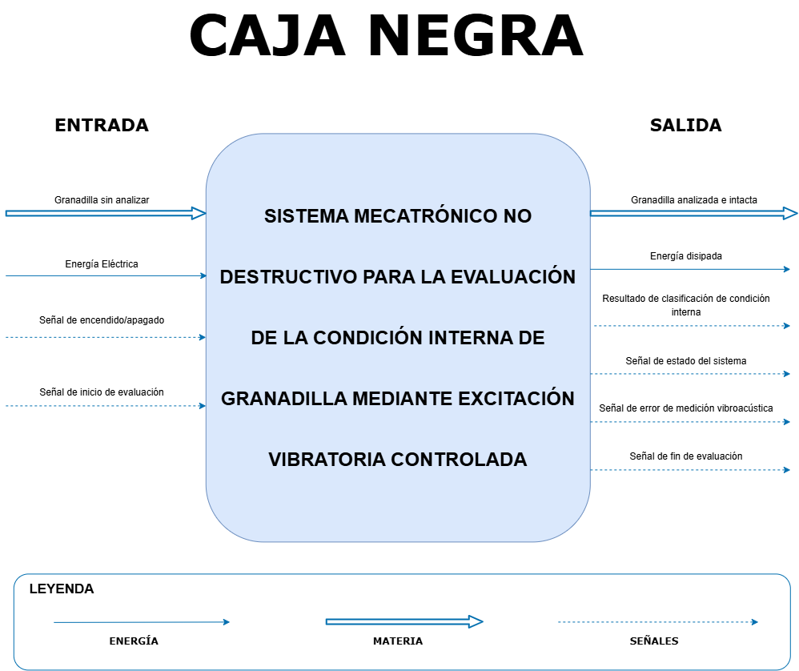
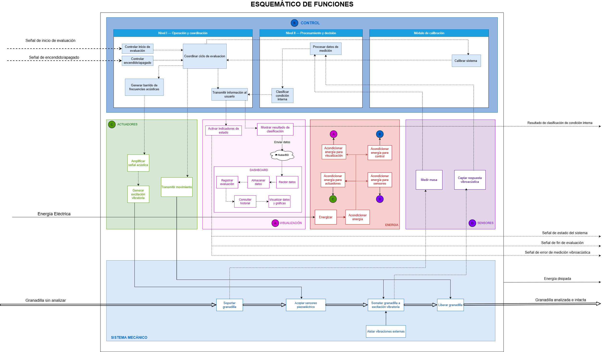
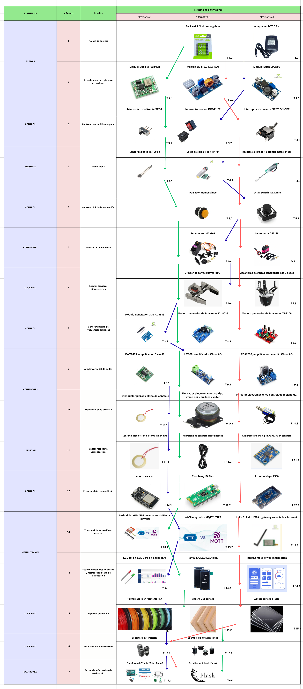
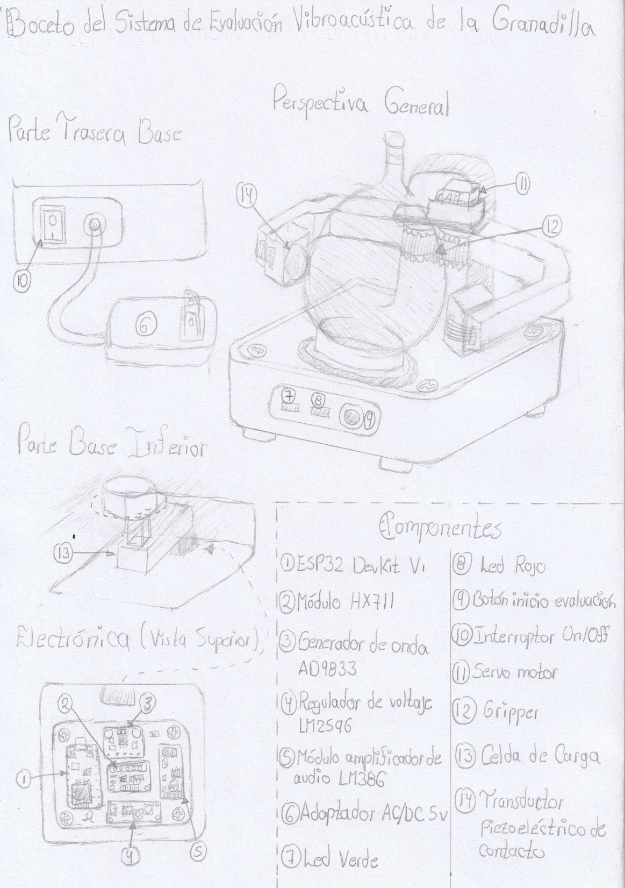
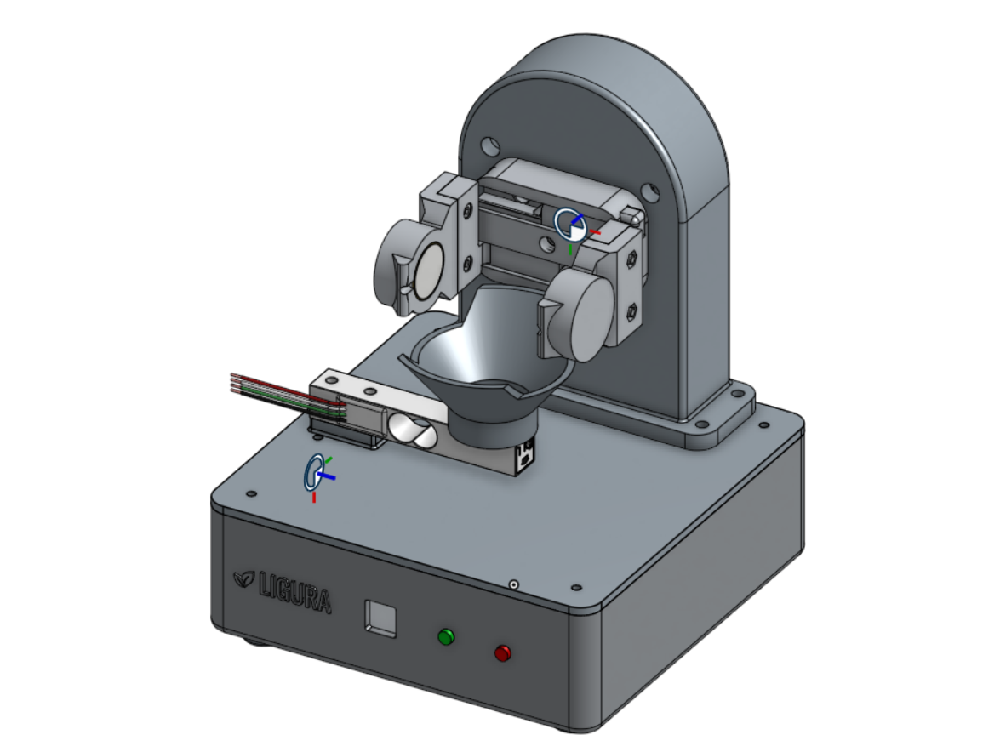
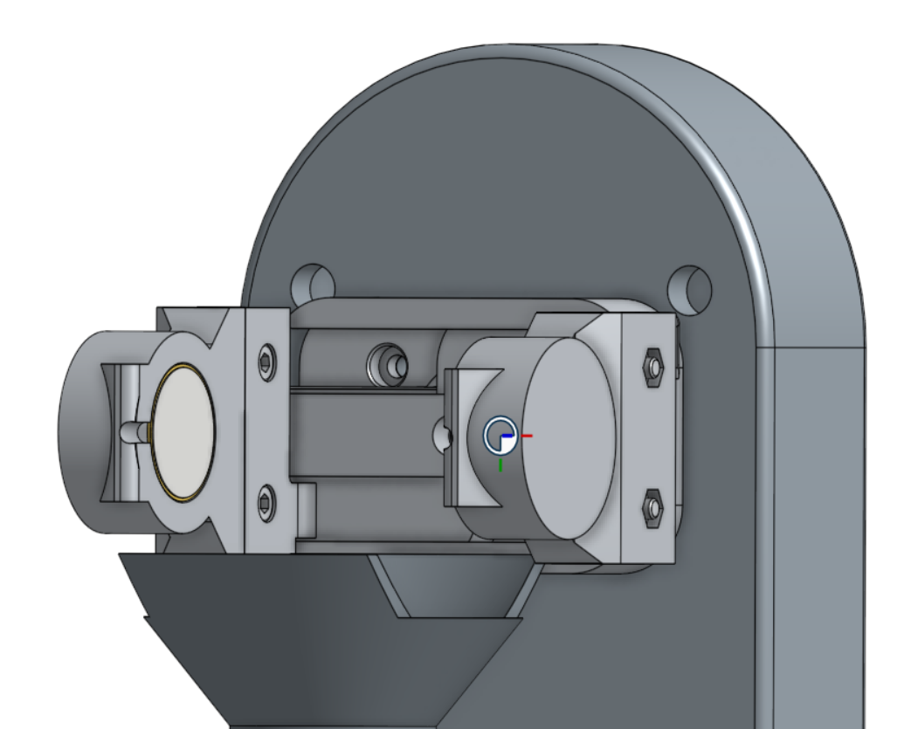
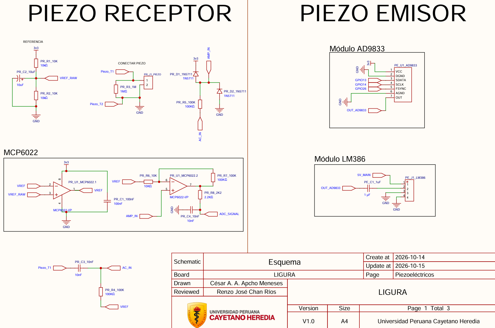
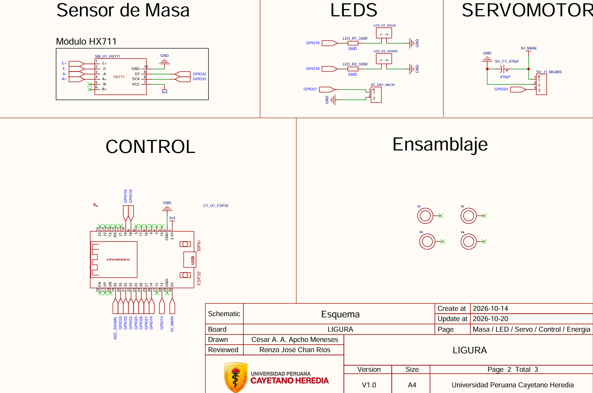
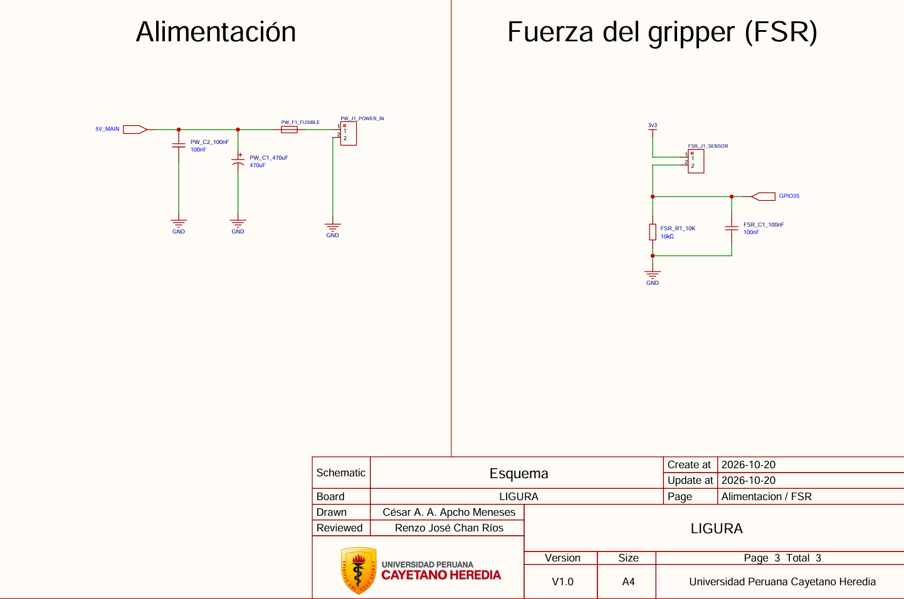
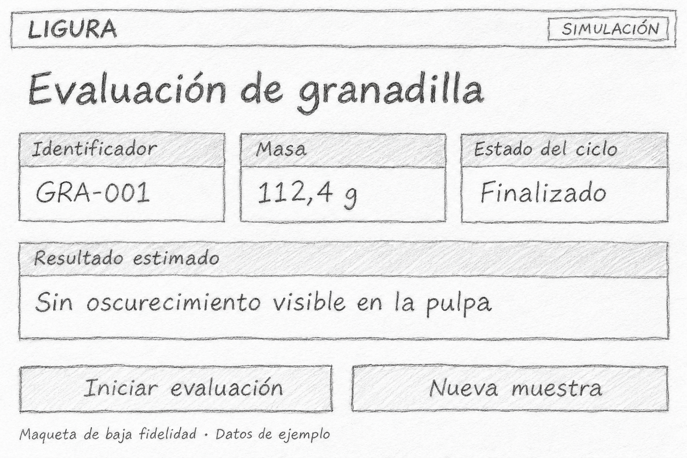

# TRL 2 – Formulación del concepto tecnológico de Ligura

Equipo 3 · Proyecto Integrador 2026-2 · Universidad Peruana Cayetano Heredia

## 1. Introducción y alcance del TRL 2

Ligura es una propuesta de evaluación poscosecha para granadillas individuales. El TRL 1 identificó principios y antecedentes sobre vibración, análisis espectral y masa. En este nivel se formula una aplicación concreta de esos principios, se comparan las soluciones existentes y se define cómo podría ponerse a prueba el concepto. El producto de la etapa es un perfil de proyecto sustentado en literatura científica y antecedentes de patente.

### 1.1. Problema y aplicación propuesta

Durante la selección poscosecha de la granadilla (*Passiflora ligularis*), la inspección externa permite observar la cáscara, pero deja abierta la pregunta de cómo estimar la condición interna de cada unidad sin abrirla. Ligura propone estudiar si la respuesta del fruto a una vibración controlada permite distinguir granadillas con y sin zonas de oscurecimiento en la pulpa antes de su comercialización.

## 2. Concepto tecnológico y arquitectura funcional

### 2.1. Frontera del sistema

Ingresan una granadilla, energía eléctrica y las señales de encendido e inicio. Se prevé devolver el fruto sin daño y comunicar una estimación por medio de los LED y el panel web. La apertura del fruto se reserva para obtener la referencia visual en los ensayos de validación.

*Figura 1. Entradas y salidas del ciclo de evaluación. Fuente: Equipo 3.*

### 2.2. Secuencia de operación

| Etapa | Funcionamiento previsto |
|---|---|
| Colocación y pesaje | El operador coloca una granadilla en una cuna cóncava. La celda de carga y el módulo HX711 registran su masa antes de la sujeción. |
| Acoplamiento | Un servomotor cierra la pinza. El controlador detiene el cierre cuando la lectura del sensor resistivo de fuerza (FSR), ubicado en un brazo, alcanza el umbral previsto. Ese umbral deberá determinarse experimentalmente. |
| Excitación y adquisición | El AD9833 genera el barrido de frecuencias. La etapa de amplificación alimenta el piezoeléctrico emisor. El piezoeléctrico del brazo opuesto registra la respuesta del fruto. |
| Procesamiento | El controlador aplica la transformada rápida de Fourier (FFT) a la señal recibida. Se propone analizar la ubicación y magnitud de los picos y la magnitud acumulada en bandas de frecuencia junto con la masa registrada. |
| Salida y liberación | Una vez validado el criterio de clasificación, el resultado individual se mostraría mediante indicadores LED y se registraría en el panel web. La pinza se abriría para retirar la granadilla. |

### 2.3. Relación entre los módulos

El ESP32 coordinaría el pesaje, el cierre de la pinza y el inicio del barrido. La lectura del FSR intervendría en el control del cierre. La señal del piezoeléctrico receptor y la masa alimentarían el análisis del fruto. Si falla la sujeción o la adquisición, se interrumpiría el ciclo y el registro se marcaría como inválido.

*Figura 2. Relación entre control, sensado, excitación, estructura y visualización. Fuente: Equipo 3.*

## 3. Objetivo e hipótesis

**Objetivo del TRL 2.** Formular y sustentar el concepto de un sistema que combine la respuesta vibroacústica y la masa de la granadilla para estimar la presencia o ausencia de zonas de oscurecimiento en la pulpa sin abrir el fruto durante la medición.

**Hipótesis de trabajo.** Bajo condiciones comparables de excitación y sujeción, algunas características del espectro podrían diferir entre granadillas con y sin zonas de oscurecimiento en la pulpa, incluso al comparar frutos de masa similar.

**Pregunta de investigación.** ¿La respuesta vibroacústica, interpretada junto con la masa, permite distinguir granadillas con y sin zonas de oscurecimiento en la pulpa?

**Criterio de referencia.** Se registrará «presente» si se observa al menos una zona de oscurecimiento en la pulpa y «ausente» si no se observa ninguna. Antes del ensayo se definirán ejemplos fotográficos para distinguir dichas zonas de las semillas oscuras y de las variaciones normales de color.

**Comprobación prevista para el TRL 3.** Se identificará cada granadilla, se registrará su masa y se repetirá la medición vibratoria tras retirar y recolocar el fruto. Después se abrirá esa misma granadilla, se fotografiará la pulpa en condiciones de iluminación comparables y se asignará la etiqueta visual sin consultar el espectro. Así se podrá evaluar la repetibilidad y contrastar las señales de ambos grupos.

## 4. Estado del arte aplicado a Ligura

| Estudio | Evidencia publicada | Aplicación y límite |
|---|---|---|
| Diezma-Iglesias et al. [1] | En sandías sin semillas, analizaron la respuesta acústica a un impacto. Las magnitudes acumuladas en determinadas bandas permitieron distinguir alteraciones internas. | Explorar bandas además del pico dominante. Las frecuencias pertinentes para granadilla deben determinarse con mediciones propias. |
| Tian et al. [2] | Calibraron el impacto aplicado a kiwis y relacionaron características del espectro con mediciones de referencia de firmeza. | Controlar la excitación y vincular cada señal con una referencia del mismo fruto. Ligura propone un barrido en lugar del impacto empleado en ese estudio. |
| Espinosa et al. [3] | En granadillas de tres localidades observaron diferencias de peso fresco y composición según procedencia. | Registrar la masa y, cuando se conozca, la procedencia. El estudio caracteriza la especie y deja abierta la relación entre masa y respuesta vibratoria. |

**Vacío que aborda Ligura.** Los estudios [1] y [2] corresponden a otras frutas y a propiedades distintas. El artículo [3] sí estudia la granadilla, pero no ensaya la detección vibratoria de oscurecimiento. Por ello se propone comprobar si la diferencia entre grupos supera la variación que aparece al volver a colocar un mismo fruto.

## 5. Análisis preliminar de patentabilidad y protección

| Documento | Características descritas | Comparación con Ligura |
|---|---|---|
| US5691473A [4], reivindicación 1 | Sujeción en puntos opuestos, excitación en un lado y medición de aceleración a ambos lados para estimar firmeza. | La disposición de los brazos tiene un antecedente directo. Ligura plantea usar la lectura del FSR para controlar el cierre y un piezoeléctrico en cada brazo para emitir o recibir la vibración. |
| US6276536B1 [5], reivindicación 1 | Vibración de frecuencia variable, pesaje y análisis de resonancia y amortiguamiento para estimar madurez y textura. | El barrido combinado con el pesaje también tiene antecedentes. En Ligura queda por investigar qué características se relacionan con el oscurecimiento observado en la pulpa. |

La patentabilidad queda por determinar. Para profundizar el análisis se propone buscar sistemas que regulen la fuerza de contacto durante la medición vibratoria y comparar sus reivindicaciones con el mecanismo de Ligura. Se documentarían la posición del FSR, el criterio de parada y el efecto del acoplamiento sobre la repetibilidad.

## 6. Diseño conceptual y requisitos de ingeniería

### 6.1. Selección de alternativas

El equipo comparó alternativas para 15 funciones. En la evaluación ponderada, el concepto A obtuvo 3,75/5, el B obtuvo 3,40/5 y el C obtuvo 3,00/5. Estas puntuaciones documentan la decisión de diseño. La precisión de clasificación se medirá con frutos en etapas posteriores.

*Figura 3. Alternativas consideradas para las funciones de Ligura. Fuente: Equipo 3.*

### 6.2. Del boceto al ensamble

El boceto seleccionado por el equipo muestra una estructura abierta. La granadilla se apoya en una cuna sobre la base y el servomotor acciona los brazos de la pinza. Las vistas auxiliares ubican la celda de carga bajo la cuna, el interruptor en la parte trasera y la electrónica dentro de la base.

*Figura 4. Boceto 2, seleccionado por el Equipo 3. La perspectiva general muestra cómo se sujeta el fruto. Las vistas de detalle muestran la base y la distribución electrónica.*

El boceto identifica el LM386 como amplificador. El diseño incorpora además un FSR en uno de los brazos para controlar el cierre de la pinza. Su conexión se presenta en la figura 7c.

*Figura 5. Ensamble de Ligura en Onshape. La cuna cóncava se apoya sobre la celda de carga. Los brazos de la pinza se sitúan a ambos lados de la cuna para sujetar la granadilla. Fuente: Equipo 3.*

### 6.3. Requisitos y decisiones pendientes

| Requisito de diseño | Implementación prevista | Verificación posterior |
|---|---|---|
| Admitir una granadilla por ciclo | Ingreso superior, cuna cóncava y base de hasta 150 × 150 mm. Altura máxima de 200 mm. | Revisar cotas y holgura del mecanismo en el ensamble. |
| Pesar antes del contacto lateral | Celda de carga bajo la cuna y adquisición con HX711. | Comprobar tara y repetibilidad con el fruto libre de la pinza. |
| Repetir las condiciones de contacto | Servomotor y FSR en uno de los brazos. | Determinar un umbral que permita adquirir señal sin producir marcas en la cáscara. |
| Captar la respuesta del fruto | Emisor y receptor en brazos opuestos, aislamiento acústico parcial y apoyos antivibratorios. | Comparar señales de fondo y lecturas repetidas al recolocar el mismo fruto. |
| Trazar el resultado hasta la muestra | Registro por identificador, masa, señal, estado del ciclo y estimación. | Vincular el registro con la fotografía y la etiqueta de referencia de esa granadilla. |

*Figura 6. Detalle de la pinza de Ligura en Onshape. Los brazos quedan enfrentados sobre la cuna. El diseño prevé un piezoeléctrico emisor en un brazo y un receptor en el opuesto. Un FSR en uno de los brazos permite controlar el cierre. La captura muestra la disposición mecánica sin identificar los sensores por lado. Fuente: Equipo 3.*

### 6.4. Electrónica e interfaz

Las tres hojas de la versión 1.0 del esquema muestran cómo se genera la excitación, cómo se adquieren las señales del fruto y qué entradas permiten controlar el ciclo. El rango del barrido, los parámetros de muestreo y el umbral de cierre deberán determinarse en las pruebas.

*Figura 7a. Excitación y recepción. La hoja del emisor identifica el generador AD9833 y el módulo amplificador LM386. En el receptor se muestra el acondicionamiento con MCP6022 y la salida ADC_SIGNAL. Fuente: Equipo 3.*

**Versión del amplificador.** Tanto el boceto como el esquema v1.0 identifican el LM386. La descripción previa del proyecto contemplaba el PAM8403. El equipo deberá confirmar qué módulo corresponde al montaje definitivo.

*Figura 7b. El HX711 conecta la celda de carga con el ESP32. La misma hoja muestra el botón de inicio, los LED de señalización y la conexión del servomotor que acciona la pinza. Fuente: Equipo 3.*

*Figura 7c. Alimentación de 5 V con fusible y circuito de lectura del FSR. La señal del sensor llega al GPIO35 del ESP32 para que el controlador pueda detener el cierre al alcanzar el umbral establecido. Fuente: Equipo 3.*

*Figura 8. Boceto digital del panel web con estilo de dibujo a mano alzada. La maqueta de baja fidelidad muestra el identificador de la granadilla, la masa, el estado del ciclo y el resultado estimado con datos simulados. Incluye las acciones propuestas «Iniciar evaluación» y «Nueva muestra».*

## 7. Perfil del proyecto

**Usuarios y aplicación.** Se prevé que el personal de selección en centros de acopio o acondicionamiento pueda evaluar una granadilla por ciclo y consultar su resultado individual. La utilidad para productores y responsables del acopio dependerá de la validación de la clasificación.

**Alcance y resultados de la etapa.** El perfil define la secuencia de operación, la función de cada sensor, los antecedentes científicos y tecnológicos, y la prueba inicial propuesta. La exactitud de la clasificación, la repetibilidad y la ausencia de daño bajo las condiciones elegidas se evaluarán en etapas posteriores.

**Entregables de diseño.** Caja negra, esquema de funciones, comparación de alternativas y diseño preliminar del ensamble. En conjunto describen qué se mediría, cómo se sujetaría la granadilla y cómo se conservaría la correspondencia entre señal, masa y fruto.

**Preparación del TRL 3.** Se propone iniciar con pruebas de pesaje y repetibilidad del acoplamiento antes de intentar la clasificación. Para cada unidad se conservarían el identificador, la masa, el lote cuando esté disponible, los espectros de las repeticiones y la fotografía de la pulpa. Si se evalúa un clasificador, las repeticiones de una granadilla se mantendrán juntas al separar los datos de entrenamiento y evaluación. El criterio elegido se limita al oscurecimiento visible. La causa de la coloración queda fuera del alcance de esta propuesta.

## 8. Cumplimiento de indicadores

| Indicador del curso | Evidencia | Sección |
|---|---|---|
| Artículos científicos relacionados | Comparación de tres publicaciones y explicación de la decisión que sustenta cada una. | 4 |
| Análisis de patentabilidad y protección | Comparación preliminar de dos reivindicaciones e identificación del mecanismo que requiere una búsqueda más específica. | 5 |
| Perfil o propuesta de proyecto | Problema, usuarios previstos, objetivo, funcionamiento, alcance y prueba propuesta. | 1–3 y 7 |

## 9. Conclusión

Se formuló el concepto tecnológico de Ligura y se identificaron antecedentes que sustentan el pesaje y el análisis en frecuencia. Para el TRL 3 se propone evaluar si la medición es repetible al recolocar el fruto y si permite distinguir granadillas con y sin zonas de oscurecimiento en la pulpa, según la inspección visual posterior a la apertura.

## 10. Referencias bibliográficas

[1] B. Diezma-Iglesias, M. Ruiz-Altisent y P. Barreiro (2004). Detection of internal quality in seedless watermelon by acoustic impulse response. *Biosystems Engineering*, 88(2), 221–230. [DOI](https://doi.org/10.1016/j.biosystemseng.2004.03.007).

[2] S. Tian, J. Wang y H. Xu (2022). Firmness measurement of kiwifruit using a self-designed device based on acoustic vibration technology. *Postharvest Biology and Technology*, 187, 111851. [DOI](https://doi.org/10.1016/j.postharvbio.2022.111851).

[3] D. S. Espinosa, L. M. Melgarejo, M. S. Hernández, S. E. Melo y J. P. Fernández-Trujillo (2018). Physiological and biochemical characterization of sweet granadilla (*Passiflora ligularis* Juss) at different locations. *Acta Horticulturae*, 1194. [DOI](https://doi.org/10.17660/ActaHortic.2018.1194.204).

[4] K. Peleg (1997). Method and equipment for measuring firmness of fruits and vegetables. [Patente US5691473A](https://patents.google.com/patent/US5691473A/en).

[5] S. Terasaki y N. Wada (2001). Method of measuring ripeness and texture of vegetable or fruit and measuring instrument. [Patente US6276536B1](https://patents.google.com/patent/US6276536B1/en).

### Documentación de diseño del equipo

- [Diseño funcional, matriz morfológica y selección de alternativas](https://github.com/Cesarapcho/PI_Equipo_03/blob/main/Proyecto_Integrador/Entregables/2.%20Caja_negra__Matriz_morfologica_Esquema_funciones.md).
- [Alternativas de boceto documentadas en el repositorio](https://github.com/Cesarapcho/PI_Equipo_03/blob/main/Proyecto_Integrador/Entregables/3.%20Bocetos.md).

