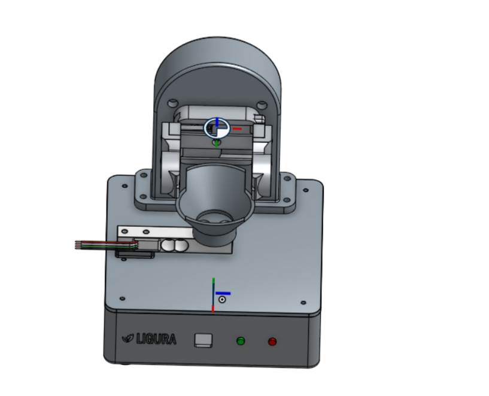
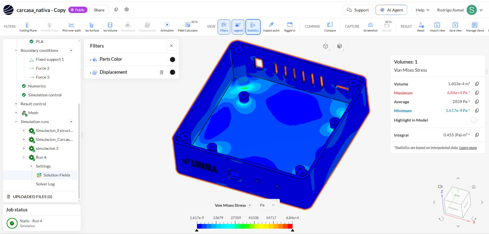
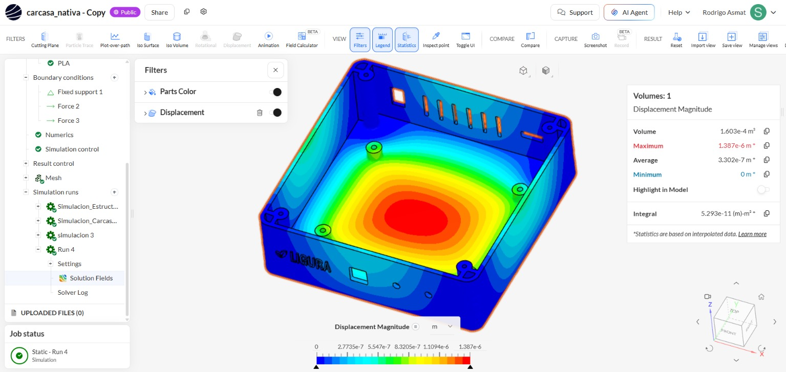
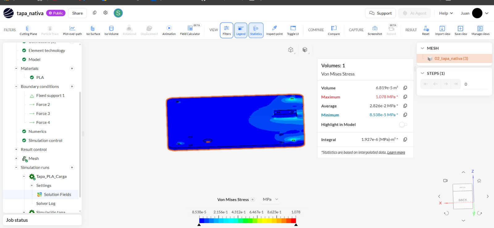
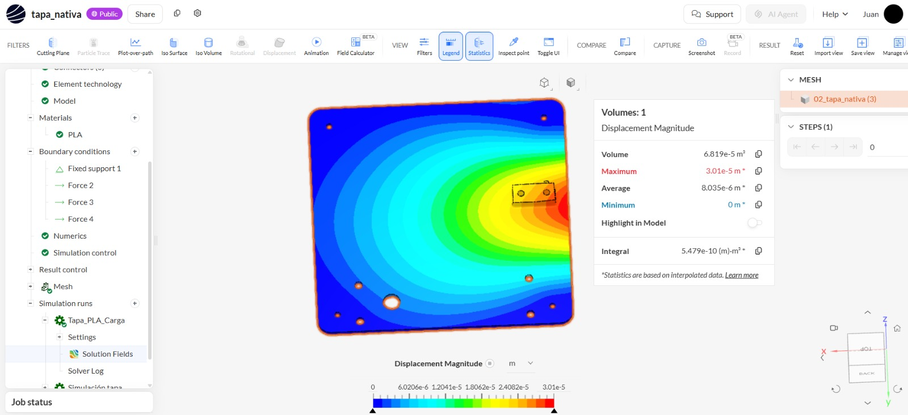
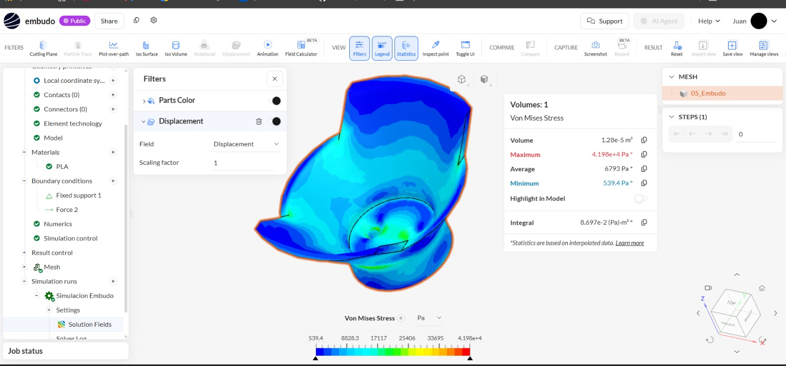
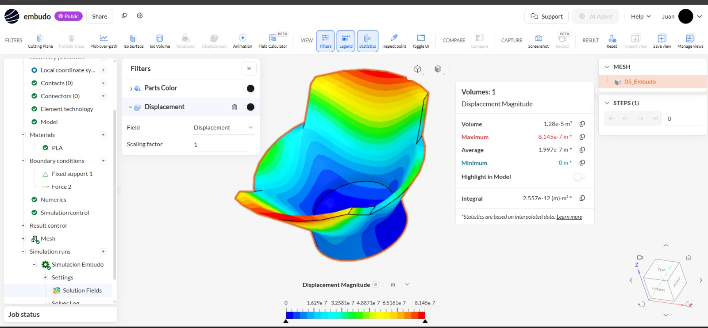
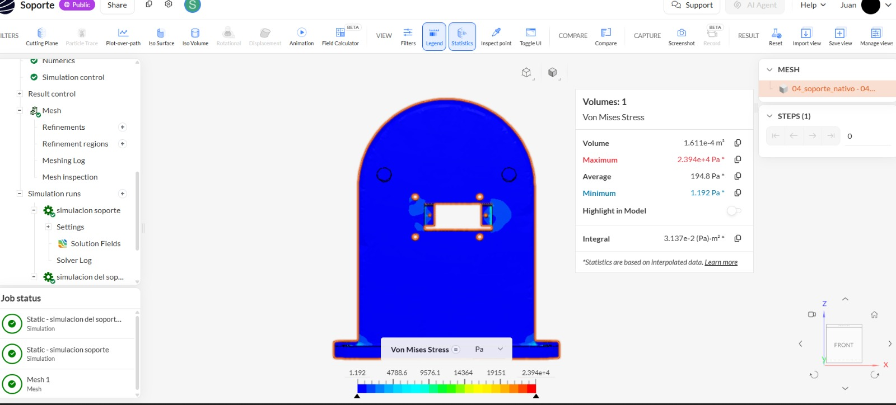
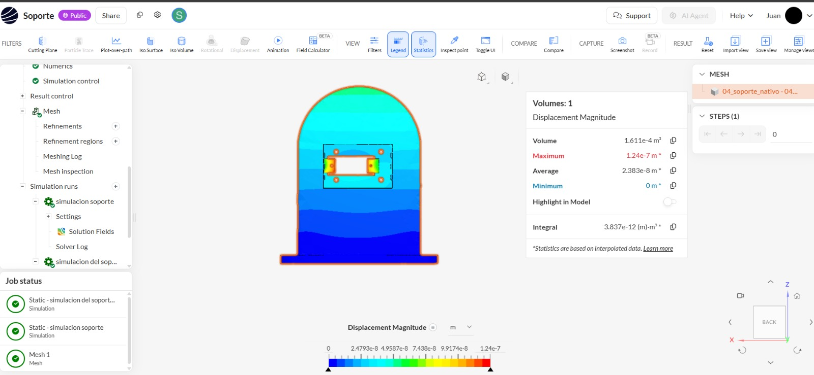

# TLR 3 – Simulación estructural de los componentes del sistema mecatrónico

## Evaluación mediante análisis estático en SimScale

**Proyecto:** Sistema mecatrónico no destructivo para evaluar y clasificar la calidad interna de la granadilla mediante excitación vibratoria controlada y análisis de su respuesta vibroacústica.  
**Etapa:** TLR 3 – Prueba de concepto y evaluación de componentes.  
**Software:** SimScale.  
**Material:** PLA.  
**Tipo de análisis:** Análisis estructural estático.

---

## 1. Objetivo

Evaluar el comportamiento estructural de los principales componentes mecánicos del sistema mediante simulaciones estáticas en SimScale. El análisis permite visualizar la distribución de esfuerzos, cuantificar los desplazamientos producidos por las cargas aplicadas e identificar las regiones de mayor solicitación mecánica.

Se analizaron cuatro componentes de manera individual: carcasa, tapa, embudo y soporte del gripper. Para cada componente se presentan los resultados de esfuerzo equivalente de Von Mises y magnitud del desplazamiento.

## 2. Modelado tridimensional

Los componentes mecánicos fueron desarrollados mediante modelado CAD y preparados para su evaluación estructural. El diseño considera las geometrías de soporte, montaje y posicionamiento necesarias para integrar los elementos del sistema de evaluación vibroacústica.

**Figura 1.** Modelo tridimensional del sistema mecatrónico.

## 3. Componentes evaluados

| Componente | Función dentro del sistema |
|---|---|
| Carcasa | Aloja y protege los componentes electrónicos y mecánicos. |
| Tapa | Cierra la carcasa y proporciona una superficie de montaje para los componentes superiores. |
| Embudo | Recibe y posiciona la granadilla durante el procedimiento de evaluación. |
| Soporte del gripper | Sostiene el mecanismo de sujeción y el servomotor. |

## 4. Material y configuración del análisis

Para los cuatro modelos se asignó **PLA**, material seleccionado para la fabricación de los componentes mediante impresión 3D.

Se realizó un análisis estático estructural en SimScale. Este procedimiento permite determinar la respuesta mecánica de cada pieza ante las cargas y restricciones definidas, obteniendo como resultados principales el esfuerzo equivalente de Von Mises y la magnitud del desplazamiento.

### 4.1 Condiciones de apoyo y carga

Las condiciones de frontera se definieron de acuerdo con la función y los puntos de montaje de cada componente:

- **Carcasa:** restricciones en las zonas de apoyo y cargas transmitidas por los elementos alojados en su interior.
- **Tapa:** restricciones en sus puntos de fijación y cargas transmitidas por los componentes montados sobre ella.
- **Embudo:** restricciones en sus puntos de montaje y carga correspondiente al elemento que recibe.
- **Soporte del gripper:** cuatro puntos de montaje destinados al gripper y dos puntos destinados al servomotor. La base inferior constituye la interfaz de fijación del soporte a la carcasa.

Para el soporte del gripper se consideraron las siguientes masas:

| Elemento | Masa | Peso aproximado |
|---|---:|---:|
| Gripper | 40.10 g | 0.3934 N |
| Servomotor | 13.40 g | 0.1315 N |
| **Total** | **53.50 g** | **0.5248 N** |

Considerando un reparto uniforme de las cargas entre sus puntos de montaje:

- Gripper: **0.09835 N por punto** (cuatro puntos).
- Servomotor: **0.06573 N por punto** (dos puntos).

### 4.2 Mallado

Cada geometría se discretizó mediante una malla para realizar el cálculo numérico. El mallado permite representar las piezas mediante elementos finitos y obtener la distribución de esfuerzos y desplazamientos en sus diferentes regiones.

## 5. Resultados de la simulación

Los resultados se obtuvieron de los paneles de estadísticas de SimScale. Se presentan los valores máximos y promedio de cada variable, conservando las unidades del análisis y sus conversiones correspondientes.

### 5.1 Resumen comparativo

| Componente | Von Mises máximo | Von Mises promedio | Desplazamiento máximo | Desplazamiento promedio |
|---|---:|---:|---:|---:|
| Carcasa | 68,400 Pa (0.0684 MPa) | 2,839 Pa (0.002839 MPa) | 1.387 × 10⁻⁶ m (0.001387 mm) | 3.302 × 10⁻⁷ m (0.0003302 mm) |
| Tapa | 1.078 MPa | 0.02826 MPa | 3.01 × 10⁻⁵ m (0.0301 mm) | 8.035 × 10⁻⁶ m (0.008035 mm) |
| Embudo | 41,980 Pa (0.04198 MPa) | 6,793 Pa (0.006793 MPa) | 8.145 × 10⁻⁷ m (0.0008145 mm) | 1.997 × 10⁻⁷ m (0.0001997 mm) |
| Soporte del gripper | 23,940 Pa (0.02394 MPa) | 1,948 Pa (0.001948 MPa) | 1.24 × 10⁻⁷ m (0.000124 mm) | 2.383 × 10⁻⁸ m (0.00002383 mm) |

### 5.2 Carcasa

#### Esfuerzo equivalente de Von Mises

- **Esfuerzo máximo:** 68,400 Pa (0.0684 MPa).
- **Esfuerzo promedio:** 2,839 Pa (0.002839 MPa).

La distribución del esfuerzo muestra valores reducidos en la mayor parte de la carcasa y concentraciones localizadas alrededor de los apoyos y elementos geométricos interiores. Estas regiones corresponden a zonas de transmisión de carga y cambios de sección.

**Figura 2.** Distribución del esfuerzo equivalente de Von Mises en la carcasa.

#### Magnitud del desplazamiento

- **Desplazamiento máximo:** 1.387 × 10⁻⁶ m (0.001387 mm).
- **Desplazamiento promedio:** 3.302 × 10⁻⁷ m (0.0003302 mm).

El mayor desplazamiento se localiza en la región central del fondo de la carcasa. Las zonas próximas a los apoyos presentan desplazamientos menores, de acuerdo con las restricciones aplicadas.

**Figura 3.** Distribución de la magnitud del desplazamiento en la carcasa.

**Interpretación:** la carcasa presenta una respuesta estructural de baja magnitud bajo las condiciones de carga simuladas. La distribución obtenida permite reconocer el comportamiento del fondo y de las zonas de apoyo que integran la estructura.

### 5.3 Tapa

#### Esfuerzo equivalente de Von Mises

- **Esfuerzo máximo:** 1.078 MPa.
- **Esfuerzo promedio:** 0.02826 MPa.

La distribución presenta concentraciones localizadas de esfuerzo en la región de montaje y transmisión de cargas. El resto de la superficie muestra niveles inferiores. El máximo registrado corresponde al mayor esfuerzo equivalente entre los cuatro componentes evaluados.

**Figura 4.** Distribución del esfuerzo equivalente de Von Mises en la tapa.

#### Magnitud del desplazamiento

- **Desplazamiento máximo:** 3.01 × 10⁻⁵ m (0.0301 mm).
- **Desplazamiento promedio:** 8.035 × 10⁻⁶ m (0.008035 mm).

El campo de desplazamiento muestra una mayor deformación en la región próxima a la zona cargada, con valores decrecientes hacia los puntos de fijación. La distribución es característica de la flexión de una superficie sometida a cargas.

**Figura 5.** Distribución de la magnitud del desplazamiento en la tapa.

**Interpretación:** la tapa presenta el mayor esfuerzo equivalente y el mayor desplazamiento máximo del conjunto analizado. Por ello, constituye el componente con mayor respuesta estructural dentro de los casos simulados. El patrón de deformación permite identificar la zona de montaje como la región de mayor influencia en su comportamiento.

### 5.4 Embudo

#### Esfuerzo equivalente de Von Mises

- **Esfuerzo máximo:** 41,980 Pa (0.04198 MPa).
- **Esfuerzo promedio:** 6,793 Pa (0.006793 MPa).

Los esfuerzos de mayor magnitud se localizan principalmente en la región inferior y en las transiciones próximas a la zona de apoyo. Estas áreas transmiten las cargas hacia los puntos de montaje del embudo.

**Figura 6.** Distribución del esfuerzo equivalente de Von Mises en el embudo.

#### Magnitud del desplazamiento

- **Desplazamiento máximo:** 8.145 × 10⁻⁷ m (0.0008145 mm).
- **Desplazamiento promedio:** 1.997 × 10⁻⁷ m (0.0001997 mm).

La mayor magnitud de desplazamiento se observa hacia la zona superior del embudo, mientras que la región de montaje presenta valores menores debido a las restricciones aplicadas.

**Figura 7.** Distribución de la magnitud del desplazamiento en el embudo.

**Interpretación:** el embudo presenta esfuerzos y desplazamientos de baja magnitud en el caso estático analizado. La distribución permite reconocer el comportamiento de la superficie receptora y de las transiciones geométricas próximas a su base.

### 5.5 Soporte del gripper

#### Esfuerzo equivalente de Von Mises

- **Esfuerzo máximo:** 23,940 Pa (0.02394 MPa).
- **Esfuerzo promedio:** 1,948 Pa (0.001948 MPa).

La distribución muestra concentraciones localizadas en las zonas próximas a los agujeros y puntos de unión del soporte. Estas regiones transmiten las cargas del gripper y del servomotor hacia la base de fijación.

**Figura 8.** Distribución del esfuerzo equivalente de Von Mises en el soporte del gripper.

#### Magnitud del desplazamiento

- **Desplazamiento máximo:** 1.24 × 10⁻⁷ m (0.000124 mm).
- **Desplazamiento promedio:** 2.383 × 10⁻⁸ m (0.00002383 mm).

El desplazamiento calculado es muy pequeño y disminuye hacia la zona de fijación del soporte. La distribución representa la respuesta del componente frente a las cargas aplicadas en los puntos de montaje.

**Figura 9.** Distribución de la magnitud del desplazamiento en el soporte del gripper.

**Interpretación:** el soporte del gripper presenta los menores valores máximos de esfuerzo y desplazamiento entre los cuatro componentes. La respuesta obtenida muestra una deformación reducida en las condiciones estáticas consideradas y permite evaluar la distribución de carga en los puntos de montaje del mecanismo.

## 6. Comparación e interpretación global

La comparación de los resultados máximos permite establecer el siguiente orden de respuesta estructural:

- **Tapa:** mayor esfuerzo de Von Mises (1.078 MPa) y mayor desplazamiento (0.0301 mm).
- **Carcasa:** esfuerzo máximo de 0.0684 MPa y desplazamiento máximo de 0.001387 mm.
- **Embudo:** esfuerzo máximo de 0.04198 MPa y desplazamiento máximo de 0.0008145 mm.
- **Soporte del gripper:** esfuerzo máximo de 0.02394 MPa y desplazamiento máximo de 0.000124 mm.

La tapa presenta la mayor respuesta estructural de los componentes evaluados, mientras que el soporte del gripper registra los valores máximos más bajos. La carcasa y el embudo muestran valores intermedios. Esta comparación describe los resultados obtenidos para las condiciones particulares de cada simulación.

## 7. Conclusiones

1. Se realizaron simulaciones estáticas estructurales en SimScale para cuatro componentes del sistema: carcasa, tapa, embudo y soporte del gripper, utilizando PLA como material asignado.
2. La tapa registró el mayor esfuerzo de Von Mises, con 1.078 MPa, y el mayor desplazamiento máximo, con 0.0301 mm.
3. La carcasa presentó un esfuerzo máximo de 0.0684 MPa y un desplazamiento máximo de 0.001387 mm, mostrando una respuesta de baja magnitud en el caso analizado.
4. El embudo alcanzó un esfuerzo máximo de 0.04198 MPa y un desplazamiento máximo de 0.0008145 mm, con concentraciones localizadas en la región inferior y en las transiciones próximas a su montaje.
5. El soporte del gripper presentó un esfuerzo máximo de 0.02394 MPa y un desplazamiento máximo de 0.000124 mm, los menores valores máximos entre los componentes evaluados.
6. Las simulaciones permitieron visualizar la distribución de esfuerzos y desplazamientos de los componentes mecánicos, identificar las zonas de mayor solicitación y obtener una base técnica para la integración estructural del prototipo.
