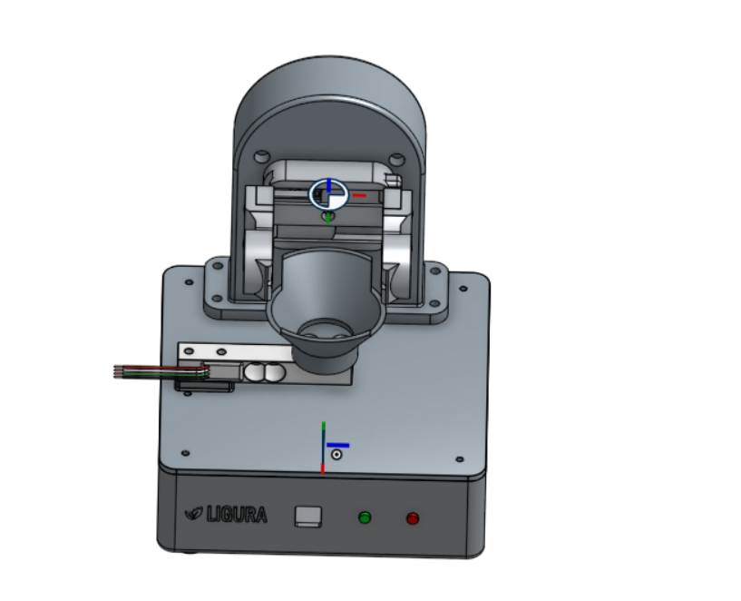
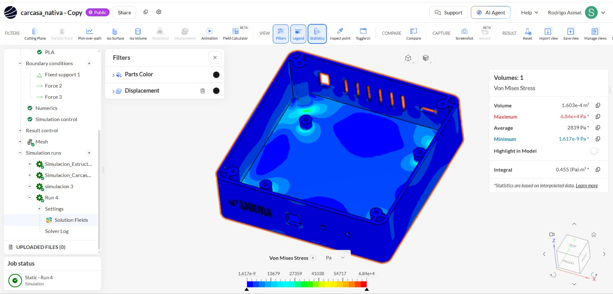
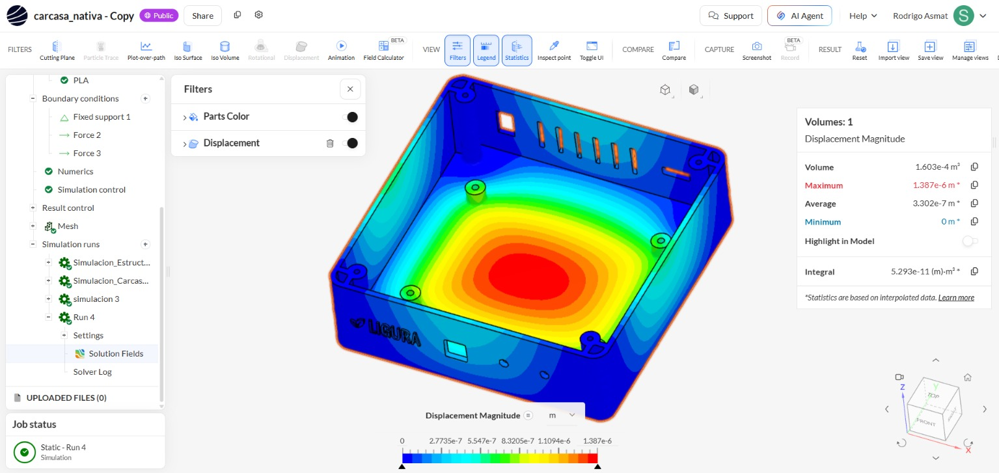
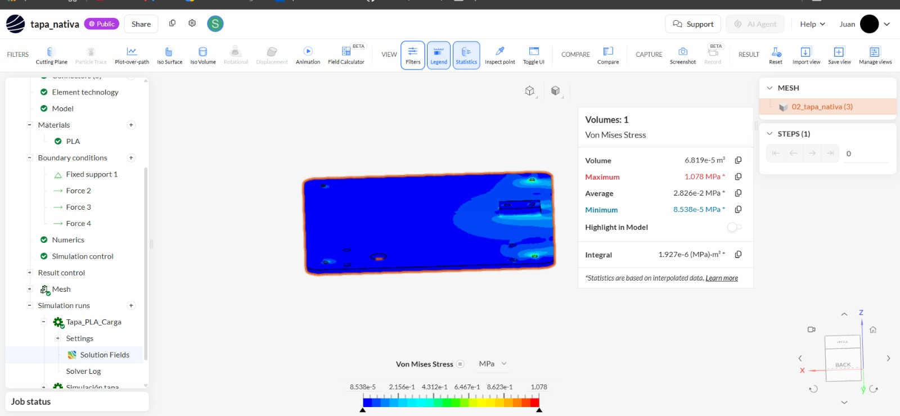
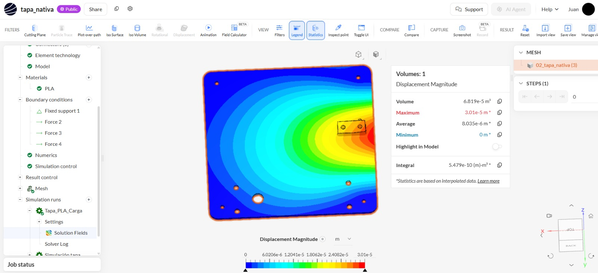
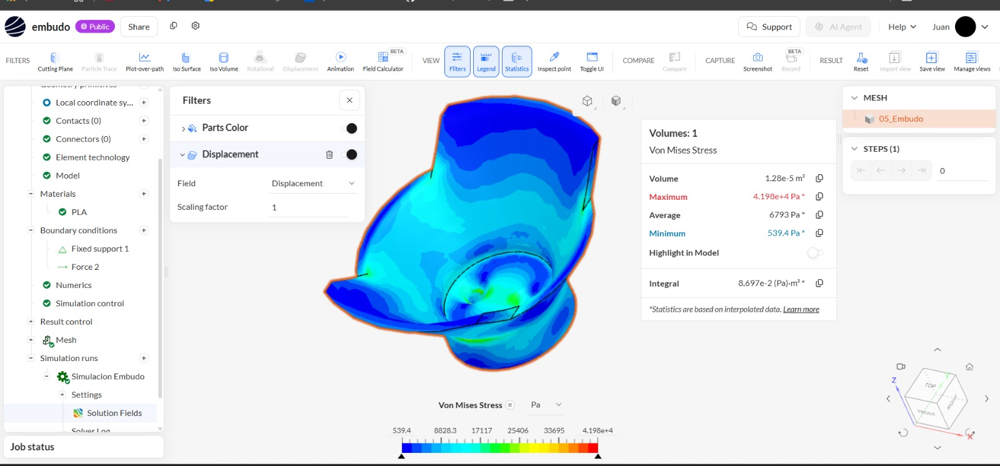
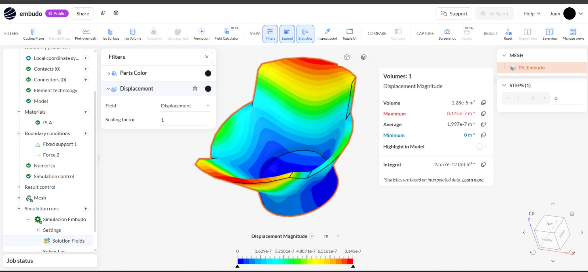
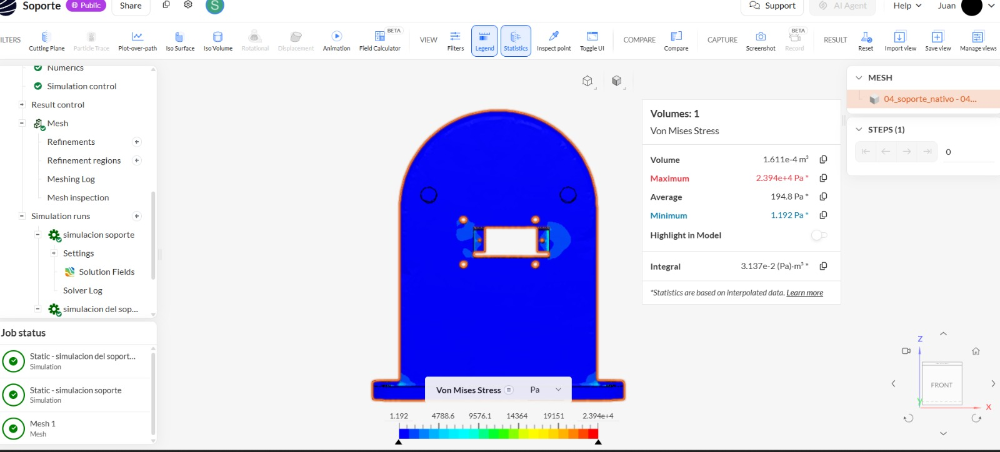
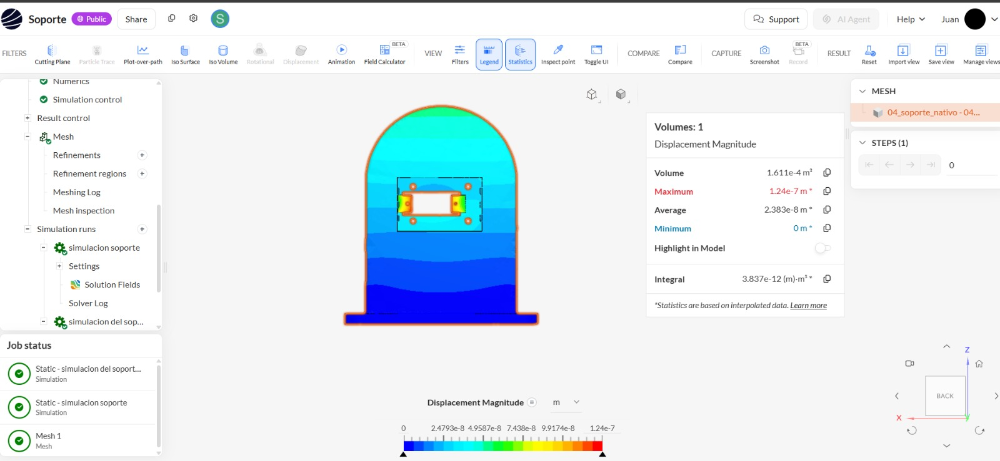

# TLR 3 – Simulación estructural de los componentes del sistema mecatrónico

## Evaluación mediante análisis estático en SimScale

**Proyecto:** Sistema mecatrónico no destructivo para evaluar y clasificar la calidad interna de la granadilla mediante excitación vibratoria controlada y análisis de su respuesta vibroacústica.  
**Etapa:** TLR 3 – Prueba de concepto y evaluación de componentes.  
**Software:** SimScale.  
**Material asignado en los modelos:** PLA.  
**Tipo de análisis:** Análisis estructural estático.

---

## 1. Objetivo

Evaluar preliminarmente el comportamiento estructural de los principales componentes mecánicos del sistema mediante simulaciones estáticas en SimScale. El análisis permite identificar las regiones de mayor esfuerzo, cuantificar los desplazamientos bajo las cargas consideradas y reconocer las zonas que requieren revisión antes de fabricar o validar el prototipo completo.

Se analizaron individualmente cuatro componentes: carcasa, tapa, embudo y soporte del gripper. Para cada uno se presentan dos resultados: esfuerzo equivalente de Von Mises y magnitud del desplazamiento.

## 2. Modelado tridimensional

Los componentes se diseñaron en CAD y se prepararon para su análisis estructural. La separación por piezas permite estudiar la respuesta de cada geometría y reconocer las zonas donde se transmiten las cargas y donde pueden aparecer concentraciones de esfuerzo.

**Figura 1.** Modelo tridimensional del sistema mecatrónico desarrollado para el proyecto.

## 3. Componentes evaluados

| Componente | Función | Aspectos estructurales de interés |
|---|---|---|
| Carcasa | Aloja y protege los componentes electrónicos y mecánicos. | Rigidez de la base, paredes, apoyos interiores y zonas de fijación. |
| Tapa | Cierra la carcasa y sirve como interfaz de montaje para componentes superiores. | Flexión de la superficie, puntos de anclaje y transmisión de cargas. |
| Embudo | Recibe y posiciona la granadilla durante la evaluación. | Deformación de la superficie receptora y concentración de esfuerzos en transiciones geométricas. |
| Soporte del gripper | Sostiene el mecanismo de sujeción y el servomotor. | Esfuerzos en anclajes, uniones y base de fijación. |

## 4. Material

En los modelos de SimScale se asignó **PLA** a los componentes analizados. El PLA es un termoplástico utilizado comúnmente en fabricación aditiva. Sin embargo, las propiedades efectivas de una pieza impresa por FDM dependen de la formulación del filamento, la orientación de impresión, el porcentaje y patrón de relleno, el número de perímetros, la altura de capa y los parámetros de fabricación.

Por ello, el material impreso no debe asumirse automáticamente como isotrópico ni idéntico a los valores de una ficha técnica genérica. Para calcular un factor de seguridad confiable es necesario documentar la marca y referencia del filamento y utilizar propiedades representativas de las condiciones reales de impresión, idealmente obtenidas mediante ensayos de probetas fabricadas con los mismos parámetros.

**Dato confirmado en las capturas:** el material asignado en SimScale es PLA.  
**Dato pendiente:** fabricante y referencia del filamento, módulo elástico, coeficiente de Poisson, límite elástico o resistencia a tracción, densidad y parámetros de impresión.

## 5. Configuración del análisis

Se utilizó un análisis estático estructural. En este tipo de estudio se aplican restricciones y cargas para calcular los campos de esfuerzo y desplazamiento que satisfacen el equilibrio del modelo.

Las condiciones de frontera deben representar de la forma más fiel posible cómo se sujeta cada pieza y por dónde se transmiten las cargas durante la operación.

### 5.1 Condiciones de apoyo y carga

Las condiciones se configuraron en función de la función de cada componente:

- **Carcasa:** se representaron los apoyos y las cargas transmitidas por los componentes alojados o montados en ella.
- **Tapa:** se representaron los puntos de fijación y las cargas transmitidas por los elementos que se apoyan sobre ella.
- **Embudo:** se representaron sus puntos de montaje y la carga asociada al elemento que recibe.
- **Soporte del gripper:** se diferenciaron los cuatro puntos de montaje del gripper y los dos puntos de montaje del servomotor. La fijación estructural del soporte se debe representar en los cuatro agujeros de la base inferior que se atornilla a la carcasa.

Para el soporte del gripper se utilizaron las siguientes masas de los componentes:

| Elemento | Masa | Peso aproximado |
|---|---:|---:|
| Gripper | 40.10 g | 0.3934 N |
| Servomotor | 13.40 g | 0.1315 N |
| **Total** | **53.50 g** | **0.5248 N** |

Bajo la hipótesis de reparto uniforme entre puntos de montaje:

- Gripper: 0.3934 N / 4 = **0.09835 N por punto**.
- Servomotor: 0.1315 N / 2 = **0.06573 N por punto**.

Estos valores por punto constituyen una idealización. En el prototipo real, la distribución puede no ser uniforme debido a la posición del centro de gravedad, la rigidez de las uniones, las holguras, el contacto entre piezas y los momentos generados por la distancia entre la carga y la base.

**Verificación de SimScale:** debe confirmarse si una condición Force asignada a varias caras interpreta el valor ingresado como fuerza total distribuida entre las caras o como magnitud aplicada por cara. Los valores anteriores son fuerzas por punto; no deben confundirse con la resultante total de una condición aplicada a varias caras.

### 5.2 Mallado

Cada componente se discretizó mediante una malla para resolver numéricamente el problema estructural. Es importante que la malla represente adecuadamente los agujeros, uniones, bordes y transiciones geométricas, ya que en estas regiones pueden presentarse gradientes elevados de esfuerzo.

Las capturas de resultados muestran simulaciones completadas en SimScale, pero no muestran el número de elementos, nodos ni métricas globales de calidad. Por tanto, esos datos no se inventan ni se consignan como valores confirmados.

Para completar esta sección con evidencia del proyecto, se recomienda añadir desde **Mesh / Meshing Log / Mesh inspection**:

- Número total de elementos.
- Número total de nodos.
- Tipo de elementos, si está disponible.
- Métricas de calidad de malla.
- Refinamientos locales aplicados en agujeros y zonas de concentración de esfuerzos.

También se recomienda realizar un estudio de independencia de malla: repetir la simulación con una malla más fina y comparar el esfuerzo máximo y el desplazamiento máximo.

## 6. Resultados de la simulación

Los valores de las tablas se transcribieron de los paneles de estadísticas de SimScale mostrados en las capturas. Las conversiones se realizaron para presentar los resultados en unidades prácticas para el análisis.

### 6.1 Resumen comparativo

| Componente | Von Mises máximo | Von Mises promedio | Desplazamiento máximo | Desplazamiento promedio |
|---|---:|---:|---:|---:|
| Carcasa | 68,400 Pa (0.0684 MPa) | 2,839 Pa (0.002839 MPa) | 1.387 × 10⁻⁶ m (0.001387 mm) | 3.302 × 10⁻⁷ m (0.0003302 mm) |
| Tapa | 1.078 MPa | 0.02826 MPa | 3.01 × 10⁻⁵ m (0.0301 mm) | 8.035 × 10⁻⁶ m (0.008035 mm) |
| Embudo | 41,980 Pa (0.04198 MPa) | 6,793 Pa (0.006793 MPa) | 8.145 × 10⁻⁷ m (0.0008145 mm) | 1.997 × 10⁻⁷ m (0.0001997 mm) |
| Soporte del gripper | 23,940 Pa (0.02394 MPa) | 1,948 Pa (0.001948 MPa) | 1.24 × 10⁻⁷ m (0.000124 mm) | 2.383 × 10⁻⁸ m (0.00002383 mm) |

**Nota:** SimScale indica que las estadísticas se basan en datos interpolados. Los máximos locales pueden verse influidos por la malla, la geometría idealizada y las condiciones de apoyo y carga.

### 6.2 Carcasa

#### Esfuerzo equivalente de Von Mises

- **Máximo:** 68,400 Pa (0.0684 MPa).
- **Promedio:** 2,839 Pa (0.002839 MPa).
- **Mínimo:** aproximadamente 0 Pa.

La distribución muestra esfuerzos de baja magnitud en la mayor parte de la carcasa y regiones localizadas de mayor intensidad alrededor de apoyos y elementos geométricos interiores. Estas zonas deben revisarse porque las transiciones, puntos de fijación y cambios de sección pueden producir concentraciones de esfuerzo.

**Figura 2.** Distribución del esfuerzo equivalente de Von Mises en la carcasa.

#### Magnitud del desplazamiento

- **Máximo:** 1.387 × 10⁻⁶ m (0.001387 mm).
- **Promedio:** 3.302 × 10⁻⁷ m (0.0003302 mm).
- **Mínimo:** 0 m.

El mayor desplazamiento se observa en una región central del fondo de la carcasa, mientras que las zonas restringidas presentan desplazamientos próximos a cero. La magnitud calculada es reducida para las cargas representadas en este modelo.

**Figura 3.** Distribución de la magnitud del desplazamiento en la carcasa.

**Interpretación:** bajo las condiciones configuradas, la carcasa presenta una deformación numérica reducida. Las zonas de apoyo y las uniones interiores deben conservarse como áreas de inspección. Esta conclusión se limita al caso de carga simulado y no representa por sí sola una validación frente a impactos, vibración dinámica, fatiga o cargas de montaje.

### 6.3 Tapa

#### Esfuerzo equivalente de Von Mises

- **Máximo:** 1.078 MPa.
- **Promedio:** 0.02826 MPa.
- **Mínimo:** 8.538 × 10⁻⁵ MPa.

La distribución presenta concentraciones localizadas de esfuerzo cerca de la zona de montaje y transmisión de cargas. El resto de la superficie muestra valores menores. El máximo de 1.078 MPa es el mayor esfuerzo equivalente registrado entre los cuatro componentes evaluados.

**Figura 4.** Distribución del esfuerzo equivalente de Von Mises en la tapa.

#### Magnitud del desplazamiento

- **Máximo:** 3.01 × 10⁻⁵ m (0.0301 mm).
- **Promedio:** 8.035 × 10⁻⁶ m (0.008035 mm).
- **Mínimo:** 0 m.

El campo de desplazamiento evidencia una deformación mayor en la región próxima a la zona cargada, con valores decrecientes hacia las zonas de fijación. El patrón es compatible con una respuesta de flexión de la tapa bajo las cargas representadas.

**Figura 5.** Distribución de la magnitud del desplazamiento en la tapa.

**Interpretación:** la tapa es el componente que presenta la mayor respuesta estructural en términos de esfuerzo máximo y desplazamiento máximo dentro de estas simulaciones. Aunque el desplazamiento calculado es pequeño en términos absolutos, la tapa debe considerarse prioritaria para revisar la rigidez local, la geometría de los soportes y la distribución de las cargas. No se puede afirmar que cumple un factor de seguridad específico sin contrastar el esfuerzo con propiedades verificadas del PLA utilizado.

### 6.4 Embudo

#### Esfuerzo equivalente de Von Mises

- **Máximo:** 41,980 Pa (0.04198 MPa).
- **Promedio:** 6,793 Pa (0.006793 MPa).
- **Mínimo:** 539.4 Pa.

Los esfuerzos de mayor magnitud aparecen de forma localizada en la región inferior y en las transiciones próximas a la zona de apoyo. Estas regiones merecen atención porque transmiten carga y presentan cambios geométricos.

**Figura 6.** Distribución del esfuerzo equivalente de Von Mises en el embudo.

#### Magnitud del desplazamiento

- **Máximo:** 8.145 × 10⁻⁷ m (0.0008145 mm).
- **Promedio:** 1.997 × 10⁻⁷ m (0.0001997 mm).
- **Mínimo:** 0 m.

La mayor magnitud de desplazamiento se observa hacia la zona superior del embudo, mientras que la región de montaje presenta valores menores debido a la restricción aplicada.

**Figura 7.** Distribución de la magnitud del desplazamiento en el embudo.

**Interpretación:** para el caso estático representado, el embudo presenta esfuerzos y desplazamientos de baja magnitud. La distribución permite identificar como zonas de interés la unión inferior y las transiciones geométricas. Para una evaluación más representativa, se debe verificar que la carga de la granadilla se aplique sobre la zona real de contacto y que el peso propio del embudo se incluya mediante gravedad o una carga equivalente correctamente justificada.

### 6.5 Soporte del gripper

#### Esfuerzo equivalente de Von Mises

- **Máximo:** 23,940 Pa (0.02394 MPa).
- **Promedio:** 1,948 Pa (0.001948 MPa).
- **Mínimo:** 1.192 Pa.

La distribución muestra concentraciones localizadas en las zonas próximas a los agujeros y puntos de unión del soporte. Estas regiones son importantes porque transmiten las cargas del gripper y del servomotor hacia la base fijada a la carcasa.

**Figura 8.** Distribución del esfuerzo equivalente de Von Mises en el soporte del gripper.

#### Magnitud del desplazamiento

- **Máximo:** 1.24 × 10⁻⁷ m (0.000124 mm).
- **Promedio:** 2.383 × 10⁻⁸ m (0.00002383 mm).
- **Mínimo:** 0 m.

El desplazamiento calculado es muy pequeño y disminuye hacia la zona de fijación del soporte. La distribución debe interpretarse considerando que el modelo representa una idealización de las uniones atornilladas.

**Figura 9.** Distribución de la magnitud del desplazamiento en el soporte del gripper.

**Interpretación:** los resultados muestran una respuesta de baja magnitud para las cargas y restricciones configuradas. Antes de tomar estos valores como definitivos se debe confirmar que el apoyo fijo se encuentre en los cuatro agujeros de la base inferior que se conecta a la carcasa, y que los cuatro puntos del gripper y los dos del servomotor reciban sus cargas sin quedar indebidamente restringidos. También debe verificarse cómo SimScale interpreta una fuerza aplicada a varias caras.

## 7. Comparación e interpretación global

La comparación de los máximos permite identificar qué componentes presentan mayor respuesta dentro de los casos simulados:

- **Tapa:** registra el mayor esfuerzo equivalente máximo (1.078 MPa) y el mayor desplazamiento máximo (0.0301 mm). Es la pieza que merece prioridad en una revisión de rigidez y distribución de carga.
- **Carcasa:** presenta un esfuerzo máximo de 0.0684 MPa y un desplazamiento máximo de 0.001387 mm. La deformación mostrada es reducida para el caso analizado.
- **Embudo:** presenta un esfuerzo máximo de 0.04198 MPa y un desplazamiento máximo de 0.0008145 mm. Las transiciones inferiores y la zona de apoyo son puntos de interés.
- **Soporte del gripper:** registra el menor esfuerzo máximo (0.02394 MPa) y el menor desplazamiento máximo (0.000124 mm) entre las cuatro piezas. La interpretación depende especialmente de que sus apoyos y cargas reproduzcan correctamente las uniones reales.

En términos comparativos, la tapa es la pieza con mayor respuesta estructural en estas simulaciones. Sin embargo, los componentes no se encuentran necesariamente sometidos al mismo estado de carga. Por tanto, los valores máximos no deben compararse como si las cuatro piezas recibieran cargas idénticas. La comparación es válida como lectura de los casos particulares configurados y debe acompañarse de las condiciones de frontera de cada modelo.

## 8. Limitaciones y verificaciones necesarias

Antes de presentar los resultados como definitivos, se recomienda completar las siguientes verificaciones:

1. **Material PLA:** documentar la referencia del filamento y las propiedades mecánicas empleadas en SimScale. Cuando sea posible, utilizar propiedades de probetas impresas con los mismos parámetros del prototipo.
2. **Condiciones de frontera:** comprobar que cada Fixed Support represente una unión física real y no inmovilice superficies que deberían transmitir carga o deformarse.
3. **Fuerzas:** verificar si el valor introducido en una condición Force aplicada a varias caras es una resultante total o una fuerza por cara. Confirmar que no se dupliquen masas ni cargas.
4. **Peso propio:** comprobar si se incluyó gravedad. Si no se incluyó, justificar qué pesos se representaron mediante fuerzas equivalentes.
5. **Contactos y uniones:** revisar si las interfaces entre componentes se modelaron mediante contactos, conectores o restricciones simplificadas. Una unión idealizada puede modificar la rigidez calculada.
6. **Malla:** registrar número de elementos y nodos, revisar la calidad y realizar al menos una comparación con una malla más fina.
7. **Convergencia:** comprobar que los máximos de esfuerzo y desplazamiento no cambien significativamente al refinar la malla.
8. **Validación experimental:** contrastar los resultados con pruebas físicas del prototipo, especialmente en las zonas de anclaje y en la tapa.

No se calcula un factor de seguridad en este informe porque no se ha documentado una resistencia de referencia validada para el PLA impreso ni se ha confirmado que las propiedades del material simulado representen las condiciones reales de fabricación.

## 9. Conclusiones

1. Se desarrollaron simulaciones estáticas individuales en SimScale para la carcasa, tapa, embudo y soporte del gripper, utilizando PLA como material asignado en los modelos.
2. Los resultados identifican la tapa como el componente con mayor esfuerzo de Von Mises máximo (1.078 MPa) y mayor desplazamiento máximo (0.0301 mm) entre las piezas evaluadas.
3. La carcasa, el embudo y el soporte del gripper presentan desplazamientos máximos inferiores a 0.0014 mm en los casos simulados, lo que indica una respuesta numérica reducida bajo las condiciones aplicadas.
4. Las regiones próximas a agujeros, anclajes, uniones y transiciones geométricas concentran los mayores valores locales y deben considerarse en la revisión del diseño.
5. Los resultados constituyen evidencia de evaluación estructural preliminar para la prueba de concepto. La aceptación definitiva del diseño requiere verificar las cargas, los apoyos, las propiedades del PLA, la calidad de la malla y la correspondencia entre el modelo numérico y el prototipo fabricado.
6. Como siguiente actividad, se recomienda realizar pruebas físicas controladas y comparar las deformaciones observadas con las predicciones de SimScale. También debe evaluarse el comportamiento dinámico del sistema, ya que el funcionamiento vibroacústico implica excitación vibratoria y no queda completamente representado por un análisis estático.

