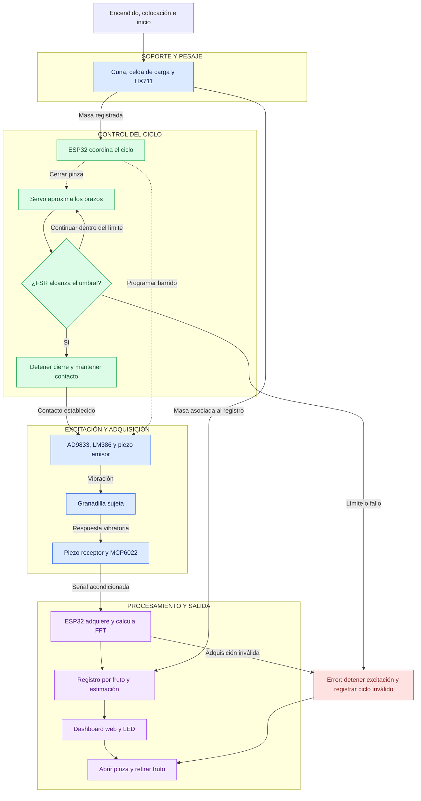

# TRL 2 – Formulación del Concepto Tecnológico de Ligura

## 1. Introducción

### 1.1 ¿Qué representa el TRL 2?

El TRL 2 corresponde a la etapa de investigación aplicada en la que los principios científicos identificados previamente se relacionan con una posible aplicación tecnológica. En este nivel se define el concepto de la solución, se describe su funcionamiento previsto y se sustenta su desarrollo mediante antecedentes científicos y tecnológicos.

Las principales evidencias consideradas son los artículos científicos relacionados con la propuesta, el análisis preliminar de patentabilidad y protección, y la formulación de un perfil o propuesta de proyecto.

En Ligura, esta etapa permite establecer cómo se combinarían la excitación vibratoria controlada, la medición de masa y el análisis de señales para investigar la condición interna de la granadilla.

### 1.2 Antecedentes provenientes del TRL 1

Durante el TRL 1 se revisaron los principios científicos relacionados con la evaluación no destructiva de frutos mediante su respuesta acústica y vibratoria. Se identificaron antecedentes que estudian la relación entre las características del espectro de frecuencia y determinadas propiedades o alteraciones internas de los frutos.

Asimismo, se consideraron los principios de transducción piezoeléctrica, medición de masa y procesamiento de señales mediante la transformada rápida de Fourier (FFT). Estos fundamentos orientan la selección de los elementos necesarios para aplicar una vibración, registrar la respuesta y analizar sus características.

A partir de esta revisión, Ligura plantea investigar si la respuesta vibroacústica de la granadilla (*Passiflora ligularis*), analizada junto con su masa, permite distinguir frutos con y sin zonas de oscurecimiento visible en la pulpa. La lectura de un sensor resistivo de fuerza (FSR) se considera para supervisar el contacto de la pinza durante la medición.

### 1.3 Objetivo del TRL 2

El objetivo de esta etapa es formular y sustentar el concepto tecnológico de **Ligura**, una propuesta de sistema para la evaluación no destructiva de granadillas mediante excitación vibratoria controlada, adquisición de la respuesta piezoeléctrica, medición de masa y análisis en frecuencia.

Para ello, se analizarán antecedentes científicos y tecnológicos relacionados con la evaluación de frutos, se definirá la arquitectura conceptual del sistema y se establecerán sus funciones y requisitos principales. También se documentarán las alternativas de diseño, se planteará la interfaz del dashboard en Figma y se desarrollará un análisis preliminar de patentabilidad y protección.

Como resultado, se obtendrá una propuesta que oriente las pruebas posteriores para investigar la relación entre las mediciones y el oscurecimiento observado en la pulpa de cada granadilla.

## 2. Estado del arte de la propuesta tecnológica

### 2.1 Evaluación no destructiva mediante respuesta acústica y vibratoria

La evaluación acústica y vibratoria de frutos permite investigar sus propiedades internas a partir de la respuesta que producen ante un estímulo mecánico. Los antecedentes seleccionados estudian cómo las características del espectro se relacionan con alteraciones internas o mediciones de firmeza.

Diezma-Iglesias, Ruiz-Altisent y Barreiro desarrollaron un procedimiento para detectar alteraciones internas en sandías sin semillas mediante respuesta acústica a un impacto. Su dispositivo integró un generador de impacto mecánico, un micrófono y elementos estructurales de soporte. Los parámetros obtenidos al sumar la magnitud del espectro dentro de determinadas bandas de frecuencia mostraron capacidad para identificar alteraciones internas [[1]](#ref1).

Este antecedente respalda la decisión de explorar características espectrales en Ligura. En particular, orienta el análisis de la magnitud por bandas de frecuencia, además de la identificación del pico dominante. Las bandas que resulten pertinentes para la granadilla deberán determinarse mediante mediciones propias.

### 2.2 Análisis espectral y control de las condiciones de medición

Tian, Wang y Xu desarrollaron un dispositivo para estimar la firmeza del kiwi mediante tecnología de vibración acústica. Para mantener condiciones de excitación comparables, calibraron la fuerza del impacto. Posteriormente, transformaron las señales al dominio de frecuencia y extrajeron diez características estadísticas. Varias de ellas presentaron correlación con las mediciones de referencia de firmeza [[2]](#ref2).

El estudio muestra la importancia de controlar el estímulo y contrastar las características espectrales con una referencia obtenida del fruto. Para Ligura, esto se traduce en dos decisiones conceptuales: establecer condiciones reproducibles de excitación y conservar la correspondencia entre la señal y la granadilla evaluada.

Ligura propone aplicar un barrido de frecuencias mediante un piezoeléctrico emisor y registrar la respuesta con otro piezoeléctrico situado en el brazo opuesto de la pinza. La lectura del FSR permitirá supervisar el cierre. Será necesario estudiar cuánto cambia la señal cuando una misma granadilla se retira y se vuelve a colocar.

### 2.3 Caracterización de la granadilla y registro de masa

Espinosa et al. estudiaron granadillas (*Passiflora ligularis*) procedentes de tres localidades de Colombia. Registraron características como peso fresco, dimensiones, firmeza, sólidos solubles, pH y acidez. Encontraron diferencias de peso fresco y composición relacionadas con la procedencia de los frutos [[3]](#ref3).

Este trabajo aporta información específica de la especie y orienta el registro de masa y procedencia en Ligura. Considerar estas variables permitirá estudiar si parte de las diferencias observadas en las señales se relaciona con la variabilidad entre frutos.

La masa se utilizará como información complementaria al análisis espectral. Su aporte a la clasificación deberá evaluarse comparando resultados obtenidos con y sin esta variable.

### 2.4 Comparación de soluciones existentes

La siguiente tabla relaciona los antecedentes revisados con las decisiones de diseño de Ligura.

| Solución / antecedente | Fruto estudiado | Excitación o medición | Información analizada | Aporte a Ligura |
|---|---|---|---|---|
| Diezma-Iglesias et al. [[1]](#ref1) | Sandía sin semillas | Impacto mecánico y registro con micrófono | Magnitud del espectro por bandas para identificar alteraciones internas | Explorar bandas de frecuencia y características asociadas a diferencias internas. |
| Tian et al. [[2]](#ref2) | Kiwi | Impacto calibrado y adquisición de respuesta vibratoria | Características espectrales relacionadas con mediciones de firmeza | Controlar la excitación y asociar cada señal con una referencia del mismo fruto. |
| Espinosa et al. [[3]](#ref3) | Granadilla | Caracterización física y bioquímica | Peso fresco, firmeza, composición y variación según procedencia | Registrar masa y trazabilidad de las muestras. |
| **Ligura — propuesta conceptual** | **Granadilla** | **Barrido de frecuencias, recepción piezoeléctrica y pesaje** | **Características espectrales y masa, contrastadas con una etiqueta visual de la pulpa** | **Investigar la distinción entre frutos con y sin zonas de oscurecimiento visible.** |

La propuesta de Ligura integra una celda de carga con HX711 para registrar la masa y una pinza accionada por servomotor cuyo cierre se supervisa mediante un FSR. El AD9833 y el amplificador LM386 alimentarían el piezoeléctrico emisor, mientras que el receptor registraría la respuesta. El ESP32 coordinaría el ciclo y el procesamiento, y el dashboard permitiría consultar el registro individual.

### 2.5 Aplicación de los antecedentes y brecha de investigación

Los antecedentes revisados orientan el análisis espectral, el control de las condiciones de medición y el registro de variables físicas del fruto. La aplicación específica que plantea Ligura es investigar si estas mediciones permiten distinguir granadillas con y sin zonas de oscurecimiento visible en la pulpa.

Para comprobarlo, se propone medir cada granadilla intacta y abrirla posteriormente para obtener una referencia visual. La fotografía y la etiqueta se asociarán al identificador de esa misma unidad.

La principal pregunta pendiente es si las diferencias entre ambas clases superan la variación producida por el contacto, la recolocación y las características individuales de los frutos. Esta cuestión orientará las pruebas de concepto del TRL 3.

## 3. Formulación del concepto tecnológico

### 3.1 Concepto de Ligura

Ligura se plantea como un sistema mecatrónico de evaluación no destructiva de granadillas (*Passiflora ligularis*) mediante excitación vibratoria controlada y análisis de su respuesta vibroacústica.

La propuesta combina la medición de masa, la sujeción supervisada mediante un sensor resistivo de fuerza (FSR) y la adquisición de señales con dos elementos piezoeléctricos. El objetivo es investigar si las características de la respuesta vibratoria, analizadas junto con la masa, permiten distinguir frutos con y sin zonas de oscurecimiento visible en la pulpa.

El ESP32 coordinaría el ciclo de evaluación y el procesamiento de la señal mediante la transformada rápida de Fourier (FFT). Los registros y las estimaciones disponibles se presentarían en un dashboard web, cuya interfaz se diseñará en Figma como evidencia conceptual del proyecto.

### 3.2 Problema que busca atender

Durante la selección poscosecha, la inspección externa permite observar la cáscara de la granadilla. Sin embargo, conocer visualmente el estado de su pulpa requiere abrir el fruto, lo que impide conservar esa misma unidad intacta para su comercialización.

Ligura propone investigar una alternativa que permita obtener información sobre la condición interna antes de abrir cada granadilla. La aplicación prevista es apoyar al personal encargado de seleccionar frutos individuales en centros de acopio o acondicionamiento.

El criterio de investigación será la presencia o ausencia de zonas de oscurecimiento visible en la pulpa. Para obtener la referencia durante las pruebas, cada fruto se abrirá después de registrar su respuesta vibratoria y se documentará mediante fotografías.

### 3.3 Propuesta de solución tecnológica

La solución se organiza en módulos de soporte y pesaje, sujeción, excitación, adquisición, procesamiento y visualización.

El operador colocaría una granadilla en una cuna cóncava. La celda de carga y el módulo HX711 permitirían registrar su masa con la pinza abierta. Posteriormente, el servomotor aproximaría los brazos hasta alcanzar el umbral de contacto definido mediante la lectura del FSR.

Una vez establecido el contacto, el AD9833 generaría un barrido de frecuencias. El LM386 amplificaría la señal para accionar el piezoeléctrico emisor. El piezoeléctrico del brazo opuesto registraría la respuesta, que sería acondicionada antes de su adquisición por el ESP32.

El procesamiento permitiría obtener características del espectro, como la ubicación de picos y la magnitud por bandas de frecuencia. Estas características se estudiarían junto con la masa para desarrollar y evaluar posteriormente un criterio de clasificación.

Al finalizar el ciclo, se registraría la medición, se comunicaría el estado mediante el dashboard y los LED, y la pinza se abriría para retirar el fruto. La estimación de oscurecimiento se incorporaría cuando se disponga de un criterio validado con datos experimentales.

### 3.4 Variables y sensores considerados

| Variable o señal | Elemento considerado | Función en Ligura |
|---|---|---|
| Masa del fruto | Celda de carga y HX711 | Registrar la masa antes de la sujeción lateral. |
| Lectura de contacto | Sensor resistivo de fuerza (FSR) | Supervisar el cierre y determinar cuándo detener la aproximación de los brazos. |
| Frecuencia de excitación | Generador AD9833 | Establecer el barrido aplicado al fruto. |
| Excitación mecánica | Piezoeléctrico emisor y amplificador LM386 | Transmitir la vibración a la cáscara. |
| Respuesta a la vibración | Piezoeléctrico receptor y acondicionamiento con MCP6022 | Obtener una señal eléctrica para su adquisición y análisis. |
| Características espectrales | Procesamiento mediante FFT | Identificar picos y magnitudes por bandas de frecuencia. |
| Condición interna de referencia | Inspección visual posterior a la apertura | Asignar la etiqueta con o sin oscurecimiento observado en la pulpa. |

El FSR se utilizará inicialmente como referencia de contacto. La interpretación de su lectura como fuerza requerirá calibración. Los parámetros del barrido, del muestreo y del acondicionamiento se definirán durante la caracterización experimental.

## 4. Arquitectura conceptual de Ligura

La arquitectura conceptual de Ligura integra las funciones necesarias para pesar, sujetar y excitar una granadilla, adquirir su respuesta y registrar los resultados del ciclo.

El ESP32 actuará como unidad coordinadora. Recibirá las señales del pesaje, del FSR y del receptor piezoeléctrico, y enviará las órdenes correspondientes al servomotor, al generador de señal y a los elementos de visualización.

### 4.1 Módulo de soporte y medición de masa

El fruto se colocará en una cuna cóncava situada sobre el sistema de pesaje. La celda de carga y el HX711 permitirán obtener la masa antes de que los brazos establezcan contacto con la granadilla.

Esta secuencia busca evitar que las fuerzas ejercidas por la pinza alteren la lectura utilizada para caracterizar el fruto. La tara y la estabilidad del pesaje deberán verificarse durante las pruebas.

La estructura abierta permitirá el ingreso superior y el retiro de la granadilla al terminar la evaluación.

### 4.2 Módulo de sujeción y excitación

El servomotor accionará la pinza para aproximar sus dos brazos al fruto. Un FSR ubicado en uno de ellos proporcionará una lectura para supervisar el contacto y detener el cierre al alcanzar el umbral establecido.

Una vez alcanzada la condición de sujeción, se iniciará la excitación. El AD9833 generará la señal de frecuencia variable y el LM386 alimentará el piezoeléctrico emisor, que transmitirá la vibración a la granadilla.

El umbral de contacto y las condiciones de excitación se determinarán mediante pruebas de repetibilidad y observación de la cáscara.

### 4.3 Adquisición y procesamiento de datos

El piezoeléctrico receptor, situado en el brazo opuesto al emisor, registrará la respuesta vibratoria. El circuito con MCP6022 acondicionará la señal antes de su adquisición.

El ESP32 organizará las muestras y aplicará la FFT para obtener su representación en frecuencia. Se propone explorar características como la ubicación de los picos y la magnitud acumulada en determinadas bandas.

Cada registro se asociará al identificador de la granadilla y a su masa. En las pruebas posteriores, también se vinculará con la fotografía y la etiqueta visual obtenidas al abrir esa misma unidad.

### 4.4 Comunicación e interfaz web

El ESP32 proporcionará la comunicación prevista con el dashboard mediante Wi-Fi. La implementación deberá definir cómo se intercambian y conservan los datos de cada evaluación.

El diseño conceptual de la interfaz se elaborará en Figma y contemplará la evaluación actual, el detalle de la medición, el historial y el estado del sistema.

Se distinguirá entre el estado operativo del ciclo y el resultado estimado del fruto. Un ciclo interrumpido deberá quedar identificado como medición inválida.

### 4.5 Visualización y señalización

El dashboard permitirá consultar el identificador de la granadilla, su masa, el estado del ciclo y la estimación cuando esté disponible. También se propone consultar el espectro y recuperar mediciones anteriores.

Los LED verde y rojo proporcionarán señalización local. Su correspondencia con los estados del equipo y los resultados deberá definirse de forma consistente con la interfaz y el programa de control.

Los mensajes de error indicarán la etapa afectada, como pesaje, sujeción o adquisición. Los datos utilizados para representar las pantallas en Figma se identificarán como «SIMULACIÓN».

### 4.6 Flujo conceptual del sistema

El siguiente diagrama representa las rutas de medición y las órdenes coordinadas por el ESP32. Las flechas continuas muestran la secuencia de evaluación y las discontinuas representan las órdenes de control.

La estimación indicada en el flujo corresponde a la función que se pretende desarrollar y evaluar. Durante las primeras pruebas se registrarán la masa, la señal y el estado del ciclo para estudiar la repetibilidad y establecer el criterio de clasificación.
