# TRL 2 – Formulación del Concepto Tecnológico de Ligura

## 1. Introducción

### 1.1 ¿Qué representa el TRL 2?

El TRL 2 corresponde a la etapa de investigación aplicada en la que los principios científicos identificados previamente se relacionan con una posible aplicación tecnológica. En este nivel se define el concepto de la solución, se describe su funcionamiento previsto y se sustenta su desarrollo mediante antecedentes científicos y tecnológicos.

Las principales evidencias consideradas son los artículos científicos relacionados con la propuesta, el análisis preliminar de patentabilidad y protección, y la formulación de un perfil o propuesta de proyecto.

En Ligura, esta etapa permite establecer cómo se combinarían la excitación vibratoria controlada, la medición de masa y el análisis de señales para investigar la condición interna de la granadilla.

### 1.2 Antecedentes provenientes del TRL 1

Durante el TRL 1 se revisaron los principios científicos relacionados con la evaluación no destructiva de frutos mediante su respuesta acústica y vibratoria. Se identificaron antecedentes que estudian la relación entre las características del espectro de frecuencia y determinadas propiedades o alteraciones internas de los frutos.

Asimismo, se consideraron los principios de transducción piezoeléctrica, medición de masa y procesamiento de señales mediante la transformada rápida de Fourier (FFT). Estos fundamentos orientan la selección de los elementos necesarios para aplicar una vibración, registrar la respuesta y analizar sus características.

A partir de esta revisión, Ligura plantea investigar si la respuesta vibroacústica de la granadilla (*Passiflora ligularis*), analizada junto con su masa, permite distinguir frutos con y sin zonas de oscurecimiento visible en la pulpa. La lectura de un sensor resistivo de fuerza (FSR) se considera para supervisar el contacto de la pinza durante la medición.

### 1.3 Objetivo del TRL 2

El objetivo de esta etapa es formular y sustentar el concepto tecnológico de **Ligura**, una propuesta de sistema para la evaluación no destructiva de granadillas mediante excitación vibratoria controlada, adquisición de la respuesta piezoeléctrica, medición de masa y análisis en frecuencia.

Para ello, se analizaron antecedentes científicos y tecnológicos relacionados con la evaluación de frutos, se definió la arquitectura conceptual del sistema y se establecieron sus funciones y requisitos principales. También se documentaron las alternativas de diseño, se elaboró la interfaz conceptual del dashboard en Figma y se desarrolló un análisis preliminar de patentabilidad y protección.

Como resultado, se obtuvo una propuesta que orienta las pruebas posteriores para investigar la relación entre las mediciones y el oscurecimiento observado en la pulpa de cada granadilla.

## 2. Estado del arte de la propuesta tecnológica

### 2.1 Evaluación no destructiva mediante respuesta acústica y vibratoria

La evaluación acústica y vibratoria de frutos permite investigar sus propiedades internas a partir de la respuesta que producen ante un estímulo mecánico. Los antecedentes seleccionados estudian cómo las características del espectro se relacionan con alteraciones internas o mediciones de firmeza.

Diezma-Iglesias, Ruiz-Altisent y Barreiro desarrollaron un procedimiento para detectar alteraciones internas en sandías sin semillas mediante respuesta acústica a un impacto. Su dispositivo integró un generador de impacto mecánico, un micrófono y elementos estructurales de soporte. Los parámetros obtenidos al sumar la magnitud del espectro dentro de determinadas bandas de frecuencia mostraron capacidad para identificar alteraciones internas [[1]](#ref1).

Este antecedente respalda la decisión de explorar características espectrales en Ligura. En particular, orienta el análisis de la magnitud por bandas de frecuencia, además de la identificación del pico dominante. Las bandas que resulten pertinentes para la granadilla deberán determinarse mediante mediciones propias.

### 2.2 Análisis espectral y control de las condiciones de medición

Tian, Wang y Xu desarrollaron un dispositivo para estimar la firmeza del kiwi mediante tecnología de vibración acústica. Para mantener condiciones de excitación comparables, calibraron la fuerza del impacto. Posteriormente, transformaron las señales al dominio de frecuencia y extrajeron diez características estadísticas. Varias de ellas presentaron correlación con las mediciones de referencia de firmeza [[2]](#ref2).

El estudio muestra la importancia de controlar el estímulo y contrastar las características espectrales con una referencia obtenida del fruto. Para Ligura, esto se traduce en dos decisiones conceptuales: establecer condiciones reproducibles de excitación y conservar la correspondencia entre la señal y la granadilla evaluada.

Ligura propone aplicar un barrido de frecuencias mediante un piezoeléctrico emisor y registrar la respuesta con otro piezoeléctrico situado en el brazo opuesto de la pinza. La lectura del FSR permitirá supervisar el cierre. Será necesario estudiar cuánto cambia la señal cuando una misma granadilla se retira y se vuelve a colocar.

### 2.3 Caracterización de la granadilla y registro de masa

Espinosa et al. estudiaron granadillas (*Passiflora ligularis*) procedentes de tres localidades de Colombia. Registraron características como peso fresco, dimensiones, firmeza, sólidos solubles, pH y acidez. Encontraron diferencias de peso fresco y composición relacionadas con la procedencia de los frutos [[3]](#ref3).

Este trabajo aporta información específica de la especie y orienta el registro de masa y procedencia en Ligura. Considerar estas variables permitirá estudiar si parte de las diferencias observadas en las señales se relaciona con la variabilidad entre frutos.

La masa se utilizará como información complementaria al análisis espectral. Su aporte a la clasificación deberá evaluarse comparando resultados obtenidos con y sin esta variable.

### 2.4 Comparación de soluciones existentes

La siguiente tabla relaciona los antecedentes revisados con las decisiones de diseño de Ligura.

| Solución / antecedente | Fruto estudiado | Excitación o medición | Información analizada | Aporte a Ligura |
|---|---|---|---|---|
| Diezma-Iglesias et al. [[1]](#ref1) | Sandía sin semillas | Impacto mecánico y registro con micrófono | Magnitud del espectro por bandas para identificar alteraciones internas | Explorar bandas de frecuencia y características asociadas a diferencias internas. |
| Tian et al. [[2]](#ref2) | Kiwi | Impacto calibrado y adquisición de respuesta vibratoria | Características espectrales relacionadas con mediciones de firmeza | Controlar la excitación y asociar cada señal con una referencia del mismo fruto. |
| Espinosa et al. [[3]](#ref3) | Granadilla | Caracterización física y bioquímica | Peso fresco, firmeza, composición y variación según procedencia | Registrar masa y trazabilidad de las muestras. |
| **Ligura — propuesta conceptual** | **Granadilla** | **Barrido de frecuencias, recepción piezoeléctrica y pesaje** | **Características espectrales y masa, contrastadas con una etiqueta visual de la pulpa** | **Investigar la distinción entre frutos con y sin zonas de oscurecimiento visible.** |

La propuesta de Ligura integra una celda de carga con HX711 para registrar la masa y una pinza accionada por servomotor cuyo cierre se supervisa mediante un FSR. El AD9833 y el amplificador LM386 alimentarían el piezoeléctrico emisor, mientras que el receptor registraría la respuesta. El ESP32 coordinaría el ciclo y el procesamiento, y el dashboard permitiría consultar el registro individual.

### 2.5 Aplicación de los antecedentes y brecha de investigación

Los antecedentes revisados orientan el análisis espectral, el control de las condiciones de medición y el registro de variables físicas del fruto. La aplicación específica que plantea Ligura es investigar si estas mediciones permiten distinguir granadillas con y sin zonas de oscurecimiento visible en la pulpa.

Para comprobarlo, se propone medir cada granadilla intacta y abrirla posteriormente para obtener una referencia visual. La fotografía y la etiqueta se asociarán al identificador de esa misma unidad.

La principal pregunta pendiente es si las diferencias entre ambas clases superan la variación producida por el contacto, la recolocación y las características individuales de los frutos. Esta cuestión orientará las pruebas de concepto del TRL 3.

## 3. Formulación del concepto tecnológico

### 3.1 Concepto de Ligura

Ligura se plantea como un sistema mecatrónico de evaluación no destructiva de granadillas (*Passiflora ligularis*) mediante excitación vibratoria controlada y análisis de su respuesta vibroacústica.

La propuesta combina la medición de masa, la sujeción supervisada mediante un sensor resistivo de fuerza (FSR) y la adquisición de señales con dos elementos piezoeléctricos. El objetivo es investigar si las características de la respuesta vibratoria, analizadas junto con la masa, permiten distinguir frutos con y sin zonas de oscurecimiento visible en la pulpa.

El ESP32 coordinaría el ciclo de evaluación y el procesamiento de la señal mediante la transformada rápida de Fourier (FFT). Los registros y las estimaciones disponibles se presentarían en un dashboard web, cuya interfaz conceptual se diseñó en Figma como evidencia del proyecto.

### 3.2 Problema que busca atender

Durante la selección poscosecha, la inspección externa permite observar la cáscara de la granadilla. Sin embargo, conocer visualmente el estado de su pulpa requiere abrir el fruto, lo que impide conservar esa misma unidad intacta para su comercialización.

Ligura propone investigar una alternativa que permita obtener información sobre la condición interna antes de abrir cada granadilla. La aplicación prevista es apoyar al personal encargado de seleccionar frutos individuales en centros de acopio o acondicionamiento.

El criterio de investigación será la presencia o ausencia de zonas de oscurecimiento visible en la pulpa. Para obtener la referencia durante las pruebas, cada fruto se abrirá después de registrar su respuesta vibratoria y se documentará mediante fotografías.

### 3.3 Propuesta de solución tecnológica

La solución se organiza en módulos de soporte y pesaje, sujeción, excitación, adquisición, procesamiento y visualización.

El operador colocaría una granadilla en una cuna cóncava. La celda de carga y el módulo HX711 permitirían registrar su masa con la pinza abierta. Posteriormente, el servomotor aproximaría los brazos hasta alcanzar el umbral de contacto definido mediante la lectura del FSR.

Una vez establecido el contacto, el AD9833 generaría un barrido de frecuencias. El LM386 amplificaría la señal para accionar el piezoeléctrico emisor. El piezoeléctrico del brazo opuesto registraría la respuesta, que sería acondicionada antes de su adquisición por el ESP32.

El procesamiento permitiría obtener características del espectro, como la ubicación de picos y la magnitud por bandas de frecuencia. Estas características se estudiarían junto con la masa para desarrollar y evaluar posteriormente un criterio de clasificación.

Al finalizar el ciclo, se registraría la medición, se comunicaría el estado mediante el dashboard y los LED, y la pinza se abriría para retirar el fruto. La estimación de oscurecimiento se incorporaría cuando se disponga de un criterio validado con datos experimentales.

### 3.4 Variables y sensores considerados

| Variable o señal | Elemento considerado | Función en Ligura |
|---|---|---|
| Masa del fruto | Celda de carga y HX711 | Registrar la masa antes de la sujeción lateral. |
| Lectura de contacto | Sensor resistivo de fuerza (FSR) | Supervisar el cierre y determinar cuándo detener la aproximación de los brazos. |
| Frecuencia de excitación | Generador AD9833 | Establecer el barrido aplicado al fruto. |
| Excitación mecánica | Piezoeléctrico emisor y amplificador LM386 | Transmitir la vibración a la cáscara. |
| Respuesta a la vibración | Piezoeléctrico receptor y acondicionamiento con MCP6022 | Obtener una señal eléctrica para su adquisición y análisis. |
| Características espectrales | Procesamiento mediante FFT | Identificar picos y magnitudes por bandas de frecuencia. |
| Condición interna de referencia | Inspección visual posterior a la apertura | Asignar la etiqueta con o sin oscurecimiento observado en la pulpa. |

El FSR se utilizará inicialmente como referencia de contacto. La interpretación de su lectura como fuerza requerirá calibración. Los parámetros del barrido, del muestreo y del acondicionamiento se definirán durante la caracterización experimental.

## 4. Arquitectura conceptual de Ligura

La arquitectura conceptual de Ligura integra las funciones necesarias para pesar, sujetar y excitar una granadilla, adquirir su respuesta y registrar los resultados del ciclo.

El ESP32 actuará como unidad coordinadora. Recibirá las señales del pesaje, del FSR y del receptor piezoeléctrico, y enviará las órdenes correspondientes al servomotor, al generador de señal y a los elementos de visualización.

El esquema de funciones representa las operaciones necesarias para transformar las entradas del sistema —granadilla, energía eléctrica y señales de control— en una evaluación registrada y la liberación del fruto.

Permite relacionar las funciones de soporte, pesaje, sujeción, excitación, adquisición, procesamiento y visualización con la arquitectura conceptual de Ligura.

[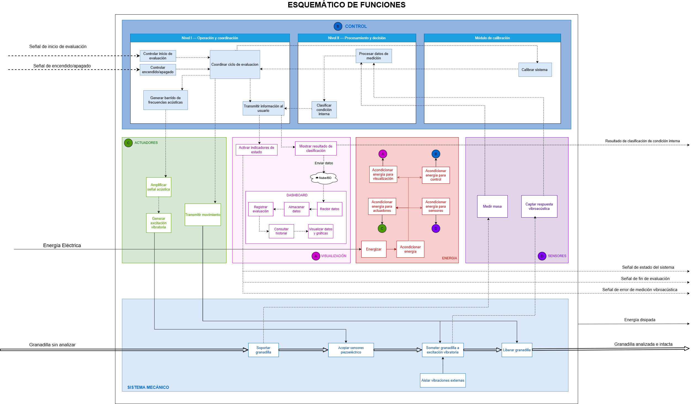](https://github.com/Cesarapcho/PI_Equipo_03/blob/main/Proyecto_Integrador/Talleres/TRL2/imagenes/Esquema_de_funciones_ultimo_2.png)

*Figura 4.1. Esquema de funciones de Ligura. Haz clic sobre la imagen para verla en tamaño completo.*

### 4.1 Módulo de soporte y medición de masa

El fruto se colocará en una cuna cóncava situada sobre el sistema de pesaje. La celda de carga y el HX711 permitirán obtener la masa antes de que los brazos establezcan contacto con la granadilla.

Esta secuencia busca evitar que las fuerzas ejercidas por la pinza alteren la lectura utilizada para caracterizar el fruto. La tara y la estabilidad del pesaje deberán verificarse durante las pruebas.

La estructura abierta permitirá el ingreso superior y el retiro de la granadilla al terminar la evaluación.

### 4.2 Módulo de sujeción y excitación

El servomotor accionará la pinza para aproximar sus dos brazos al fruto. Un FSR ubicado en uno de ellos proporcionará una lectura para supervisar el contacto y detener el cierre al alcanzar el umbral establecido.

Una vez alcanzada la condición de sujeción, se iniciará la excitación. El AD9833 generará la señal de frecuencia variable y el LM386 alimentará el piezoeléctrico emisor, que transmitirá la vibración a la granadilla.

El umbral de contacto y las condiciones de excitación se determinarán mediante pruebas de repetibilidad y observación de la cáscara.

### 4.3 Adquisición y procesamiento de datos

El piezoeléctrico receptor, situado en el brazo opuesto al emisor, registrará la respuesta vibratoria. El circuito con MCP6022 acondicionará la señal antes de su adquisición.

El ESP32 organizará las muestras y aplicará la FFT para obtener su representación en frecuencia. Se propone explorar características como la ubicación de los picos y la magnitud acumulada en determinadas bandas.

Cada registro se asociará al identificador de la granadilla y a su masa. En las pruebas posteriores, también se vinculará con la fotografía y la etiqueta visual obtenidas al abrir esa misma unidad.

### 4.4 Comunicación e interfaz web

El ESP32 proporcionará la comunicación prevista con el dashboard mediante Wi-Fi. La implementación deberá definir cómo se intercambian y conservan los datos de cada evaluación.

El diseño conceptual de la interfaz se elaboró en Figma y contempla la evaluación actual, el detalle de la medición, el historial y el estado del sistema.

Se distinguirá entre el estado operativo del ciclo y el resultado estimado del fruto. Un ciclo interrumpido deberá quedar identificado como medición inválida.

### 4.5 Visualización y señalización

El dashboard permitirá consultar el identificador de la granadilla, su masa, el estado del ciclo y la estimación cuando esté disponible. También se propone consultar el espectro y recuperar mediciones anteriores.

Los LED verde y rojo proporcionarán señalización local. Su correspondencia con los estados del equipo y los resultados deberá definirse de forma consistente con la interfaz y el programa de control.

Los mensajes de error indicarán la etapa afectada, como pesaje, sujeción o adquisición. Los datos utilizados para representar las pantallas en Figma se identificarán como «SIMULACIÓN».

### 4.6 Flujo conceptual del sistema

El siguiente diagrama representa las rutas de medición y las órdenes coordinadas por el ESP32. Las flechas continuas muestran la secuencia de evaluación y las discontinuas representan las órdenes de control.

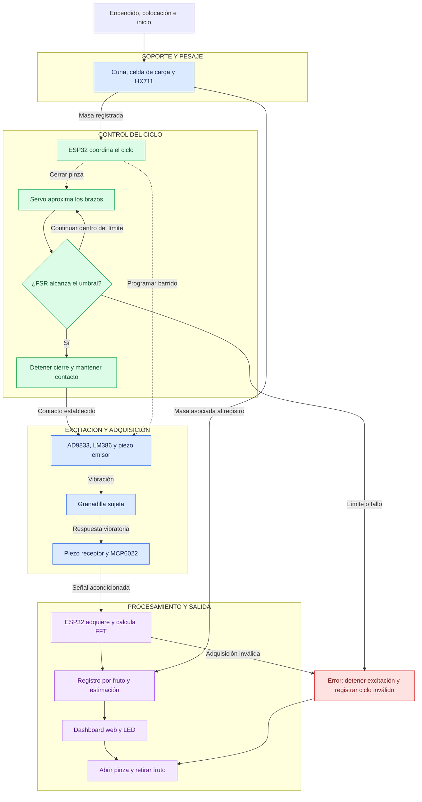

La estimación indicada en el flujo corresponde a la función que se pretende desarrollar y evaluar. Durante las primeras pruebas se registrarán la masa, la señal y el estado del ciclo para estudiar la repetibilidad y establecer el criterio de clasificación.

## 5. Evidencias de diseño conceptual

Las evidencias de diseño conceptual de Ligura comprenden la matriz morfológica, las alternativas de bocetado, el modelado tridimensional y el diseño electrónico preliminar. Estos elementos permiten representar la solución propuesta y la integración prevista de sus componentes mecánicos, electrónicos y de control.

### 5.1 Matriz morfológica

La matriz morfológica organiza las funciones principales de Ligura y las alternativas tecnológicas consideradas para resolverlas. Su elaboración permitió comparar opciones para el soporte del fruto, el pesaje, la sujeción, la excitación vibratoria, la adquisición de señales y la presentación de resultados.

[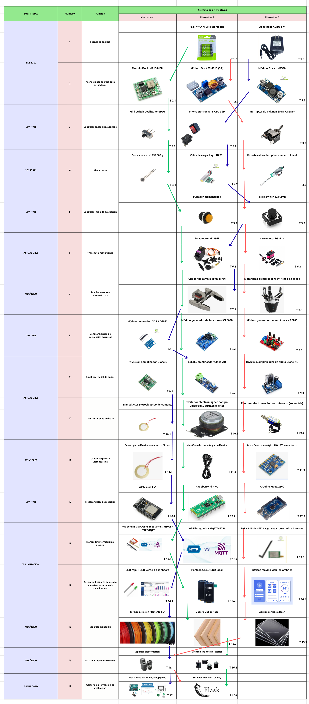](https://github.com/Cesarapcho/PI_Equipo_03/blob/main/Proyecto_Integrador/Entregables/imagenes/matriz_morfo_v4.png)

*Figura 5.1. Matriz morfológica de Ligura. Haz clic sobre la imagen para verla en tamaño completo.*

La configuración conceptual actual considera los siguientes componentes:

| Elemento | Componente seleccionado | Función |
|---|---|---|
| Control del sistema | ESP32 DevKit V1 | Coordinar el ciclo de evaluación, adquirir las señales y gestionar la comunicación con la interfaz web. |
| Apoyo del fruto | Cuna cóncava | Sostener la granadilla durante su colocación y evaluación. |
| Medición de masa | Celda de carga y módulo HX711 | Registrar la masa del fruto antes del cierre de la pinza. |
| Sujeción | Gripper accionado por servomotor | Aproximar los brazos y establecer el contacto con la granadilla. |
| Supervisión del contacto | Sensor resistivo FSR | Proporcionar una lectura de contacto para detener el cierre al alcanzar el umbral establecido. |
| Generación de señal | Módulo AD9833 | Generar la señal de excitación para el barrido de frecuencias. |
| Amplificación de excitación | Módulo LM386 | Amplificar la señal destinada al piezoeléctrico emisor. |
| Emisión de vibraciones | Transductor piezoeléctrico emisor | Aplicar la excitación vibratoria al fruto mediante contacto. |
| Recepción de vibraciones | Transductor piezoeléctrico receptor | Captar la respuesta vibratoria de la granadilla. |
| Acondicionamiento de señal | Circuito basado en MCP6022 | Acondicionar la señal del receptor para su adquisición por el ESP32. |
| Procesamiento | Análisis mediante FFT | Obtener la representación en frecuencia de la señal adquirida y extraer características para su posterior evaluación. |
| Alimentación | Adaptador AC/DC de 5 V y circuitos de alimentación | Suministrar energía a los componentes del sistema. |
| Encendido | Interruptor basculante | Permitir el encendido y apagado del equipo. |
| Inicio del ciclo | Botón físico | Permitir al usuario iniciar una evaluación. |
| Señalización | LED verde y LED rojo | Comunicar estados o resultados según la lógica de funcionamiento definida. |
| Visualización | Dashboard web | Mostrar el identificador del fruto, la masa, el estado del ciclo y el resultado estimado. |

La matriz documenta las alternativas consideradas durante la formulación de la solución. La tabla presenta la configuración conceptual actual de Ligura e incorpora el **LM386** como amplificador de excitación; esta selección actualiza cualquier alternativa previa de amplificación representada en la matriz.

La lectura del FSR se utilizará inicialmente como criterio de contacto. Su conversión a una fuerza expresada en newtons requerirá una calibración específica.

### 5.2 Bocetos conceptuales

Se desarrollaron tres bocetos para explorar la distribución de los componentes y la configuración física de Ligura. Las propuestas consideran el apoyo de la granadilla, la ubicación del mecanismo de sujeción, la disposición de los transductores y el alojamiento de la electrónica.

Los tres bocetos se presentan como evidencia del proceso de formulación y comparación de alternativas.

#### Boceto 1 — Alternativa evaluada

[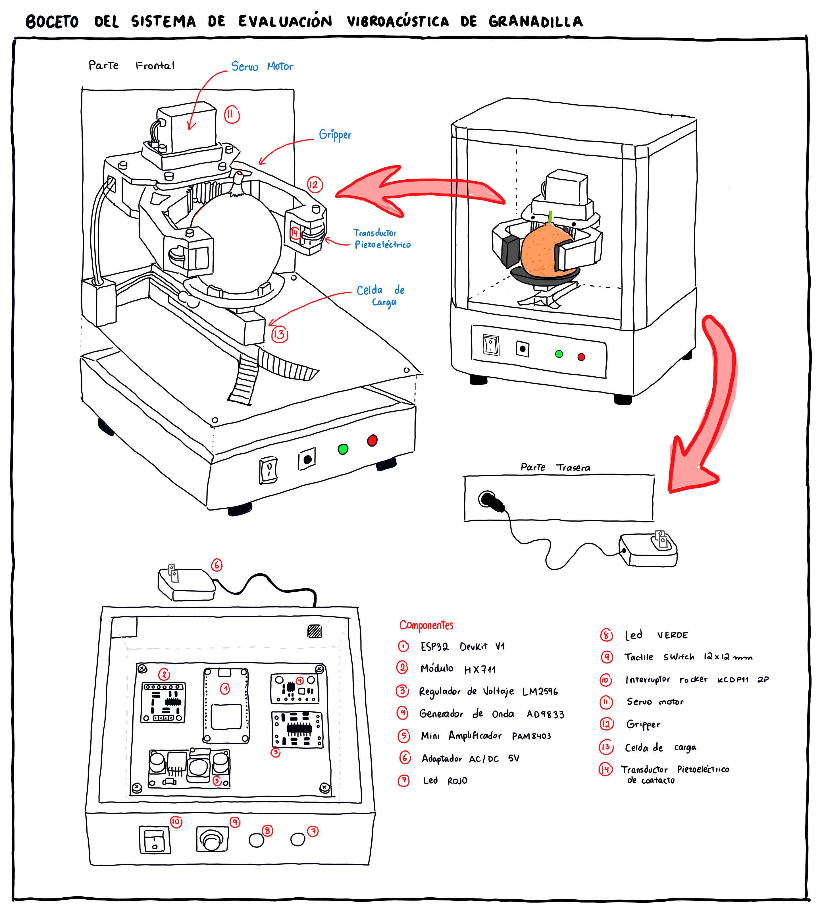](https://github.com/Cesarapcho/PI_Equipo_03/blob/main/Proyecto_Integrador/Talleres/TRL2/imagenes/1.boceto.png)

*Figura 5.2. Boceto 1 de Ligura: alternativa evaluada.*

#### Boceto 2 — Diseño conceptual seleccionado

[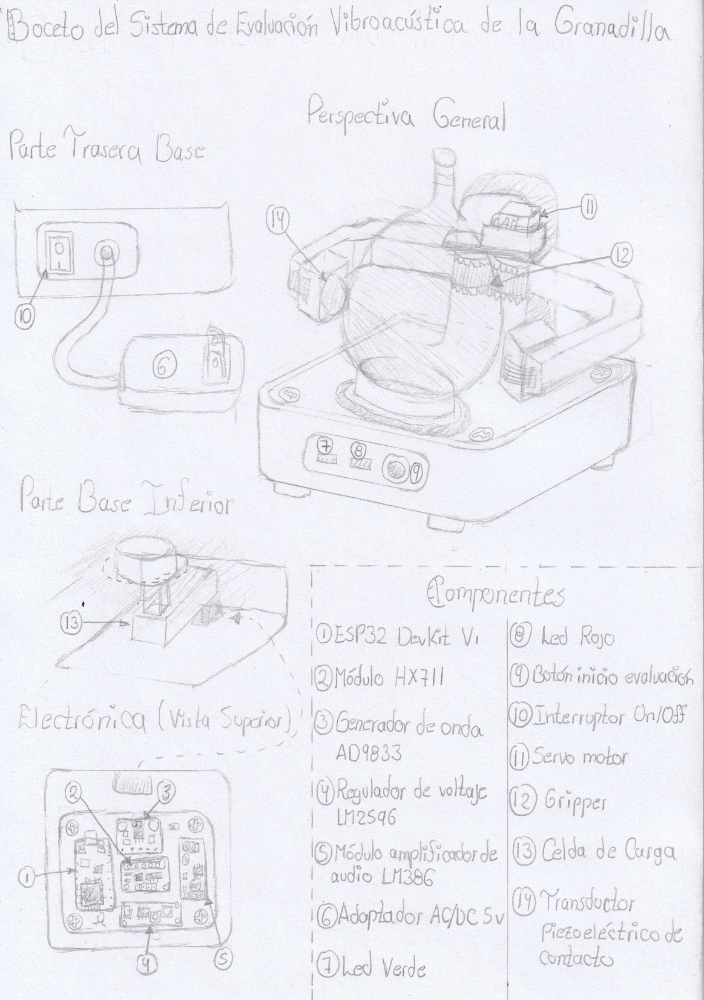](https://github.com/Cesarapcho/PI_Equipo_03/blob/main/Proyecto_Integrador/Talleres/TRL2/imagenes/2.boceto.png)

*Figura 5.3. Boceto 2 de Ligura: diseño conceptual seleccionado.*

#### Boceto 3 — Alternativa evaluada

[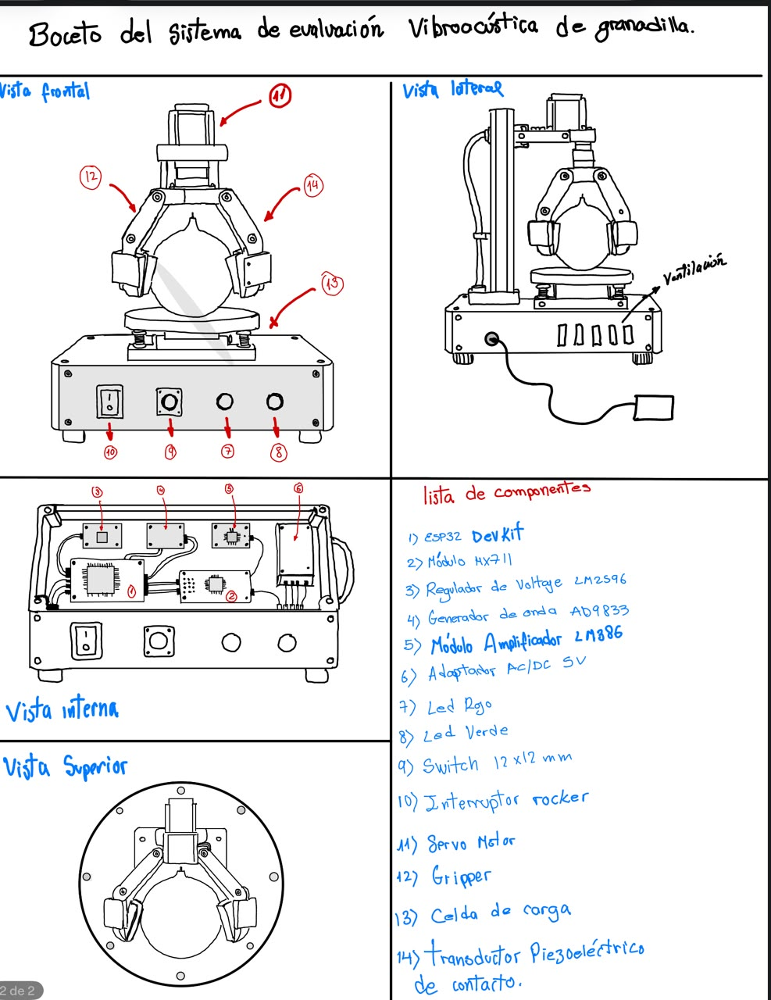](https://github.com/Cesarapcho/PI_Equipo_03/blob/main/Proyecto_Integrador/Talleres/TRL2/imagenes/boceto_3.jpg)

*Figura 5.4. Boceto 3 de Ligura: alternativa evaluada.*

Se seleccionó el **Boceto 2** como base para el desarrollo del diseño conceptual. La propuesta reúne una base para alojar la electrónica, un soporte de pesaje, una cuna de apoyo y un mecanismo de sujeción con transductores ubicados en brazos opuestos.

Esta disposición plantea el ingreso del fruto por la parte superior y el acceso al área de evaluación. Asimismo, permite organizar la secuencia de funcionamiento: colocar la granadilla, registrar su masa, establecer el contacto lateral, aplicar la excitación y adquirir la respuesta vibratoria.

La justificación conceptual de la selección se resume a continuación. La comparación describe la disposición de las propuestas; no asigna puntuaciones ni sustituye una evaluación experimental.

| Alternativa | Configuración planteada | Consideración para la selección |
|---|---|---|
| Boceto 1 | Estructura cerrada con los elementos de evaluación y electrónica integrados. | El cerramiento requiere resolver el acceso al fruto y a los elementos internos para inspección y ajuste. |
| **Boceto 2 — seleccionado** | Estructura abierta, mecanismo de sujeción visible y electrónica alojada en la base. | Se adopta como base por su acceso superior, la separación del área de evaluación respecto al alojamiento electrónico y el acceso al contacto lateral para montaje y ajuste. |
| Boceto 3 | Estructura vertical abierta, con el gripper sobre la granadilla y electrónica en la base inferior. | Plantea una disposición distinta del mecanismo que requiere definir su integración con el apoyo y el pesaje. |

La selección del Boceto 2 se refiere a la configuración mecánica. Los componentes electrónicos y los parámetros de operación se precisan mediante el diseño actual y las pruebas posteriores.

El diseño seleccionado se desarrolló posteriormente mediante modelado tridimensional. La estabilidad del conjunto, la repetibilidad del contacto y la ausencia de daño durante la sujeción deberán comprobarse experimentalmente.

### 5.3 Modelado 3D

Se elaboró un modelado tridimensional preliminar de Ligura en Onshape para representar el ensamble y la distribución física de sus principales componentes.

El modelo comprende la base, la placa superior, el soporte posterior, el mecanismo de sujeción y la cuna cóncava. Estas representaciones permiten examinar las relaciones de montaje y planificar la fabricación de las piezas.

#### Vista general del ensamble

[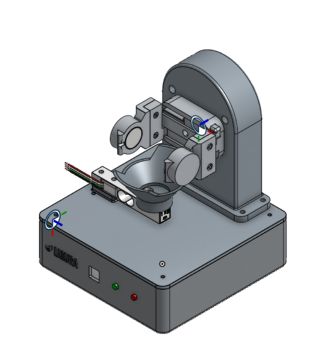](https://cad.onshape.com/documents/ff89f7bc2a25d26004de773a/w/684c83361a04b421324a0321/e/841d3118aa7f10e8925417ff)

*Figura 5.5. Vista general del ensamble conceptual de Ligura. Haz clic sobre la imagen para abrir el modelo 3D en Onshape.*

[**Abrir modelo 3D interactivo de Ligura en Onshape**](https://cad.onshape.com/documents/ff89f7bc2a25d26004de773a/w/684c83361a04b421324a0321/e/841d3118aa7f10e8925417ff)

El modelo puede explorarse en Onshape para girar la vista, acercar y alejar el ensamble, según los permisos de acceso del documento.

El ensamble muestra la cuna ubicada frente al soporte posterior y debajo de la pinza. La base contempla el alojamiento de la electrónica y la ubicación de los elementos de interacción con el usuario.

#### Placa superior de la base

[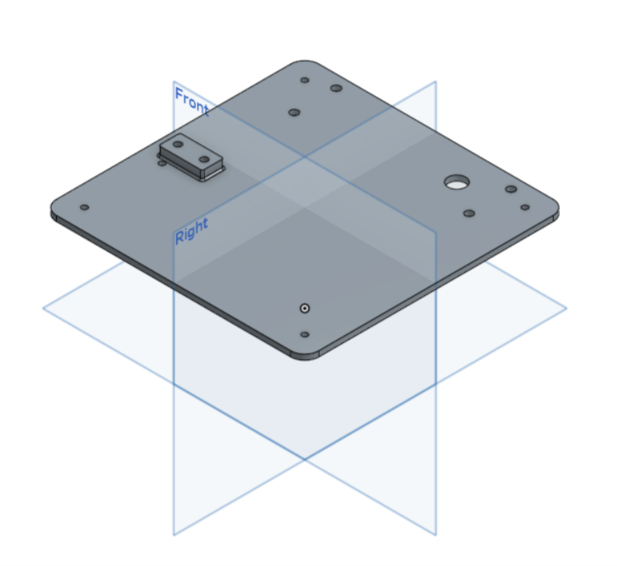](https://github.com/Cesarapcho/PI_Equipo_03/blob/main/Proyecto_Integrador/Talleres/TRL2/imagenes/07b-placa-superior-base.png)

*Figura 5.6. Placa superior de la base y puntos de montaje.*

La placa superior proporciona una superficie para montar el soporte posterior y los elementos asociados al apoyo y pesaje del fruto. Incluye perforaciones destinadas a la fijación y al paso de conexiones.

#### Mecanismo de sujeción

[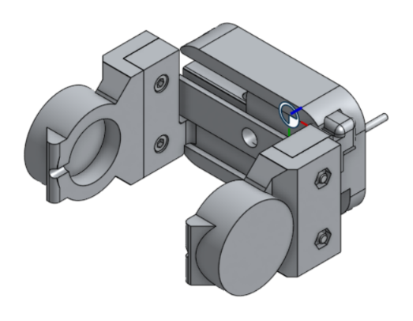](https://github.com/Cesarapcho/PI_Equipo_03/blob/main/Proyecto_Integrador/Talleres/TRL2/imagenes/07c-gripper.png)

*Figura 5.7. Modelo tridimensional del mecanismo de sujeción de la granadilla.*

La pinza contempla dos brazos opuestos para establecer el contacto lateral con el fruto. Se prevé ubicar el piezoeléctrico emisor en un brazo y el receptor en el otro, además del FSR para supervisar el contacto durante el cierre.

El recorrido de la pinza, el montaje de los sensores y el umbral de detención deberán ajustarse durante las pruebas posteriores.

#### Soporte posterior

[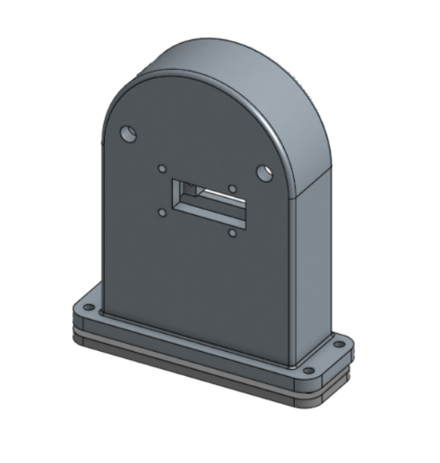](https://github.com/Cesarapcho/PI_Equipo_03/blob/main/Proyecto_Integrador/Talleres/TRL2/imagenes/07d-soporte-posterior.png)

*Figura 5.8. Soporte posterior del mecanismo de sujeción.*

El soporte posterior permite fijar el mecanismo de sujeción respecto a la base. Su configuración contempla puntos de montaje y una abertura para la integración del conjunto.

#### Cuna de apoyo

[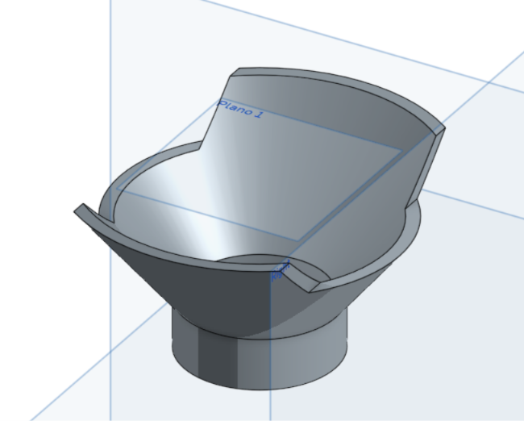](https://github.com/Cesarapcho/PI_Equipo_03/blob/main/Proyecto_Integrador/Talleres/TRL2/imagenes/07e-cuna-apoyo.png)

*Figura 5.9. Cuna cóncava para el apoyo de la granadilla.*

La cuna ofrece una superficie de apoyo para colocar el fruto antes del cierre de la pinza. Su integración con la celda de carga debe permitir que la masa se registre antes de aplicar la sujeción lateral.

El diseño tiene como restricciones una base máxima de **150 × 150 mm** y una altura máxima de **200 mm**. Su cumplimiento deberá documentarse mediante planos o vistas acotadas; las imágenes del modelo permiten observar la geometría, pero no verificar por sí solas estas dimensiones.

### 5.4 Diseño electrónico preliminar

El diseño electrónico preliminar de Ligura comprende los esquemáticos de sus subsistemas, la distribución de pistas de la placa de circuito impreso y su representación tridimensional.

La arquitectura considera un ESP32 para coordinar el pesaje, la sujeción, la generación de la excitación, la adquisición de la respuesta y la comunicación con la interfaz web.

#### Excitación y recepción piezoeléctrica

[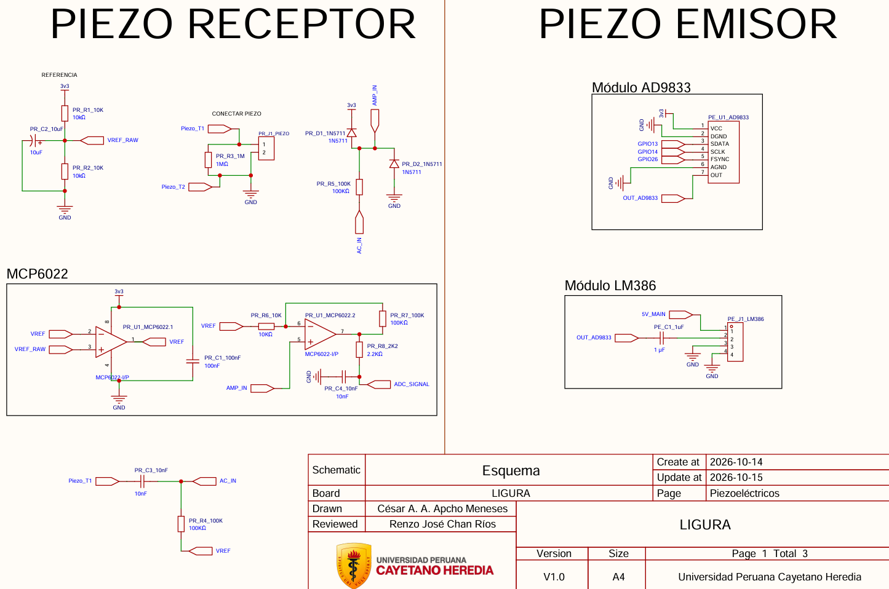](https://github.com/Cesarapcho/PI_Equipo_03/blob/main/Proyecto_Integrador/Talleres/TRL2/imagenes/07a-piezoelectricos.png)

*Figura 5.10. Esquemático preliminar de excitación y recepción piezoeléctrica.*

La etapa emisora considera el módulo AD9833 como generador de señal y el LM386 como amplificador para excitar el transductor piezoeléctrico.

La etapa receptora contempla la conexión del segundo piezoeléctrico y un circuito de acondicionamiento basado en MCP6022. El diseño incluye una referencia de tensión, acoplamiento de señal y elementos de protección y filtrado para preparar la señal destinada a la adquisición.

La ganancia, el ancho de banda y los niveles de tensión deberán verificarse antes de conectar la salida al convertidor analógico-digital del ESP32.

#### Pesaje, control y señalización

[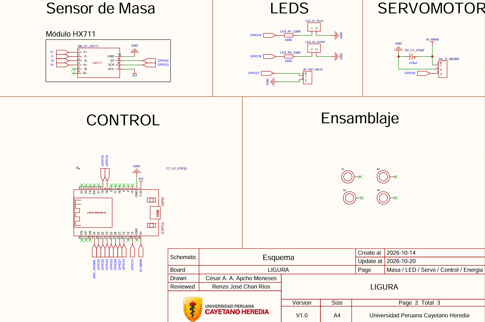](https://github.com/Cesarapcho/PI_Equipo_03/blob/main/Proyecto_Integrador/Talleres/TRL2/imagenes/07b-pesaje-control.png)

*Figura 5.11. Esquemático preliminar de pesaje, control, servomotor y señalización.*

Este esquema contempla la conexión de la celda de carga mediante el módulo HX711, el ESP32, el servomotor, el botón de inicio y los indicadores LED.

El ESP32 coordinará el registro de masa antes de la sujeción y el accionamiento del servomotor durante el establecimiento del contacto. También gestionará los estados del ciclo y la señalización correspondiente.

#### Alimentación y sensor FSR

[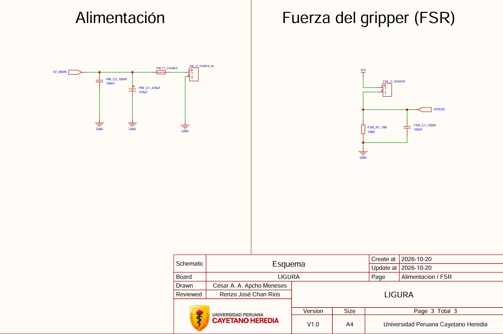](https://github.com/Cesarapcho/PI_Equipo_03/blob/main/Proyecto_Integrador/Talleres/TRL2/imagenes/07c-alimentacion-fsr.png)

*Figura 5.12. Esquemático preliminar de alimentación y conexión del sensor FSR.*

La etapa de alimentación contempla la entrada de energía, un fusible y condensadores de filtrado. La conexión del FSR utiliza un divisor resistivo para obtener una señal que pueda leer el ESP32.

Esta lectura permitirá definir un umbral para detener el cierre de la pinza. Dicho umbral deberá determinarse mediante pruebas de contacto y repetibilidad con granadillas.

#### Distribución de pistas de la PCB

[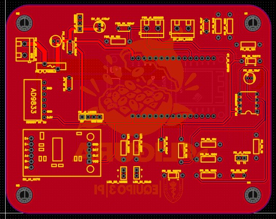](https://github.com/Cesarapcho/PI_Equipo_03/blob/main/Proyecto_Integrador/Talleres/TRL2/imagenes/10e-pcb-diseno-pistas.jpeg)

*Figura 5.13. Diseño preliminar de pistas y distribución de componentes de la PCB de Ligura.*

La distribución de la PCB representa la ubicación prevista de los componentes, los conectores y las pistas que vinculan los subsistemas.

Antes de su fabricación, deberá comprobarse la correspondencia con los esquemáticos, la asignación de pines, las dimensiones de las huellas y los espacios necesarios para montar los módulos. También deberá revisarse el recorrido de alimentación y de las señales analógicas para reducir posibles interferencias.

#### Representación tridimensional de la PCB

[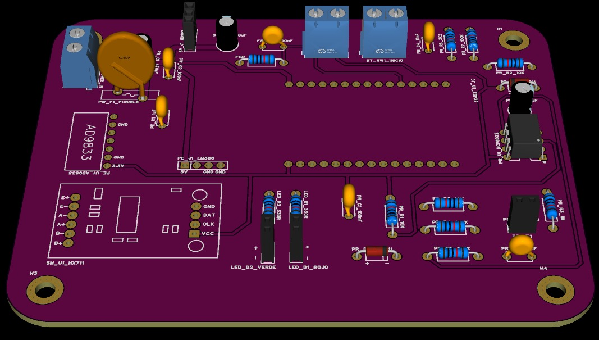](https://cesarapcho.github.io/PCB-GitHub-Pages/)

*Figura 5.14. Representación tridimensional de la PCB de Ligura con los componentes modelados. Haz clic sobre la imagen para abrir el visor interactivo.*

[**Abrir diseño interactivo de la PCB de Ligura**](https://cesarapcho.github.io/PCB-GitHub-Pages/)

El visor publicado en GitHub Pages permite girar el modelo, acercar y alejar la vista y examinar la distribución tridimensional de la placa y los componentes representados. Se utiliza arrastrando para rotar, la rueda del ratón para ajustar el zoom y el clic derecho para desplazar la vista.

La vista tridimensional permite examinar la disposición de los componentes representados, los conectores y los orificios de fijación. Algunos módulos aparecen mediante sus posiciones de montaje, por lo que deberá considerarse su volumen real al comprobar el alojamiento dentro de la base.

Los esquemáticos, el trazado y la vista 3D constituyen evidencias del diseño preliminar. La comprobación del funcionamiento eléctrico y de la integración con el mecanismo se realizará en las siguientes etapas de desarrollo.

### 5.5 Diseño conceptual del dashboard

Se elaboró un diseño conceptual del dashboard de Ligura en Figma para representar la consulta de las evaluaciones, la visualización de las señales y la supervisión del equipo.

La interfaz comprende cuatro pantallas: evaluación de granadilla, detalle del fruto, historial de evaluaciones y estado del equipo. Las pantallas cuentan con navegación entre ellas y elementos editables.

El diseño utiliza fondo crema, naranja, azul petróleo y títulos oscuros, siguiendo la identidad visual de la presentación del proyecto.

[Consultar el diseño editable del dashboard en Figma](https://www.figma.com/design/PDqMWSpBy16A39IbHWTqc9?node-id=3-138).

Todas las pantallas incluyen el aviso **«Simulación — datos de ejemplo»**. Los valores, gráficos y estados presentados son ilustrativos y no corresponden a mediciones experimentales.

#### 5.5.1 Evaluación de granadilla

La pantalla principal presenta la información general de la evaluación de un fruto:

- Identificador de la granadilla.
- Masa registrada en gramos antes de la sujeción lateral.
- Estado del ciclo de evaluación.
- Secuencia de pesaje, sujeción, excitación, adquisición, procesamiento y liberación.
- Resultado estimado.
- Fecha y hora del registro.
- Estado de la inspección interna de referencia.

La maqueta muestra un ciclo finalizado y una adquisición válida como escenario de ejemplo. El resultado permanece como **«Pendiente de validación»**, debido a que todavía debe comprobarse la relación entre las características de la señal y la condición interna del fruto.

También se incluyen accesos al detalle de la evaluación y al historial. El inicio del ciclo se plantea mediante el botón físico del equipo.

[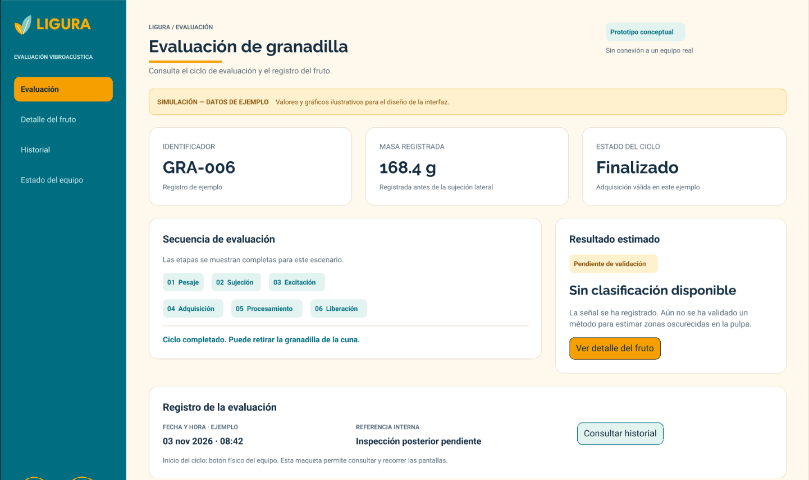](https://github.com/Cesarapcho/PI_Equipo_03/blob/main/Proyecto_Integrador/Talleres/TRL2/imagenes/11-figma-evaluacion.png)

*Figura 5.15. Diseño conceptual de la pantalla de evaluación de Ligura. Simulación con datos de ejemplo.*

#### 5.5.2 Detalle del fruto

La segunda pantalla permite representar la consulta de la información asociada a una granadilla seleccionada.

Incluye la masa, el estado de la adquisición y el estado de la estimación. Asimismo, presenta dos gráficos ilustrativos:

- **Respuesta en el tiempo:** amplitud expresada en cuentas del convertidor analógico-digital frente al tiempo en milisegundos.
- **Espectro de magnitud mediante FFT:** magnitud en unidades arbitrarias frente a la frecuencia en hercios.

Estos gráficos representan el tipo de información que se espera consultar durante el desarrollo experimental. El rango de frecuencias mostrado es ilustrativo y deberá definirse mediante pruebas.

La pantalla también contempla una sección de referencia de la condición interna. Durante la validación, se propone abrir cada fruto después de su medición y registrar fotografías de la pulpa, junto con una etiqueta de presencia o ausencia de zonas oscurecidas visibles.

La observación interna de referencia se mantendrá separada del resultado estimado por el sistema para permitir su comparación.

[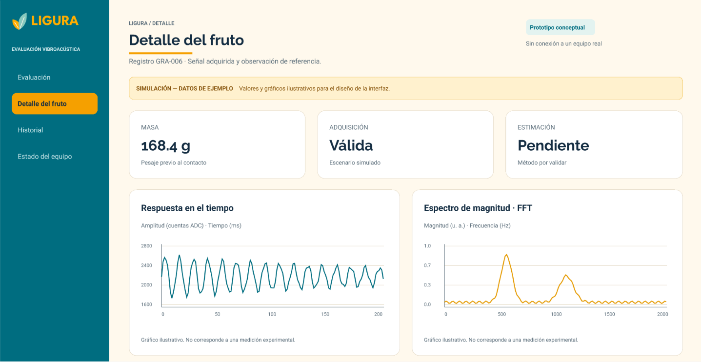](https://github.com/Cesarapcho/PI_Equipo_03/blob/main/Proyecto_Integrador/Talleres/TRL2/imagenes/12-figma-detalle.png)

*Figura 5.16. Diseño conceptual de la pantalla de detalle del fruto y visualización de señales. Gráficos ilustrativos.*

#### 5.5.3 Historial de evaluaciones

La pantalla de historial presenta una tabla de registros que permite identificar las evaluaciones realizadas y consultar su detalle.

La tabla contempla los siguientes campos:

| Campo | Información presentada |
|---|---|
| Fruto | Identificador de la granadilla. |
| Fecha y hora | Momento de realización de la evaluación. |
| Masa | Valor registrado en gramos. |
| Estado | Ciclo finalizado o inválido. |
| Resultado estimado | Estimación disponible, pendiente de validación o sin resultado. |
| Detalle | Acceso a la evaluación o al evento correspondiente. |

La maqueta incluye seis registros de ejemplo y diferencia visualmente un ciclo inválido. Este registro se conserva para mantener la trazabilidad, pero no se interpreta como un resultado sobre la condición interna de la granadilla.

Se representan controles de búsqueda por identificador y filtrado por fecha y estado. Su funcionamiento y la exportación de datos se contemplan para la implementación posterior.

[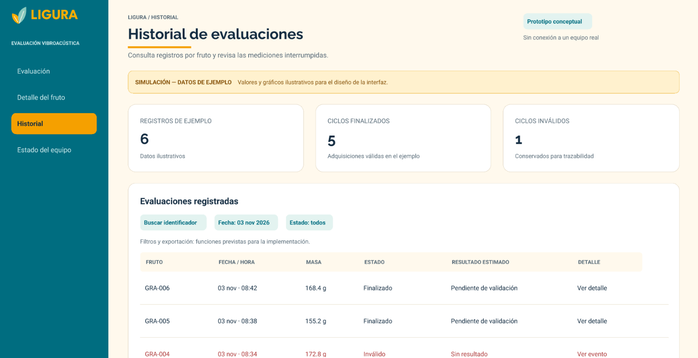](https://github.com/Cesarapcho/PI_Equipo_03/blob/main/Proyecto_Integrador/Talleres/TRL2/imagenes/13-figma-historial.png)

*Figura 5.17. Diseño conceptual del historial de evaluaciones de Ligura. Registros simulados.*

#### 5.5.4 Estado del equipo y eventos

La cuarta pantalla representa la supervisión del equipo mediante un escenario de interrupción por contacto insuficiente durante la sujeción.

La interfaz muestra:

- Estado de comunicación.
- Estado del ciclo.
- Lectura normalizada del FSR.
- Umbral de contacto ilustrativo.
- Mensaje de acción requerida.
- Registro cronológico de eventos.

En el ejemplo, la lectura del FSR no alcanza el umbral dentro del límite configurado. La interfaz presenta el ciclo como **«Interrumpido»**, identifica la evaluación como inválida e indica que debe revisarse la colocación del fruto antes de repetirla.

La lectura normalizada y el umbral mostrados son valores de ejemplo, sin unidad. No representan una fuerza calibrada en newtons.

El registro de eventos permite seguir la secuencia desde el inicio y la sujeción hasta la interrupción. Los mensajes describen la condición observada sin atribuir automáticamente el problema a un sensor averiado.

[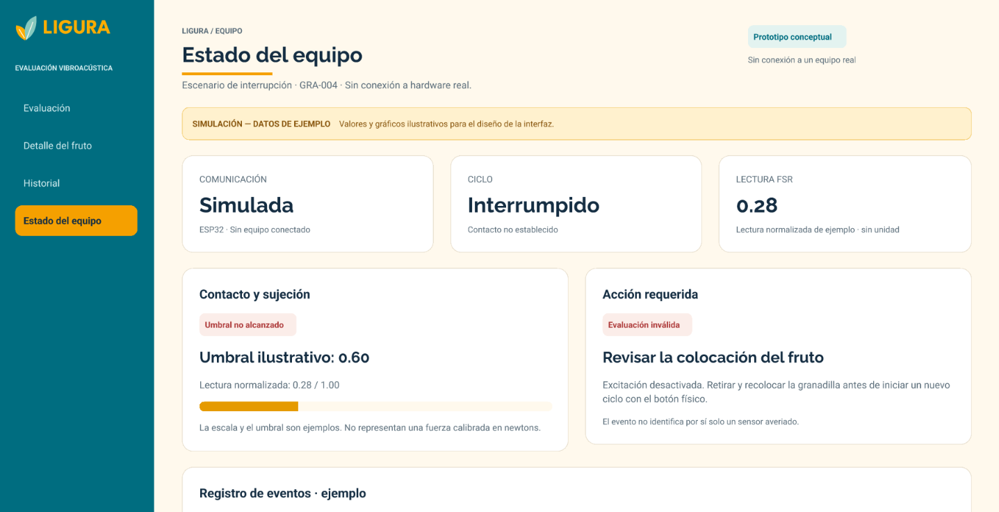](https://github.com/Cesarapcho/PI_Equipo_03/blob/main/Proyecto_Integrador/Talleres/TRL2/imagenes/14-figma-estado.png)

*Figura 5.18. Diseño conceptual de la pantalla de estado del equipo y registro de eventos. Escenario simulado de interrupción.*

El diseño en Figma constituye una evidencia de la propuesta de interacción y visualización de Ligura. La conexión con el ESP32, el almacenamiento de mediciones, el procesamiento de señales y la presentación de resultados reales se implementarán y verificarán en etapas posteriores.

## 6. Requisitos conceptuales

A partir del concepto tecnológico de Ligura, se establecen los siguientes requisitos para orientar su implementación y posterior evaluación experimental.

Los requisitos describen el comportamiento esperado del sistema. Su cumplimiento deberá comprobarse durante las siguientes etapas de desarrollo.

### 6.1 Colocación y soporte de la granadilla

El sistema deberá permitir la colocación y el retiro de una granadilla mediante acceso superior.

La estructura deberá incorporar una cuna cóncava que proporcione apoyo al fruto y permita su posicionamiento frente al mecanismo de sujeción.

El diseño deberá respetar las siguientes restricciones geométricas:

- Base máxima de 150 × 150 mm.
- Altura máxima de 200 mm.
- Estructura abierta con acceso al área de evaluación.

Estas dimensiones deberán verificarse mediante planos acotados y mediciones del conjunto fabricado.

### 6.2 Medición de masa

El sistema deberá registrar la masa de la granadilla mediante una celda de carga conectada al módulo HX711.

La medición se realizará antes del cierre de la pinza, para evitar que las fuerzas de sujeción lateral alteren el registro.

La masa deberá expresarse en gramos y quedar asociada al identificador del fruto. Su utilización como variable de ajuste o normalización se evaluará durante el análisis experimental.

### 6.3 Sujeción y supervisión del contacto

El mecanismo de sujeción deberá aproximar los brazos del gripper mediante un servomotor y establecer el contacto entre el fruto y los transductores.

El FSR ubicado en uno de los brazos deberá proporcionar una lectura para detener el cierre cuando se alcance el umbral establecido.

El control deberá contemplar un límite de recorrido o tiempo de cierre. Si el contacto no se establece dentro de ese límite, el ciclo deberá interrumpirse y registrarse como inválido.

El umbral del FSR deberá determinarse experimentalmente. Su lectura no se interpretará como una fuerza en newtons sin una calibración específica.

### 6.4 Excitación vibratoria

El sistema deberá generar una señal de excitación mediante el módulo AD9833 y amplificarla mediante el LM386 para accionar el piezoeléctrico emisor.

El barrido deberá contar con parámetros definidos y registrados:

- Frecuencia inicial y final.
- Incremento o velocidad del barrido.
- Duración.
- Nivel de excitación utilizado.

Estos parámetros se establecerán mediante pruebas de señal y respuesta del conjunto. Los valores ilustrativos del dashboard no constituyen parámetros definitivos de operación.

La excitación solo deberá comenzar después de establecer el contacto previsto con el fruto.

### 6.5 Recepción y adquisición de señales

El piezoeléctrico receptor deberá captar la respuesta vibratoria del fruto. La señal deberá acondicionarse mediante el circuito basado en MCP6022 antes de su adquisición por el ESP32.

La etapa de adquisición deberá considerar:

- Compatibilidad de los niveles eléctricos con la entrada del ESP32.
- Frecuencia de muestreo suficiente para el intervalo de frecuencias estudiado.
- Filtrado y control de componentes fuera de la banda de interés.
- Detección de saturación, señal ausente o adquisición incompleta.
- Registro de los parámetros de muestreo.

La señal y los parámetros utilizados deberán asociarse al mismo identificador del fruto.

### 6.6 Procesamiento y estimación

El sistema deberá permitir el análisis de la señal mediante FFT para obtener su representación en frecuencia.

Se evaluarán características como la ubicación y magnitud de los picos espectrales y la distribución de la respuesta en bandas de frecuencia. La selección definitiva dependerá de la calidad de las señales y de los resultados experimentales.

El desarrollo posterior deberá estudiar si estas características, junto con la masa y las condiciones de contacto, permiten estimar la presencia o ausencia de zonas oscurecidas visibles en la pulpa.

Mientras no exista un método validado, el resultado deberá mostrarse como **«Pendiente de validación»**. Una adquisición inválida deberá presentarse como **«Sin resultado»**.

### 6.7 Visualización y trazabilidad

El dashboard deberá permitir consultar:

- Identificador del fruto.
- Masa registrada.
- Fecha y hora de evaluación.
- Estado del ciclo.
- Señal adquirida y representación en frecuencia.
- Resultado estimado, cuando esté disponible.
- Observaciones y eventos de la evaluación.

Cada registro deberá conservar la relación entre el fruto, la señal, las condiciones de adquisición y la observación interna de referencia.

Las interfaces que utilicen datos ilustrativos deberán mantener visible la etiqueta **«Simulación — datos de ejemplo»**.

### 6.8 Alimentación, señalización y gestión de errores

El sistema deberá alimentarse mediante el adaptador AC/DC de 5 V y los circuitos de alimentación definidos en el diseño electrónico.

Deberá contar con interruptor de encendido, botón de inicio e indicadores LED. El significado de los indicadores deberá documentarse y mantenerse coherente con los mensajes del dashboard.

Ante un error de sujeción, adquisición o procesamiento, el sistema deberá:

1. Interrumpir la excitación.
2. Ejecutar la secuencia de detención y liberación que se defina para el mecanismo.
3. Identificar el ciclo como interrumpido o inválido.
4. Registrar el evento.
5. Informar al usuario de la acción necesaria antes de repetir la evaluación.

### 6.9 Mantenimiento y repetibilidad

El diseño deberá permitir el acceso a los componentes electrónicos, las conexiones, la celda de carga, los transductores y el mecanismo de sujeción.

Se deberá facilitar la limpieza de las superficies de contacto y la inspección de las piezas mecánicas.

La repetibilidad se evaluará mediante mediciones sucesivas del mismo fruto, incluyendo su retiro y recolocación. También deberá comprobarse que la sujeción y la excitación no produzcan daño observable bajo las condiciones ensayadas.

## 7. Análisis de patentabilidad y protección

### 7.1 Búsqueda de antecedentes relacionados

Se realizó una revisión preliminar de documentos de patente relacionados con la evaluación no destructiva de frutos mediante vibraciones.

La búsqueda se orientó a identificar tecnologías que incorporan sujeción del fruto, excitación controlada, recepción de señales, análisis en frecuencia y medición de masa.

| Elemento | Descripción |
|---|---|
| Fecha de revisión | 3 de noviembre de 2026. |
| Fuente de documentos | Google Patents. |
| Orientación sobre patentabilidad | Información de la Organización Mundial de la Propiedad Intelectual — OMPI. |
| Consultas utilizadas | `fruit vibration piezoelectric gripper force sensor` y `fruit firmness vibration weight resonance`. |
| Documentos examinados | US5691473A, US6276536B1 y CN118746544B. |
| Criterio de selección | Relación directa con la sujeción, excitación, recepción vibratoria y análisis de propiedades del fruto. |

La revisión comprendió los resúmenes y las partes pertinentes de las descripciones y reivindicaciones. Su alcance es exploratorio y no constituye una búsqueda exhaustiva.

#### US5691473A

La patente *Method and equipment for measuring firmness of fruits and vegetables* describe la sujeción del fruto en puntos opuestos, la aplicación de vibraciones y la medición de señales de aceleración para calcular un índice de firmeza [4].

Es relevante para Ligura porque muestra antecedentes del contacto opuesto y la evaluación vibratoria de frutos.

#### US6276536B1

La patente *Method of measuring ripeness and texture of vegetable or fruit and measuring instrument* combina excitación con frecuencias variables, análisis de la respuesta y medición del peso para obtener parámetros relacionados con madurez y textura [5].

Este documento evidencia que la asociación entre masa y comportamiento vibratorio ya se ha considerado en tecnologías anteriores.

#### CN118746544B

La patente *Vibration sensing manipulator for fruit quality detection and detection method* describe una pinza con elementos piezoeléctricos de excitación y recepción en dedos opuestos. También incorpora sensores resistivos de presión y una secuencia de cierre hasta alcanzar un umbral antes de aplicar un barrido sinusoidal [6].

Su descripción incluye la evaluación de diferencias de pardeamiento interno en peras. Es el antecedente más cercano entre los documentos examinados.

### 7.2 Comparación con Ligura

| Antecedente | Coincidencia con Ligura | Aspecto que debe examinarse |
|---|---|---|
| US5691473A [4] | Sujeción opuesta y excitación vibratoria. | Diferencias entre su método de aceleraciones y el procedimiento de adquisición propuesto. |
| US6276536B1 [5] | Análisis en frecuencia asociado a la masa del fruto. | Diferencias entre sus parámetros de evaluación y las características que se investigarán en granadilla. |
| CN118746544B [6] | Piezoeléctricos opuestos, supervisión del contacto y barrido posterior a la sujeción. | Coincidencias del montaje y de la secuencia de contacto y medición. |

La comparación indica que el uso de piezoeléctricos, FFT, masa o sensores de contacto no permite afirmar por sí solo una novedad tecnológica.

En particular, incorporar un FSR no constituye una diferencia suficiente frente al antecedente CN118746544B. La aplicación a granadilla tampoco demuestra por sí sola que el mecanismo sea nuevo.

### 7.3 Elemento técnico que merece evaluación

Se propone examinar la configuración concreta formada por la cuna vinculada al sistema de pesaje, el soporte posterior y el mecanismo que establece el contacto lateral después de registrar la masa.

La característica por investigar es si esta disposición permite conservar una posición de medición repetible y reducir la influencia de la sujeción sobre el pesaje y la respuesta adquirida.

Para sustentar una posible diferencia será necesario documentar:

- Geometría y relaciones de montaje.
- Secuencia de pesaje y establecimiento del contacto.
- Condiciones de apoyo durante la adquisición.
- Diferencias frente a las reivindicaciones de los antecedentes.
- Efecto técnico observado mediante pruebas comparativas.

Este planteamiento es una línea de evaluación y no una conclusión de patentabilidad.

### 7.4 Evaluación preliminar y documentación

La OMPI identifica entre las condiciones centrales de patentabilidad la novedad, la actividad inventiva y la aplicación industrial [7].

| Criterio | Situación preliminar de Ligura |
|---|---|
| Novedad | Pendiente de establecer; se identificaron antecedentes cercanos. |
| Actividad inventiva | Pendiente de demostrar una diferencia técnica que no resulte evidente frente a los antecedentes. |
| Aplicación industrial | Se plantea su uso en evaluación poscosecha; su funcionamiento todavía requiere validación. |

Se conservarán versiones de los diseños CAD, esquemáticos, PCB, programas, protocolos y resultados, con identificación de autores y fechas.

La conclusión actual es que **no se ha establecido la patentabilidad de Ligura**. Una evaluación posterior deberá ampliar la búsqueda y comparar las reivindicaciones con la solución finalmente desarrollada.

## 8. Perfil del proyecto Ligura

### 8.1 Problema

La inspección externa de una granadilla permite observar su apariencia, pero no muestra directamente el estado de la pulpa.

La apertura del fruto permite examinar su interior, aunque impide conservar intacta la unidad inspeccionada. Esto plantea la necesidad de investigar métodos que obtengan información relacionada con su condición interna antes de abrirlo.

Ligura aborda este problema mediante el estudio de la respuesta vibratoria de granadillas intactas. La condición inicial de interés será la presencia o ausencia de zonas oscurecidas visibles en la pulpa.

### 8.2 Objetivo general

Formular el concepto tecnológico de Ligura como un sistema mecatrónico de evaluación no destructiva de granadilla mediante pesaje, sujeción supervisada y análisis de la respuesta vibratoria, orientado a investigar su relación con la presencia o ausencia de zonas oscurecidas visibles en la pulpa.

### 8.3 Objetivos específicos

- Sustentar el concepto mediante antecedentes científicos y tecnológicos relacionados.
- Definir la arquitectura mecánica, electrónica y de control.
- Plantear el registro de masa previo a la sujeción lateral.
- Establecer una estrategia de contacto mediante servomotor y lectura del FSR.
- Proponer la cadena de excitación, recepción y acondicionamiento de señales.
- Definir el análisis en frecuencia y la asociación de cada señal con su fruto.
- Diseñar la interfaz conceptual para consultar evaluaciones y eventos.
- Identificar antecedentes de patente y aspectos que requieren comparación.
- Formular el procedimiento inicial de prueba de concepto.

### 8.4 Usuarios y beneficiarios

Los usuarios potenciales son responsables de selección poscosecha, personal técnico e investigadores interesados en evaluar granadillas mediante métodos no destructivos.

Si el método demuestra utilidad, podría aportar información complementaria para apoyar decisiones de selección. Este beneficio dependerá de su desempeño experimental y de su viabilidad de uso.

### 8.5 Propuesta tecnológica e hipótesis

Ligura se plantea como un equipo de sobremesa con una cuna cóncava, celda de carga, pinza accionada por servomotor, FSR y dos transductores piezoeléctricos.

La excitación se generará mediante AD9833 y LM386. La respuesta se acondicionará mediante MCP6022 y será adquirida por el ESP32 para su análisis y presentación en el dashboard.

La hipótesis de trabajo es que, bajo condiciones de adquisición y contacto suficientemente repetibles, algunas características de la respuesta vibratoria podrían diferir entre granadillas con y sin zonas oscurecidas visibles en la pulpa.

Esta hipótesis deberá contrastarse con la inspección del mismo fruto después de abrirlo.

### 8.6 Resultados esperados

Como productos del TRL 2 se consideran:

- Concepto tecnológico y aplicación definidos.
- Arquitectura conceptual y flujo de funcionamiento.
- Matriz morfológica y selección de componentes.
- Tres bocetos, con el Boceto 2 identificado como seleccionado.
- Modelado tridimensional preliminar.
- Esquemáticos y diseño preliminar de PCB.
- Dashboard conceptual editable en Figma.
- Requisitos de funcionamiento y trazabilidad.
- Análisis preliminar de antecedentes de patente.
- Propuesta de prueba de concepto.

Estos productos orientan el desarrollo posterior; no constituyen evidencia de una capacidad de clasificación ya demostrada.

### 8.7 Alcance y limitaciones

El TRL 2 comprende la formulación y representación de la solución, su sustento documental y la planificación de la evaluación experimental.

Todavía no se han establecido:

- Precisión y repetibilidad del pesaje.
- Umbral de contacto y condiciones de sujeción sin daño.
- Intervalo útil de excitación.
- Calidad y repetibilidad de la señal adquirida.
- Características que permitan diferenciar la condición interna.
- Exactitud de un posible método de clasificación.
- Funcionamiento del dashboard con mediciones reales.

La propuesta no incluye una medición directa de °Brix, pH o inocuidad. Su condición inicial de estudio se limita a la observación de zonas oscurecidas en la pulpa.

### 8.8 Continuidad hacia la prueba de concepto

La siguiente etapa deberá evaluar los principios críticos antes de concluir que el sistema puede estimar una condición interna.

| Actividad | Evidencia prevista |
|---|---|
| Comprobar pesaje y adquisición | Registros de calibración, señales de prueba y parámetros utilizados. |
| Evaluar sujeción y contacto | Lecturas del FSR, repetición del cierre y observación de daño. |
| Evaluar excitación y recepción | Señales obtenidas con diferentes parámetros y control de saturación. |
| Medir frutos intactos | Registros identificados de masa, señal y condiciones de medición. |
| Abrir los mismos frutos | Fotografías y etiquetas de la condición interna observada. |
| Comparar grupos y repeticiones | Análisis de variabilidad y de posibles diferencias entre condiciones. |

El protocolo deberá definir previamente el número de frutos, las repeticiones y las condiciones de conservación y medición.

Antes de recolectar los datos, se establecerá un criterio visual para distinguir la coloración normal de la pulpa de las zonas consideradas oscurecidas. Se documentará qué región del interior se observa y cómo se asigna la etiqueta de presencia o ausencia. Las fotografías se tomarán bajo condiciones de iluminación y encuadre comparables y se conservarán asociadas al identificador del fruto.

El registro de referencia incluirá la persona que realizó la observación y las dudas o desacuerdos de etiquetado. Los casos ambiguos se identificarán por separado, evitando forzar su inclusión en una de las dos clases.

Las repeticiones de una misma granadilla deberán mantenerse juntas al separar datos de desarrollo y evaluación, para evitar que el mismo fruto aparezca en ambos conjuntos.

Si no se obtienen señales repetibles o diferencias suficientes, se revisarán las condiciones de contacto, el montaje y el procedimiento antes de avanzar hacia una clasificación.

## 9. Cumplimiento de indicadores del TRL 2

El documento organiza las evidencias de Ligura alrededor de los tres indicadores principales considerados para esta etapa.

| Indicador del TRL 2 | Evidencia presentada | Ubicación |
|---|---|---|
| Artículos científicos publicados que respalden o tengan relación directa con la propuesta tecnológica. | Antecedentes sobre respuesta acústica, evaluación vibratoria de frutos y caracterización de granadilla [1]–[3]. Se identifican sus aportes y límites para la propuesta. | Apartado 2 y referencias. |
| Análisis de patentabilidad y protección. | Búsqueda preliminar, comparación de tres documentos de patente y delimitación del elemento técnico que requiere evaluación. | Apartado 7. |
| Perfil o propuesta de proyecto. | Problema, objetivos, usuarios, propuesta tecnológica, resultados esperados, alcance y continuidad experimental. | Apartado 8. |

Los apartados 3 al 6 complementan estas evidencias mediante la formulación del concepto, la arquitectura, las representaciones de diseño y los requisitos.

La evidencia corresponde a una formulación tecnológica sustentada. La demostración experimental de sus funciones críticas se desarrollará en la prueba de concepto posterior.

## 10. Conclusión

Durante el TRL 2 se formuló el concepto tecnológico de Ligura como una propuesta de evaluación no destructiva de granadilla mediante excitación vibratoria controlada y análisis de su respuesta.

La arquitectura contempla el pesaje previo a la sujeción, el establecimiento del contacto mediante un gripper supervisado por FSR, la excitación con AD9833 y LM386, la recepción piezoeléctrica y el acondicionamiento de la señal para su adquisición por el ESP32.

Se desarrollaron representaciones del diseño mecánico y electrónico, se identificó el Boceto 2 como alternativa seleccionada y se elaboró un dashboard conceptual en Figma para consultar registros, señales y eventos.

La revisión de patentes identificó antecedentes cercanos, por lo que todavía no se establece la novedad ni la patentabilidad de la solución.

La viabilidad de estimar la presencia o ausencia de zonas oscurecidas visibles en la pulpa permanece como hipótesis. Su evaluación requerirá mediciones repetibles de frutos intactos y su comparación con la inspección interna posterior.

Con ello, Ligura dispone de una base conceptual y de una propuesta de trabajo para continuar hacia la prueba de concepto.

---

## Referencias

[1] B. Diezma-Iglesias, M. Ruiz-Altisent y P. Barreiro, “Detection of internal quality in seedless watermelon by acoustic impulse response”, *Biosystems Engineering*, vol. 88, n.º 2, pp. 221–230, 2004. DOI: [10.1016/j.biosystemseng.2004.03.007](https://doi.org/10.1016/j.biosystemseng.2004.03.007).

[2] S. Tian, J. Wang y H. Xu, “Firmness measurement of kiwifruit using a self-designed device based on acoustic vibration technology”, *Postharvest Biology and Technology*, vol. 187, art. 111851, 2022. DOI: [10.1016/j.postharvbio.2022.111851](https://doi.org/10.1016/j.postharvbio.2022.111851).

[3] D. S. Espinosa, L. M. Melgarejo, M. S. Hernández, S. E. Melo y J. P. Fernández-Trujillo, “Physiological and biochemical characterization of sweet granadilla (Passiflora ligularis Juss) at different locations”, *Acta Horticulturae*, n.º 1194, 2018. DOI: [10.17660/ActaHortic.2018.1194.204](https://doi.org/10.17660/ActaHortic.2018.1194.204).

[4] K. Peleg, “Method and equipment for measuring firmness of fruits and vegetables”, patente US5691473A, 25 de noviembre de 1997. Disponible en: [Google Patents](https://patents.google.com/patent/US5691473A/en).

[5] S. Terasaki y N. Wada, “Method of measuring ripeness and texture of vegetable or fruit and measuring instrument”, patente US6276536B1, 21 de agosto de 2001. Disponible en: [Google Patents](https://patents.google.com/patent/US6276536B1/en).

[6] Nanjing Forestry University, “Vibration sensing manipulator for fruit quality detection and detection method”, patente CN118746544B, 22 de abril de 2025. Disponible en: [Google Patents](https://patents.google.com/patent/CN118746544B/en).

[7] Organización Mundial de la Propiedad Intelectual, “How to Protect Inventions through Patents”. Consultado el 3 de noviembre de 2026. Disponible en: [OMPI](https://www.wipo.int/en/web/patents/protection).

[8] Equipo 3, “Ligura: documentación de diseño conceptual”, repositorio del curso Proyecto Integrador, Universidad Peruana Cayetano Heredia, 2026. Disponible en: [PI_Equipo_03](https://github.com/Cesarapcho/PI_Equipo_03).

[9] Equipo 3, “Ligura — Dashboard TRL 2”, diseño conceptual editable en Figma, 2026. Disponible en: [Dashboard de Ligura](https://www.figma.com/design/PDqMWSpBy16A39IbHWTqc9?node-id=3-138).
