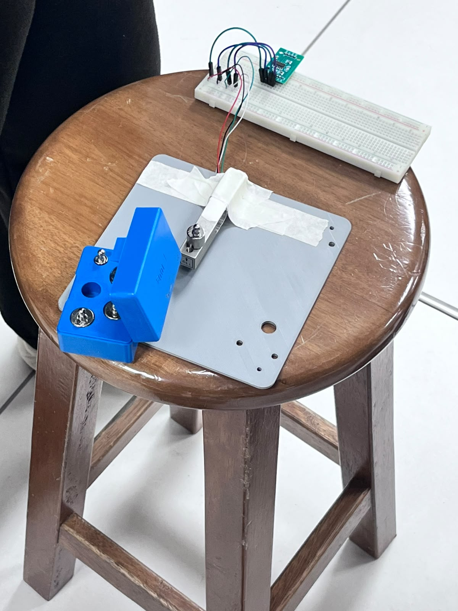
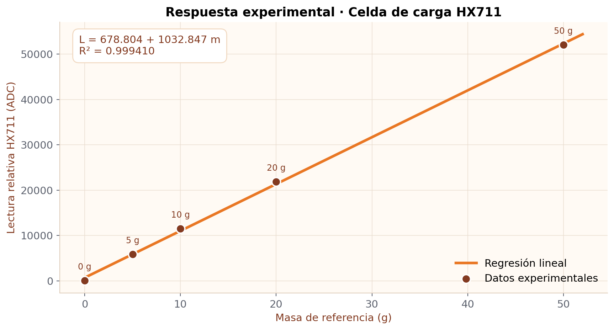
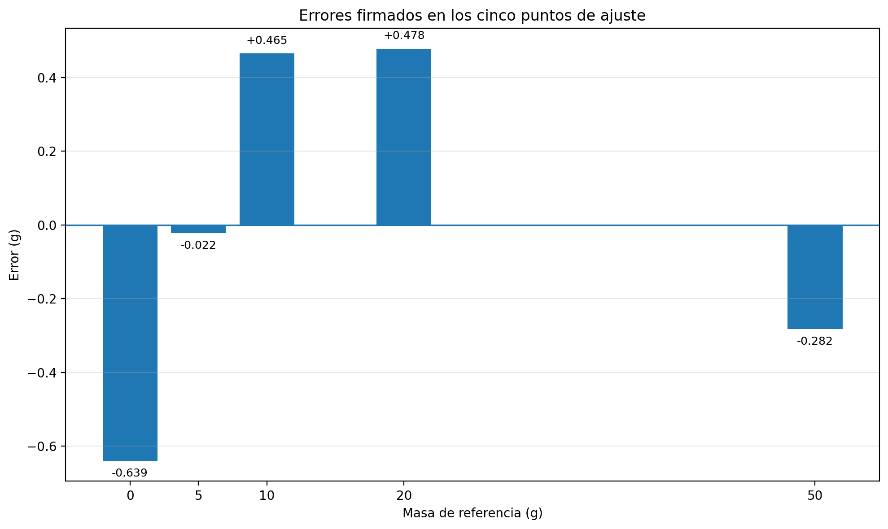
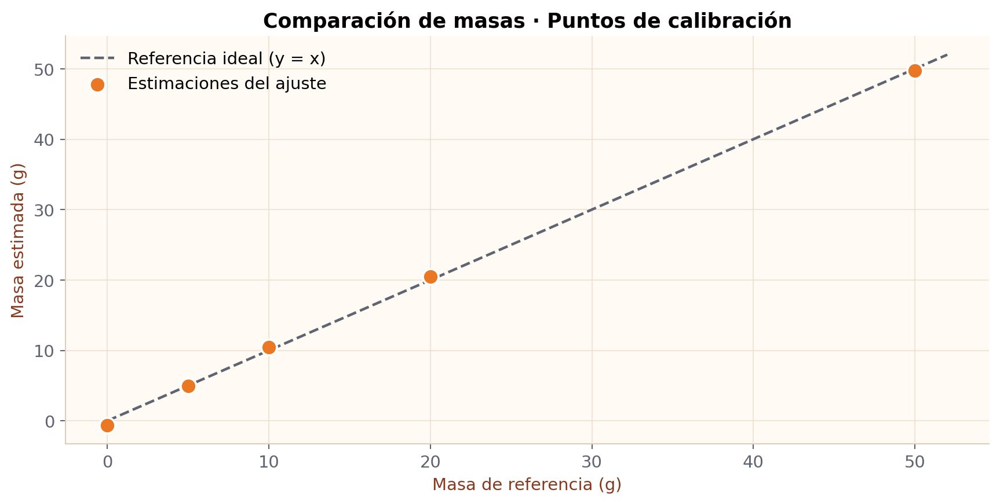
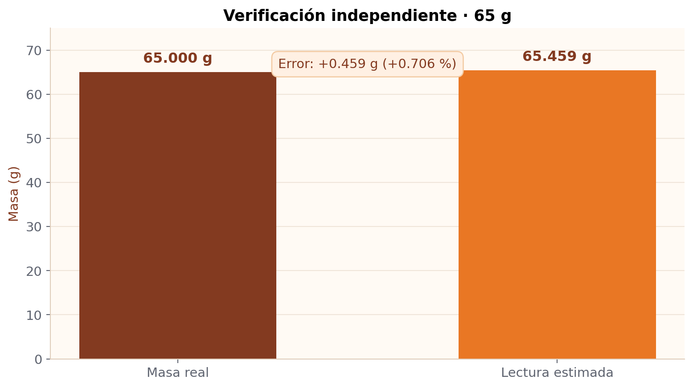

# TRL 3 | Calibración experimental de celda de carga con HX711

<p align="center">
  <strong>LIGURA · Equipo 03</strong><br>
  <em>Prueba de concepto de medición de carga mediante ESP32 y conversor HX711</em>
</p>

<p align="center">
  
  
</p>

> **Alcance:** este documento presenta los resultados experimentales de calibración de una celda de carga de **1 kg** empleando el **HX711** y un **ESP32**. Corresponde a una prueba de concepto individual de componente (TRL 3); **no** demuestra aún la validación del sistema completo de agarre.

## 1. Objetivo

Evaluar la viabilidad de medir cargas conocidas mediante una celda de carga de 1 kg conectada a un HX711 y un ESP32, realizando una **calibración multipunto** con regresión lineal y una **verificación independiente**, como actividad preliminar al monitoreo de fuerza en el gripper de **LIGURA**.

### 1.1 Objetivos específicos

1. Establecer la lectura de referencia mediante tara sin carga adicional.
2. Adquirir y promediar 30 muestras para cada masa de referencia.
3. Determinar los parámetros de una regresión lineal entre masa y lectura digital relativa a la tara.
4. Calcular los errores en los puntos de ajuste y el coeficiente de determinación \(R^2\).
5. Verificar el modelo con una masa de 65 g no utilizada en el ajuste.

## 2. Actividades desarrolladas

| N.º | Actividad | Descripción | Estado |
|:---:|---|---|:---:|
| 01 | Montaje y comunicación | Conexión de celda de carga, HX711 y ESP32; comprobación de lecturas digitales | Realizada |
| 02 | Tara | Establecimiento de referencia sin masa adicional, promediando 30 muestras | Realizada |
| 03 | Calibración multipunto | Registro de 0, 5, 10, 20 y 50 g, con 30 muestras por punto | Realizada |
| 04 | Ajuste matemático | Regresión lineal por mínimos cuadrados, errores y \(R^2\) | Realizada |
| 05 | Verificación independiente | Medición de una combinación de pesas cuya masa total era 65 g | Realizada (una lectura) |
| 06 | Repetibilidad y deriva del cero | Series repetidas y retorno al cero después de descargar | Pendiente |
| 07 | Validación en el gripper | Evaluación del montaje definitivo y fuerza de contacto sobre la fruta | Pendiente |

## 3. Materiales y montaje experimental

| Elemento | Especificación / uso |
|---|---|
| Celda de carga | Capacidad nominal de **1 kg** |
| Convertidor | Módulo **HX711** |
| Controlador | **ESP32** |
| Masas de referencia | **5 g, 10 g, 20 g y 50 g** |
| Alimentación y comunicación | USB del ESP32 y Monitor Serie a **115200 baudios** |
| Software | Arduino IDE y biblioteca **HX711 de Bogdan Necula (Bogde)** |

### 3.1 Conexiones utilizadas en el ensayo

**HX711 → ESP32**

| HX711 | ESP32 |
|---|---|
| VCC | 3V3 |
| GND | GND |
| DT / DOUT | GPIO 32 |
| SCK / CLK | GPIO 33 |

**Celda de carga → HX711** (asignación típica; comprobar colores contra el modelo físico)

| Terminal HX711 | Cable de referencia |
|---|---|
| E+ | Rojo |
| E− | Negro |
| A+ | Verde |
| A− | Blanco |

Durante este ensayo la celda se sujetó **provisionalmente mediante cinta adhesiva** sobre una base impresa en 3D. Las pesas se aplicaron sobre **el extremo libre de la celda**. Esta sujeción temporal puede introducir desplazamientos o variaciones mecánicas y constituye una limitación de la prueba. Se evitó superar la capacidad nominal de 1 kg.

### 3.2 Evidencia fotográfica del montaje

La fotografía del ensayo documenta la disposición del montaje sobre una mesa de trabajo: la base impresa en 3D, la celda de carga, la protoboard y el módulo HX711 conectado mediante cables.

**Figura 1. Entorno de ensayo y disposición experimental del subsistema de medición.**



## 4. Metodología experimental

1. Instalar el montaje provisional sobre la base impresa en 3D, con cinta adhesiva y el extremo de carga libre. Conectar el módulo HX711 al ESP32 y verificar que responde a las solicitudes de lectura.
2. Dejar la celda sin masa adicional y ejecutar una **tara de 30 muestras**. El montaje se mantuvo en la misma disposición durante la serie.
3. Registrar inmediatamente el punto **0 g** mediante otras 30 muestras; la lectura relativa a la tara puede no ser exactamente cero por ruido y deriva.
4. Colocar sucesivamente **5, 10, 20 y 50 g**; para cada masa estable, introducir su valor en el Monitor Serie y registrar el promedio de **30 muestras** corregidas por la tara.
5. Se efectuó **una única serie de calibración**, con 30 muestras por masa (no 30 repeticiones independientes). Ejecutar `CAL` para calcular la pendiente y el intercepto del modelo por mínimos cuadrados, así como los errores en los cinco puntos y el coeficiente \(R^2\).
6. Colocar las pesas de **50 + 10 + 5 = 65 g**; ejecutar `VER` para obtener la masa estimada sin recalcular el modelo.

### 4.1 Interfaz serial

| Comando | Acción |
|---|---|
| `5`, `10`, `20`, `50` | Capturar 30 muestras y registrar la masa ingresada |
| `CAL` | Estimar la regresión lineal y mostrar errores |
| `VER` | Medir con el modelo ya calculado |
| `LIST` | Mostrar los puntos registrados |
| `RESET` | Repetir tara y reiniciar los puntos |

El código completo se conserva tanto en [el archivo `.ino`](codigo/calibracion_multipunto_hx711.ino) como en la **sección 9** de este README.

## 5. Fundamento matemático

### 5.1 Lectura relativa a la tara

Sea \(A_i\) la lectura digital de cada muestra, y \(A_0\) la referencia establecida durante la tara. El valor de calibración es la lectura media corregida:

\[
L=\overline{A}-A_0
\]

En el ensayo se emplearon **30 muestras** por punto. Las lecturas registradas se expresan en unidades digitales relativas al cero, no en gramos.

### 5.2 Regresión lineal

Se propone una relación empírica entre la masa conocida \(m\) y la lectura relativa \(L\):

\[
L=a+b\,m
\]

Donde \(a\) es el intercepto en unidades ADC y \(b\) es la pendiente en ADC/g. El estimador de masa es:

\[
\boxed{\hat m=\frac{L-a}{b}}
\]

La pendiente y el intercepto se obtienen por mínimos cuadrados utilizando los cinco pares \((m_i,L_i)\). Se reporta \(R^2\) como indicador de ajuste a estos datos; **no debe confundirse con exactitud, incertidumbre o repetibilidad**.

### 5.3 Error de medición

\[
e=\hat m-m_{\mathrm{real}}
\qquad\qquad
E_{\%}=\frac{|e|}{m_{\mathrm{real}}}\times 100\%
\]

El error relativo porcentual **no se define para 0 g**, por lo que allí se informa únicamente el error en gramos.

## 6. Resultados experimentales — 05/11/2026

### 6.1 Datos registrados

Los valores siguientes corresponden al registro experimental del Monitor Serie de la sesión de calibración.

| Masa de referencia (g) | Lectura media relativa (ADC) | Masa estimada (g) | Error (g) |
|---:|---:|---:|---:|
| 0 | 19 | −0.639 | −0.639 |
| 5 | 5 820 | 4.978 | −0.022 |
| 10 | 11 488 | 10.465 | +0.465 |
| 20 | 21 829 | 20.478 | +0.478 |
| 50 | 52 030 | 49.718 | −0.282 |

*Las masas estimadas y los errores reproducen la salida mostrada por el firmware; los decimales están redondeados.*

### 6.2 Parámetros de calibración reportados por el firmware

| Parámetro | Valor |
|---|---:|
| Pendiente \(b\) | **1032.846802 ADC/g** |
| Intercepto \(a\) | **678.804382 ADC** |
| Coeficiente de determinación \(R^2\) | **0.999410** |
| Mayor error absoluto en los puntos de ajuste | **0.639 g** |

La ecuación informada por el programa fue:

\[
\boxed{\hat m\;(\mathrm{g})=\frac{L-678.804382}{1032.846802}}
\]

Al evaluar los valores se observa un intercepto distinto de cero, incluso después de la tara. Este efecto puede reflejar variabilidad del cero o el compromiso del ajuste lineal entre todos los puntos; requiere ensayos de estabilidad adicionales.

### 6.3 Verificación independiente con 65 g

Se colocó una combinación de **50 g + 10 g + 5 g**. Esta masa **no se empleó para calcular** los parámetros de la regresión.

| Variable | Resultado |
|---|---:|
| Masa real | **65.000 g** |
| Lectura relativa del HX711 | **68 288 ADC** |
| Masa estimada por el firmware | **65.459 g** |
| Error firmado | **+0.459 g** |
| Error absoluto | **0.459 g** |
| Error relativo absoluto | **0.706 %** |
| Fuerza equivalente calculada a partir de la lectura | **0.64193 N** |

Cálculos:

\[
e=65.459-65.000=+0.459\;\mathrm{g}\]

\[
E_{\%}=\frac{0.459}{65}\times100=0.706\%\]

La fuerza equivalente corresponde a \(F=mg\), con \(m\) expresada en kg y \(g=9.80665\,\mathrm{m/s^2}\). **No equivale automáticamente a la fuerza de agarre del gripper**; ello depende del montaje mecánico y de la dirección de aplicación de carga.

### 6.4 Representación gráfica de los resultados

Las siguientes figuras se generaron a partir de los cinco pares de datos reales y de la verificación independiente; **no contienen mediciones simuladas**. Su estilo visual incorpora los tonos naranjas de LIGURA, mientras que los ejes y ecuaciones conservan una presentación técnica.

**Figura 2. Respuesta de la celda: masa conocida frente a lectura digital y ajuste lineal.**



**Figura 3. Errores firmados en los cinco puntos de ajuste.**



**Figura 4. Masa real frente a masa estimada para las referencias de calibración.**



**Figura 5. Comparación de 65 g reales frente a 65.459 g estimados.**



## 7. Análisis general de resultados

- La fijación con **cinta adhesiva fue provisional** y puede afectar la estabilidad de la transferencia de carga; será necesario un montaje rígido para futuras etapas.
- La lectura digital aumentó de **19 ADC** a **52 030 ADC** entre 0 y 50 g, lo que confirma una respuesta sensible a las cargas aplicadas en este montaje.
- Se obtuvo **\(R^2=0.999410\)**, evidencia de un ajuste lineal elevado **para los cinco puntos examinados**.
- El máximo error absoluto en los puntos utilizados para ajustar la recta fue **0.639 g**; este error interno no constituye una evaluación independiente de precisión.
- La verificación externa a **65 g** produjo **65.459 g**, con un error de **+0.459 g** (\(+0.706\%\) de la referencia).
- La lectura estimada en **0 g** fue **−0.639 g**; es necesario estudiar el retorno al cero y la deriva temporal.
- Se realizó una sola secuencia con **30 muestras por punto**; no se almacenaron las muestras individuales, por lo que no se puede calcular la dispersión intra-punto con el registro disponible.
- No se registraron aún series repetidas que permitan cuantificar **desviación estándar, repetibilidad, histéresis o incertidumbre**.
- El conjunto de pesos utilizado cubre **0 a 65 g**, una fracción pequeña de la capacidad nominal de 1 kg. Los datos no permiten extrapolar la exactitud a todo el intervalo.

> **Interpretación TRL 3:** la experiencia aporta evidencia de funcionamiento y ajuste matemático de un subsistema de medición bajo condiciones experimentales. No constituye una validación del prototipo completo ni un criterio suficiente de control seguro sobre la fruta.

## 8. Conclusiones y aplicación en LIGURA

### 8.1 Conclusiones

1. Se implementó una prueba experimental de lectura de cargas mediante **celda de 1 kg + HX711 + ESP32**, con adquisición de **30 muestras** por punto.
2. La calibración de cinco puntos (0, 5, 10, 20 y 50 g) permitió obtener una ecuación lineal de conversión a gramos y un ajuste elevado (**\(R^2=0.999410\)**).
3. La verificación no utilizada para el ajuste, realizada con **65 g**, presentó un error absoluto de **0.459 g** y un error relativo de **0.706 %**.
4. Los resultados apoyan la **viabilidad preliminar** del subsistema para medir carga, pero no justifican aún declarar exactitud global, repetibilidad o idoneidad definitiva para el gripper.

### 8.2 Aplicación en LIGURA

La celda de carga se considera un componente candidato para cuantificar esfuerzos mecánicos en el mecanismo de sujeción. Como etapa posterior, se requiere calibrarla o validarla **en la disposición mecánica real del gripper**, comprobar la transferencia de fuerza hacia la granadilla y establecer límites de operación respaldados por ensayos de daño y sujeción. La medición con el FSR en la mordaza y la lectura de la celda de carga cumplen funciones complementarias; no deben suponerse equivalentes sin caracterización experimental.

### 8.3 Actividades pendientes

- Capturar cinco lecturas repetidas para 0 g, 65 g y 85 g (cuando se disponga de esas mediciones) y calcular su dispersión.
- Evaluar el retorno a cero después de descargar y la posible deriva de la tara.
- Verificar otras combinaciones de masas **sin reajustar** los coeficientes.
- Evaluar el gripper ensamblado y documentar la relación entre la carga medida y la fuerza efectiva de contacto.

## 9. Código Arduino utilizado

El archivo independiente está disponible en [`codigo/calibracion_multipunto_hx711.ino`](codigo/calibracion_multipunto_hx711.ino). Se reproduce íntegramente a continuación para que el documento sea autocontenido.

```cpp
#include <Arduino.h>
#include <math.h>
#include <stdlib.h>
#include "HX711.h"

// LIGURA | TRL 3 | Calibracion multipunto ESP32 + HX711
// Firmware del procedimiento experimental del 05/11/2026.
// Las lecturas ADC se registran relativas a la tara.

#define HX_DOUT 32
#define HX_SCK  33

HX711 celda;
const int NUM_MUESTRAS = 30;
const int MAX_PUNTOS = 20;

float masas[MAX_PUNTOS];
float lecturas[MAX_PUNTOS];
int numPuntos = 0;
float pendiente = 0;
float intercepto = 0;
float r2 = 0;
bool calibrado = false;
bool disponible = false;

void registrarPunto(float masa) {
  if (numPuntos >= MAX_PUNTOS) {
    Serial.println("ERROR: limite de puntos alcanzado.");
    return;
  }
  if (!celda.wait_ready_timeout(3000)) {
    Serial.println("ERROR: HX711 no disponible.");
    return;
  }
  Serial.println("----------------------------");
  Serial.print("Masa de referencia: ");
  Serial.print(masa, 2);
  Serial.println(" g");
  Serial.print("Tomando ");
  Serial.print(NUM_MUESTRAS);
  Serial.println(" muestras...");
  // La biblioteca de bogde devuelve el promedio del valor corregido por la tara.
  // get_value(n) redondea el promedio a un entero (long).
  float lectura = celda.get_value(NUM_MUESTRAS);
  masas[numPuntos] = masa;
  lecturas[numPuntos] = lectura;
  numPuntos++;
  calibrado = false;
  Serial.print("Lectura ADC promedio: ");
  Serial.println(lectura, 3);
  Serial.print("Punto registrado: ");
  Serial.println(numPuntos);
  Serial.println("----------------------------");
}

void calcularCalibracion() {
  if (numPuntos < 3) {
    Serial.println("Se requieren al menos 3 puntos.");
    return;
  }
  double sx = 0, sy = 0, sxx = 0, sxy = 0;
  for (int i = 0; i < numPuntos; i++) {
    double x = masas[i], y = lecturas[i];
    sx += x;
    sy += y;
    sxx += x*x;
    sxy += x*y;
  }
  double denominador = numPuntos*sxx - sx*sx;
  if (fabs(denominador) < 1e-9) {
    Serial.println("ERROR: masas insuficientemente distintas.");
    return;
  }
  pendiente = (numPuntos*sxy - sx*sy) / denominador;
  intercepto = (sy - pendiente*sx) / numPuntos;
  if (fabs(pendiente) < 1e-6) {
    Serial.println("ERROR: pendiente invalida.");
    return;
  }
  double promedioY = sy / numPuntos;
  double ssTotal = 0, ssError = 0;
  Serial.println("==================================");
  Serial.println("RESULTADOS DE CALIBRACION");
  Serial.println("==================================");
  for (int i = 0; i < numPuntos; i++) {
    double estimada = (lecturas[i] - intercepto) / pendiente;
    double error = estimada - masas[i];
    double yEstimada = intercepto + pendiente*masas[i];
    ssTotal += pow(lecturas[i]-promedioY,2);
    ssError += pow(lecturas[i]-yEstimada,2);
    Serial.print("Real: "); Serial.print(masas[i],2);
    Serial.print(" g | Estimada: "); Serial.print(estimada,3);
    Serial.print(" g | Error: "); Serial.print(error,3);
    Serial.println(" g");
  }
  r2 = ssTotal > 0 ? 1.0 - ssError/ssTotal : 0;
  calibrado = true;
  Serial.print("Pendiente (ADC/g): "); Serial.println(pendiente,6);
  Serial.print("Intercepto (ADC): "); Serial.println(intercepto,6);
  Serial.print("R2: "); Serial.println(r2,6);
  Serial.println("Ecuacion: masa=(ADC-intercepto)/pendiente");
  Serial.println("CALIBRACION FINALIZADA");
}

void verificarMedicion() {
  if (!calibrado) {
    Serial.println("Primero ejecuta CAL.");
    return;
  }
  if (!celda.wait_ready_timeout(3000)) {
    Serial.println("HX711 no responde.");
    return;
  }
  float adc = celda.get_value(NUM_MUESTRAS);
  float masa = (adc - intercepto) / pendiente;
  Serial.println("=== VERIFICACION ===");
  Serial.print("ADC: "); Serial.println(adc,3);
  Serial.print("Masa: "); Serial.print(masa,3); Serial.println(" g");
  Serial.print("Fuerza equivalente: ");
  Serial.print(masa*0.00980665f,5);
  Serial.println(" N");
}

void listarPuntos() {
  Serial.println("=== PUNTOS REGISTRADOS ===");
  for (int i = 0; i < numPuntos; i++) {
    Serial.print(i+1); Serial.print(" | ");
    Serial.print(masas[i],2); Serial.print(" g | ADC: ");
    Serial.println(lecturas[i],3);
  }
}

void reiniciar() {
  if (!celda.wait_ready_timeout(3000)) {
    Serial.println("HX711 no responde.");
    return;
  }
  Serial.println("Retira todas las pesas.");
  Serial.println("Realizando tara...");
  delay(2000);
  celda.set_scale(1.0f);
  celda.tare(NUM_MUESTRAS);
  numPuntos = 0;
  calibrado = false;
  registrarPunto(0);
  Serial.println("Tara completada.");
}

void setup() {
  Serial.begin(115200);
  Serial.setTimeout(1000);
  delay(1000);
  celda.begin(HX_DOUT,HX_SCK);
  Serial.println("LIGURA - CALIBRACION MULTIPUNTO");
  Serial.println("Celda de carga: 1 kg");
  disponible = celda.wait_ready_timeout(5000);
  if (!disponible) {
    Serial.println("ERROR: HX711 no detectado; reinicia tras revisar cableado.");
    return;
  }
  reiniciar();
  Serial.println("COMANDOS: masa en gramos; CAL; VER; LIST; RESET");
  Serial.println("Ejemplo: coloca 5 g, envia 5, espera el promedio.");
}

void loop() {
  if (!disponible || !Serial.available()) return;
  String comando = Serial.readStringUntil('\n');
  comando.trim();
  comando.toUpperCase();
  if (comando == "CAL") calcularCalibracion();
  else if (comando == "VER") verificarMedicion();
  else if (comando == "LIST") listarPuntos();
  else if (comando == "RESET") reiniciar();
  else {
    char *fin = nullptr;
    float masa = strtof(comando.c_str(), &fin);
    if (fin != comando.c_str() && *fin == '\0' && isfinite(masa)
        && masa > 0 && masa <= 1000) registrarPunto(masa);
    else Serial.println("Comando no valido.");
  }
}
```

## 10. Referencias y trazabilidad

- [Documentación TRL 3 del sensor FSR de LIGURA](https://github.com/Cesarapcho/PI_Equipo_03/tree/main/Proyecto_Integrador/Talleres/TRL3/Sensor%20FSR) — referencia de organización documental.
- [Biblioteca HX711 de Bogdan Necula (Bogde)](https://github.com/bogde/HX711) — interfaz de adquisición y tara.
- **Registro experimental del 05/11/2026:** transcripción de las lecturas y salidas de calibración proporcionadas durante el desarrollo del proyecto.
