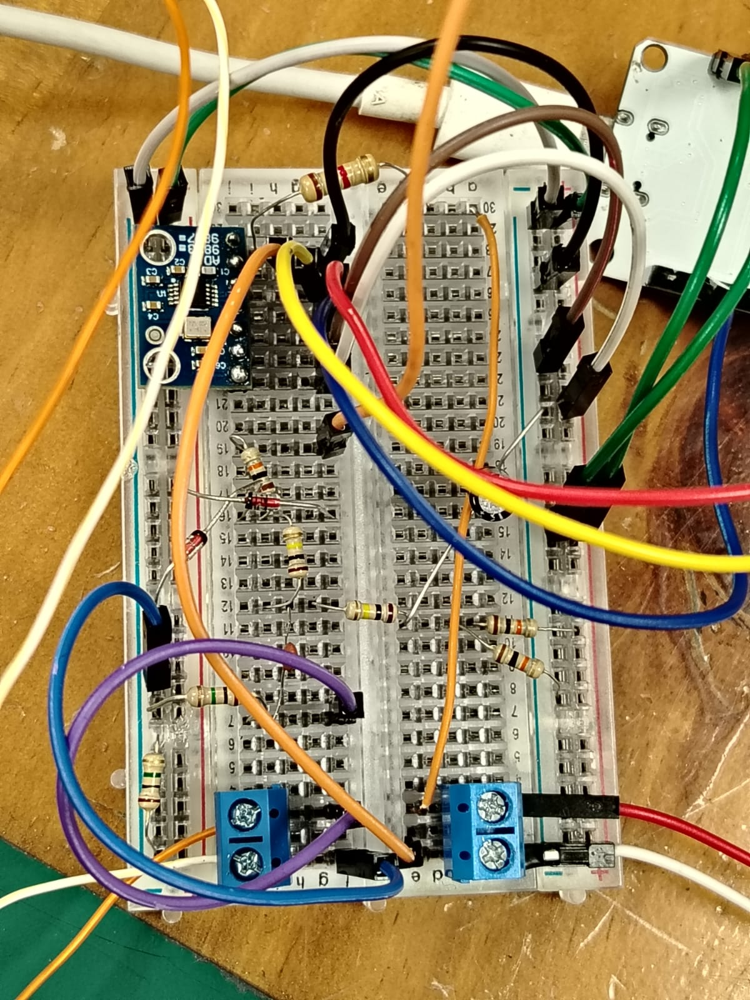
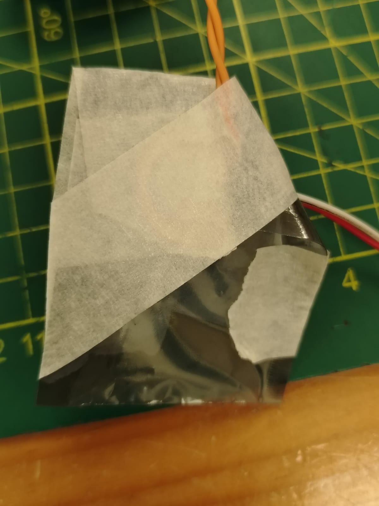
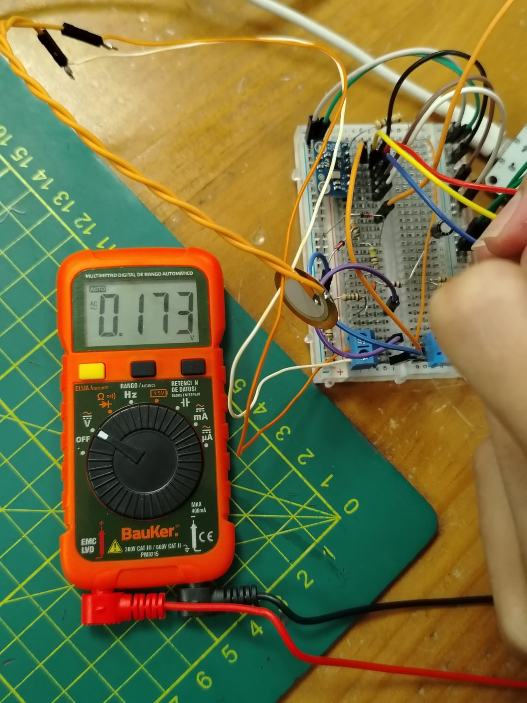
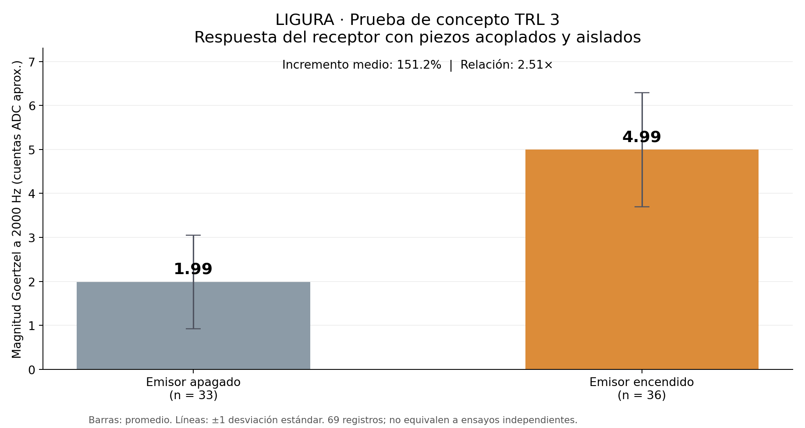
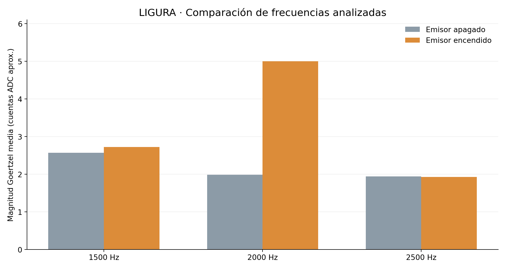
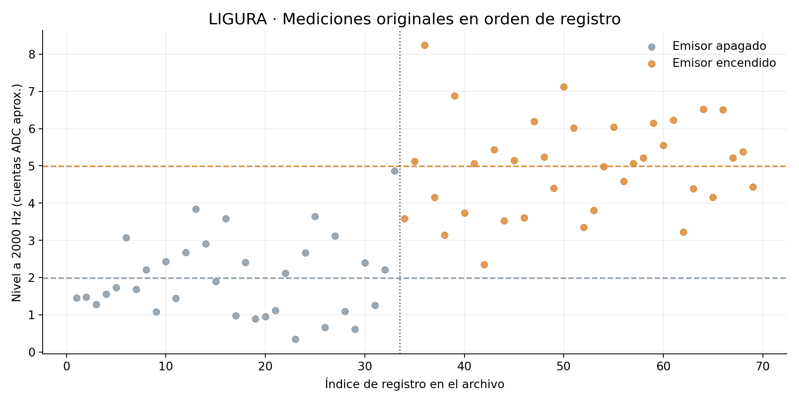
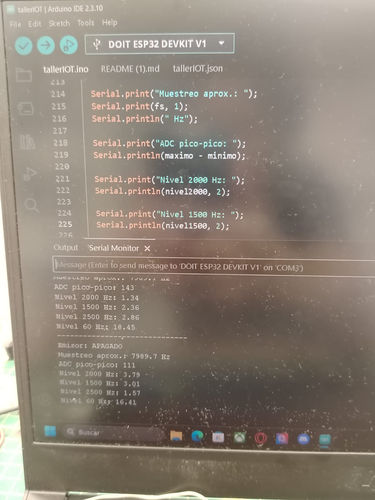
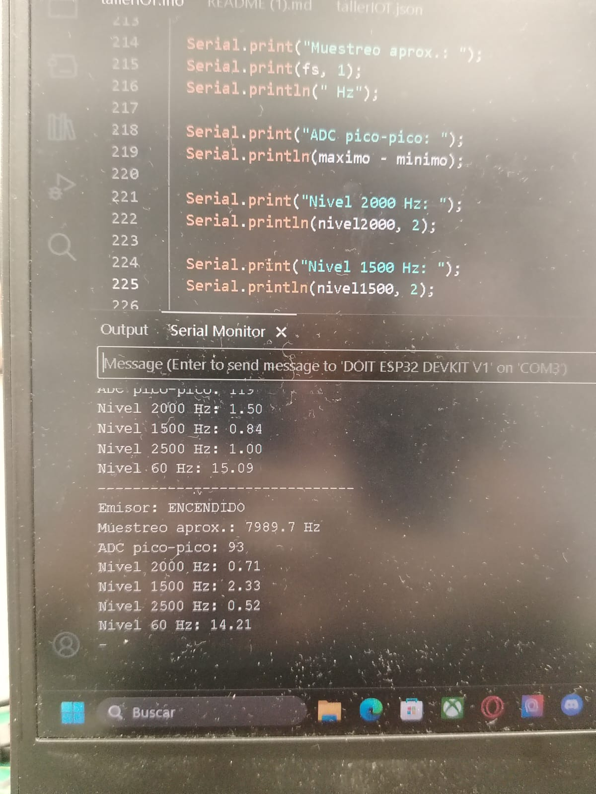

# TRL 3 — Prueba de concepto de transductores piezoeléctricos

**Proyecto:** LIGURA — Sistema inteligente de evaluación de granadilla  
**Equipo:** Equipo 03  
**Curso:** Proyecto Integrador 2026-2  
**Componente evaluado:** Par de transductores piezoeléctricos (emisor y receptor)  
**Instrumentación auxiliar:** ESP32 y generador AD9833  
**Procesamiento:** Algoritmo Goertzel a 2000 Hz

---

## 1. Objetivo

Evaluar experimentalmente la respuesta eléctrica adquirida desde un transductor piezoeléctrico receptor cuando un transductor emisor, acoplado mecánicamente y separado por un aislante no conductor, recibe una excitación programada a 2000 Hz.

Se busca establecer si la magnitud de la componente de 2000 Hz aumenta al habilitar el emisor respecto de la condición de referencia con el generador en RESET.

## 2. Fundamento de la prueba de concepto

El efecto piezoeléctrico permite transformar deformaciones mecánicas en señales eléctricas y, en la configuración inversa, producir deformaciones a partir de una excitación eléctrica. El montaje experimental explora esta relación mediante dos discos piezoeléctricos: uno excitado eléctricamente y otro conectado a un circuito de adquisición.

Para evitar el contacto metálico directo, los discos se dispusieron con sus superficies enfrentadas y una lámina plástica no conductora entre ellas. La separación evita una ruta conductiva directa a través del contacto de las caras, pero no elimina por sí misma el acoplamiento capacitivo ni las interferencias que puedan circular por la alimentación y los cables.

Este ensayo corresponde a una **prueba de concepto TRL 3** en tanto compara experimentalmente el comportamiento esperado de una función crítica y registra valores cuantitativos. El grado de validación del sistema completo LIGURA no es objeto de este ensayo.

## 3. Materiales y equipos

| Elemento | Función |
|---|---|
| 2 discos piezoeléctricos | Emisión y recepción de vibración |
| Lámina plástica no conductora | Aislamiento eléctrico de las caras metálicas en contacto |
| ESP32 | Configuración del generador y adquisición analógica |
| Módulo AD9833 | Generación de la excitación sinusoidal nominal |
| Protoboard y componentes de acondicionamiento | Conexión y adaptación experimental de la señal del receptor |
| Multímetro digital | Verificación auxiliar de tensión alterna |
| Arduino IDE | Programación y registro mediante Monitor Serie |

Los elementos de control y adquisición se utilizaron como **instrumentación auxiliar para estudiar los piezos**. No se evaluó la integridad de un sistema mecatrónico completo.

## 4. Montaje experimental

El generador AD9833 se configuró mediante las señales de control del ESP32, con conexión de salida hacia el piezo emisor. El piezo receptor se conectó a un circuito de polarización y acondicionamiento experimental, cuya señal se adquirió por el GPIO34 del ESP32.

| Parámetro | Valor utilizado |
|---|---|
| Frecuencia nominal de emisión | 2000 Hz |
| Reloj supuesto por el programa (MCLK) | 25 MHz |
| Pines AD9833 | SDATA: GPIO13; SCLK: GPIO14; FSYNC: GPIO26 |
| Entrada de recepción | GPIO34 |
| Muestras por bloque | 256 |
| Frecuencia nominal de muestreo | 8000 muestras/s |
| Frecuencia reportada | Aproximadamente 7989.7–7990.0 Hz |
| Resolución ADC configurada | 12 bits |
| Frecuencias calculadas con Goertzel | 60, 1500, 2000 y 2500 Hz |
| Estados comparados | Emisor apagado (RESET) y encendido |

**Figura 1.** Montaje experimental en protoboard del sistema de excitación y adquisición utilizado para evaluar la respuesta de los piezoeléctricos.

**Figura 2.** Discos piezoeléctricos acoplados mecánicamente con una lámina de plástico no conductor colocada entre sus caras metálicas.

## 5. Procedimiento experimental

1. Se preparó el circuito experimental con el AD9833, el ESP32 y el par de transductores piezoeléctricos.
2. Se colocó el aislante plástico entre las caras metálicas de los discos y se mantuvo el conjunto acoplado mecánicamente.
3. Se cargó en el ESP32 el programa de control y adquisición, configurado para una frecuencia nominal de 2000 Hz.
4. Mediante el Monitor Serie se registraron datos con el emisor **apagado**, manteniendo al AD9833 en condición de RESET.
5. Se habilitó el emisor y se registraron nuevos datos con el mismo montaje.
6. Para cada bloque de 256 muestras se calcularon la amplitud pico a pico del ADC y las magnitudes correspondientes a 60, 1500, 2000 y 2500 Hz mediante Goertzel.
7. Se compararon los promedios de los registros apagados y encendidos, conservando tanto el registro original como su tabla estructurada.

Se obtuvieron **69 registros**, de los cuales **33** corresponden al emisor apagado y **36** al emisor encendido. Los registros están ordenados por bloques de estado; no se efectuó una secuencia estrictamente alternada para cada muestra.

## 6. Verificación auxiliar con multímetro

Se documentó una lectura de **0.173 V AC** durante una comprobación auxiliar del circuito de generación. Esta lectura acredita la existencia de una componente de tensión alterna en la configuración medida, pero **no verifica por sí sola una frecuencia exacta de 2000 Hz**. La fotografía tampoco permite establecer de manera independiente las posiciones eléctricas exactas de ambas puntas.

**Figura 3.** Evidencia fotográfica de la lectura de 0.173 V AC obtenida con el multímetro durante la prueba de generación.

## 7. Procesamiento digital de la señal

El programa adquiere 256 muestras por bloque, estima su frecuencia de muestreo y elimina el valor medio de las muestras. Posteriormente aplica una ventana de Hann y calcula, mediante el algoritmo Goertzel, magnitudes de componentes frecuenciales específicas.

La función Goertzel utilizada devuelve una **magnitud aproximada en cuentas de ADC procesadas**, no una medición de presión acústica ni una tensión eficaz calibrada. La medición etiquetada como 60 Hz debe interpretarse con cautela debido a la corta duración de cada ventana de adquisición (aproximadamente 32 ms), insuficiente para caracterizar con buena resolución la componente de red eléctrica.

Código original de adquisición: [`codigo/LIGURA_TRL3_goertzel.ino`](codigo/LIGURA_TRL3_goertzel.ino).

## 8. Resultados experimentales

### 8.1 Resumen cuantitativo

| Indicador | Emisor apagado | Emisor encendido |
|---|---:|---:|
| Número de registros | 33 | 36 |
| Magnitud media a 2000 Hz | 1.99 | 4.99 |
| Desviación estándar a 2000 Hz | 1.06 | 1.29 |
| Magnitud mínima a 2000 Hz | 0.34 | 2.35 |
| Magnitud máxima a 2000 Hz | 4.87 | 8.24 |
| Magnitud media a 1500 Hz | 2.57 | 2.72 |
| Magnitud media a 2500 Hz | 1.94 | 1.93 |
| Magnitud media indicada a 60 Hz | 14.52 | 15.05 |
| ADC pico a pico promedio (cuentas) | 160.97 | 155.75 |

La magnitud media a 2000 Hz aumentó de **1.99** a **4.99**, una diferencia de **3.01 unidades procesadas**, equivalente a un incremento relativo de **151.2 %** y una relación de **2.51 veces**.

### 8.2 Comparación del nivel a 2000 Hz

**Figura 4.** Comparación entre los promedios a 2000 Hz con el emisor apagado y encendido. Las barras de dispersión representan ±1 desviación estándar.

### 8.3 Comparación con otras frecuencias

**Figura 5.** Comparación de las magnitudes medias a 1500, 2000 y 2500 Hz. El incremento observado destaca principalmente en la frecuencia de excitación nominal.

### 8.4 Distribución de los registros

**Figura 6.** Secuencia de las 69 magnitudes a 2000 Hz. El cambio de estado ocurre entre los registros 33 y 34.

### 8.5 Registros fotográficos de adquisición

**Figura 7.** Monitor Serie de Arduino IDE durante una lectura correspondiente a la condición de emisor apagado.

**Figura 8.** Monitor Serie de Arduino IDE durante una lectura correspondiente a la condición de emisor encendido.

Los registros íntegros se conservan en [`datos/mediciones_originales.txt`](datos/mediciones_originales.txt) y su organización tabular en [`datos/mediciones_TRL3.csv`](datos/mediciones_TRL3.csv).

## 9. Análisis e interpretación

Los resultados muestran que, al habilitar el emisor, la magnitud media medida por Goertzel a 2000 Hz es mayor que la obtenida con el generador en RESET. La diferencia registrada concuerda con la hipótesis de trabajo y constituye **evidencia preliminar de una respuesta dependiente del estado de excitación**.

El resultado debe interpretarse considerando que el ADC mide una señal eléctrica que puede incluir vibración convertida por el transductor, interferencias conducidas, acoplamiento capacitivo y ruido ambiental. Aunque el plástico evita el contacto eléctrico directo entre las superficies, no demuestra que toda la componente observada se haya transmitido por vibración mecánica.

Además, los registros de ambos estados se tomaron en bloques consecutivos y presentan dispersión; por ello, no se descartan variaciones temporales del ruido o de las condiciones de contacto. La comparación proporciona un indicio positivo de viabilidad, pero no equivale a una caracterización acústica calibrada.

## 10. Relación con TRL 3 de NASA

La NASA define el TRL 3 como una *prueba de concepto analítica y experimental de funciones o características críticas*, sustentada por resultados documentados que permitan validar predicciones relevantes.

La presente evaluación aporta:

- **Hipótesis experimental:** aumento de la componente a 2000 Hz ante la habilitación del emisor.
- **Montaje físico:** discos piezoeléctricos en contacto mecánico con aislamiento plástico y circuitos auxiliares.
- **Control de referencia:** comparación entre el generador en RESET y en funcionamiento.
- **Resultados cuantitativos:** 69 registros originales, análisis de magnitudes y gráficas.
- **Trazabilidad:** fotografías, código y archivos de datos incluidos junto al documento.

El ensayo resulta pertinente como evidencia de **prueba de concepto de un subsistema de piezoeléctricos**. La asignación definitiva del nivel de madurez del proyecto completo depende de la evaluación de todas sus funciones críticas y de los criterios académicos aplicados.

Fuentes:

- [NASA Earth Science Technology Office — Technology Readiness Levels](https://esto.nasa.gov/trl/)
- [NASA — Technology Readiness Levels](https://www.nasa.gov/directorates/somd/space-communications-navigation-program/technology-readiness-levels/)

## 11. Limitaciones y actividades posteriores

- No se verificó de manera independiente el mecanismo de transmisión exclusivamente mecánico frente a interferencias eléctricas.
- No se caracterizó el espectro completo ni la amplitud en unidades físicas calibradas.
- Las mediciones apagado y encendido se realizaron en bloques, sin alternancia de referencia por pares.
- Las magnitudes a 60 Hz no permiten cuantificar con precisión la interferencia de red a partir de estas ventanas cortas.
- No se ensayaron granadillas ni se evaluó la identificación de defectos internos.
- Antes de repetir ensayos con el GPIO34 debe verificarse que el acondicionamiento y las protecciones mantengan la entrada dentro de los límites eléctricos admitidos por el ESP32. Los diodos 1N4148 del montaje por sí solos no garantizan protección total frente a transitorios.

Estas actividades corresponden a mejoras de la instrumentación y a futuras pruebas de laboratorio; no se presentan como resultados ya realizados.

## 12. Conclusiones

1. Se implementó un montaje experimental para evaluar el comportamiento de dos transductores piezoeléctricos, utilizando un circuito de excitación y adquisición con ESP32 y AD9833 como instrumentación auxiliar.
2. Se obtuvieron 69 registros: 33 con el generador en RESET y 36 con la excitación habilitada.
3. La magnitud media de la componente de 2000 Hz aumentó de 1.99 a 4.99, lo que corresponde a una relación aproximada de 2.51 veces.
4. La variación observada es compatible con una respuesta del sistema receptor relacionada con la excitación configurada, y aporta evidencia de viabilidad preliminar para la prueba de concepto del subsistema piezoeléctrico.
5. El origen exclusivamente mecánico de la señal y el desempeño sobre granadillas reales requieren validaciones adicionales; por tanto, no se afirma que el sistema completo haya alcanzado una validación funcional integral.

## 13. Archivos de respaldo

| Archivo o carpeta | Contenido |
|---|---|
| [`codigo/LIGURA_TRL3_goertzel.ino`](codigo/LIGURA_TRL3_goertzel.ino) | Programa utilizado en las pruebas |
| [`datos/mediciones_originales.txt`](datos/mediciones_originales.txt) | Registro completo del Monitor Serie |
| [`datos/mediciones_TRL3.csv`](datos/mediciones_TRL3.csv) | Mediciones tabuladas para análisis |
| [`graficas/`](graficas/) | Tres gráficas de los resultados |
| [`imagenes/`](imagenes/) | Cinco fotografías originales del montaje y las mediciones |
