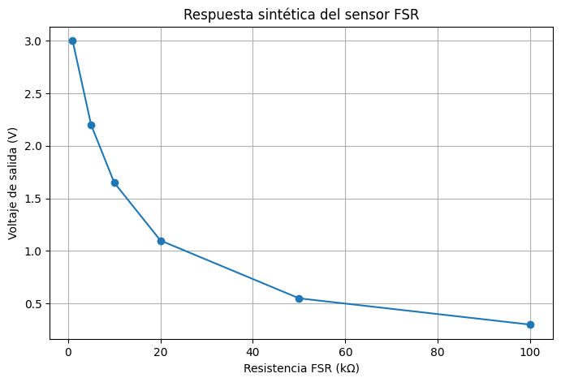
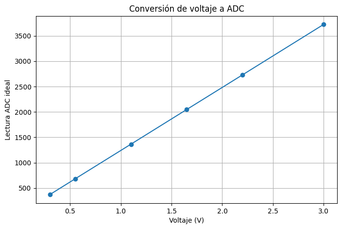

# Actividad 02 — Prueba sintética del sensor FSR en Python

**Proyecto:** Ligura — Sistema de evaluación no destructiva de granadillas mediante excitación vibratoria y análisis vibroacústico  
**Etapa:** TRL 3 — Prueba de concepto  
**Componente evaluado:** Sensor resistivo de fuerza (FSR)  
**Tipo de prueba:** Cálculo numérico y visualización de datos sintéticos  
**Herramienta:** Google Colab / Python (`numpy`, `pandas`, `matplotlib`)  
**Estado:** Notebook proporcionado con resultados y gráficas; datos sintéticos, no experimentales.

## 1. Objetivo

Comprobar mediante Python el comportamiento matemático esperado de un divisor de voltaje para el FSR, calculando la salida en voltios y su lectura ADC ideal para diferentes resistencias hipotéticas.

## 2. Alcance y fundamento

Una **prueba sintética** genera datos artificiales para estudiar el comportamiento del modelo antes de medir el sensor físico. En este caso, se utilizan seis valores de resistencia elegidos para el ejercicio, **sin asociarlos a fuerzas concretas**.

Circuito modelado:

```text
   3V3 (ESP32)
       |
   R_FSR variable
       |
       +---------- Vout / GPIO 34
       |
     10 kΩ
       |
      GND
```

Ecuaciones:

$$
V_{out}=3.3\frac{10000}{R_{FSR}+10000}
$$

$$
ADC_{ideal}\approx 4095\frac{V_{out}}{3.3}
$$

El resultado ADC se redondea al entero más cercano en el código. La conversión ADC se supone ideal únicamente para este ejercicio. No representa una calibración del convertidor real del ESP32.

## 3. Herramientas y archivo de trabajo

Se utilizó el notebook [`Actividad_02_Prueba_Sintetica_FSR.ipynb`](./Actividad_02_Prueba_Sintetica_FSR.ipynb), que contiene la importación de librerías, generación de datos, tabla y dos gráficas.

**[Abrir notebook en Google Colab](https://colab.research.google.com/drive/1-GkpycZoicLZNaBiHvb5dPfK2t-pTNuV?usp=sharing)**

## 4. Procedimiento en Python

### Paso 1. Importar librerías

```python
import numpy as np
import pandas as pd
import matplotlib.pyplot as plt
```

### Paso 2. Generar datos sintéticos y calcular resultados

```python
# Parámetros del circuito
Vcc = 3.3
R_fija = 10000

# Valores sintéticos de resistencia del FSR (ohmios)
R_fsr = np.array([100000, 50000, 20000, 10000, 5000, 1000])

# Calcular el voltaje de salida
voltaje = Vcc * R_fija / (R_fsr + R_fija)

# Calcular la lectura ADC ideal de 12 bits
adc = np.round((voltaje / Vcc) * 4095).astype(int)
```

### Paso 3. Organizar los resultados en una tabla

```python
datos = pd.DataFrame({
    "Resistencia (kΩ)": R_fsr / 1000,
    "Voltaje (V)": np.round(voltaje, 3),
    "ADC ideal": adc
})

display(datos)
```

### Paso 4. Graficar resistencia y voltaje

```python
plt.figure(figsize=(8, 5))
plt.plot(R_fsr / 1000, voltaje, marker="o")
plt.xlabel("Resistencia FSR (kΩ)")
plt.ylabel("Voltaje de salida (V)")
plt.title("Respuesta sintética del sensor FSR")
plt.grid(True)
plt.show()
```



*Figura 1. Relación entre resistencia hipotética y voltaje calculado. Imagen obtenida del resultado guardado en el notebook.*

### Paso 5. Graficar voltaje y lectura ADC ideal

```python
plt.figure(figsize=(8, 5))
plt.plot(voltaje, adc, marker="o")
plt.xlabel("Voltaje (V)")
plt.ylabel("Lectura ADC ideal")
plt.title("Conversión de voltaje a ADC")
plt.grid(True)
plt.show()
```



*Figura 2. Relación ideal entre voltaje calculado y lectura ADC de 12 bits. Imagen obtenida del resultado guardado en el notebook.*

## 5. Resultados sintéticos

| Resistencia hipotética (kΩ) | Voltaje calculado (V) | Lectura ADC ideal |
|---:|---:|---:|
| 100 | 0.300 | 372 |
| 50 | 0.550 | 683 |
| 20 | 1.100 | 1365 |
| 10 | 1.650 | 2048 |
| 5 | 2.200 | 2730 |
| 1 | 3.000 | 3723 |

Los valores se obtuvieron aplicando las ecuaciones implementadas en el notebook. **No corresponden a mediciones del FSR físico.**

## 6. Análisis de resultados

Cuando la resistencia del FSR disminuye de **100 kΩ a 1 kΩ**, el voltaje calculado aumenta de **0.300 V a 3.000 V**. La lectura ADC ideal también aumenta conforme crece el voltaje. Se observa una respuesta no lineal del divisor al representar voltaje en función de resistencia, mientras que la relación ADC ideal–voltaje es lineal por construcción.

La prueba respalda la coherencia numérica de la ecuación del divisor y permite anticipar la dirección de los cambios de la señal bajo el montaje propuesto. **No demuestra sensibilidad, exactitud, estabilidad o capacidad de medir fuerza** con el sensor físico.

## 7. Limitaciones

- Las resistencias son valores hipotéticos y no proceden de mediciones experimentales.
- No se construye una relación calibrada entre fuerza en newtons y salida ADC.
- No se modelan histéresis, ruido, geometría del contacto, tolerancias eléctricas ni diferencias entre sensores.
- La conversión ADC usa una aproximación ideal: el ESP32 real puede presentar desviaciones.

## 8. Conclusión

La prueba sintética permitió reproducir mediante Python el comportamiento previsto del circuito de lectura del FSR. La disminución hipotética de la resistencia aumenta el voltaje de salida y la lectura ADC ideal. Estos resultados **validan el cálculo numérico del modelo**, pero requieren contraste con las pruebas físicas de la Actividad 03 y la calibración posterior.
