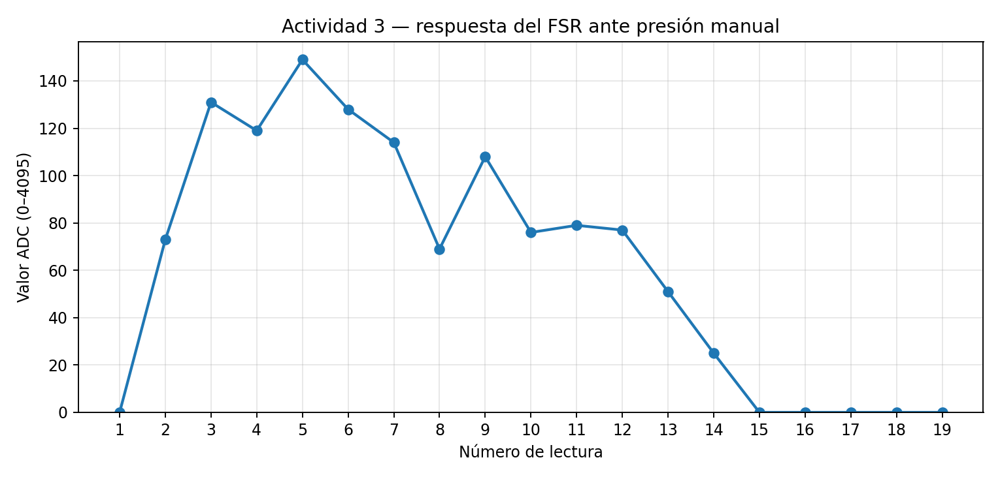
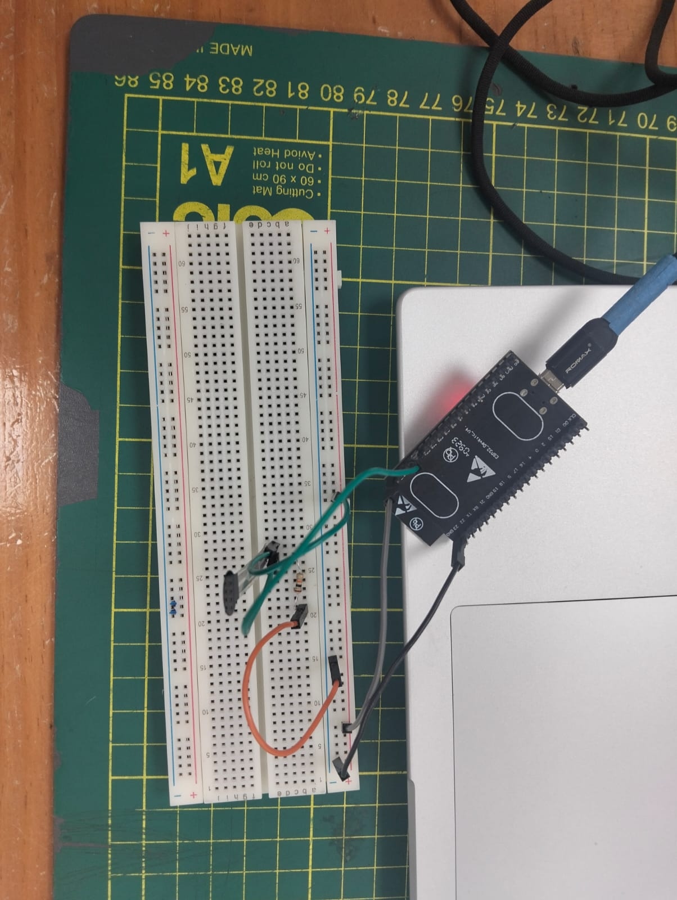
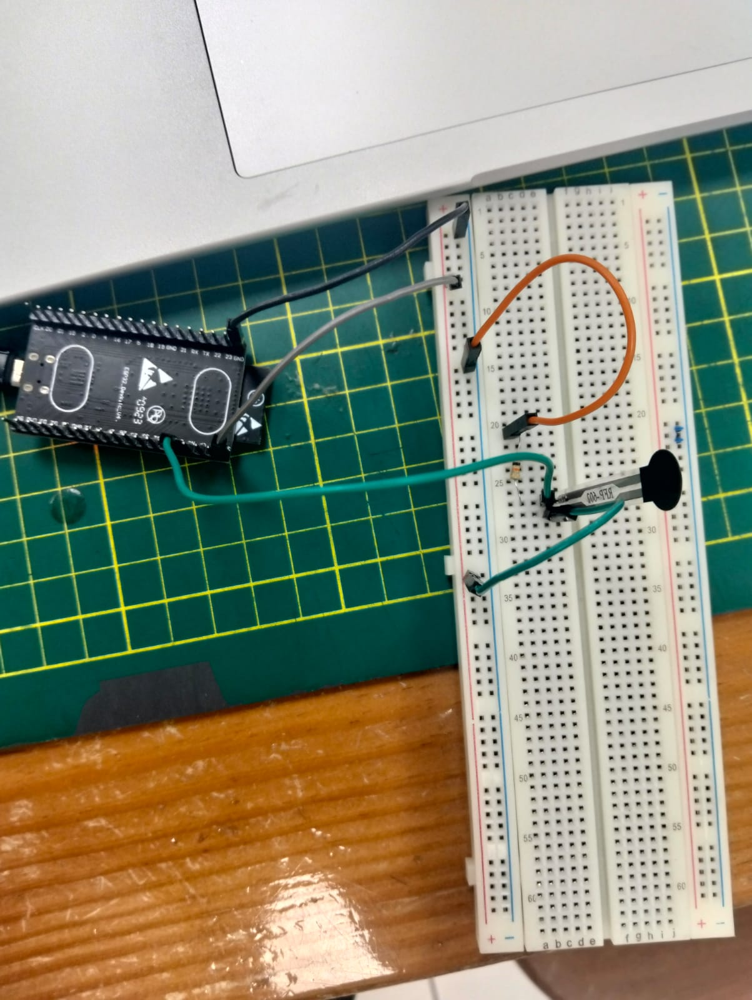
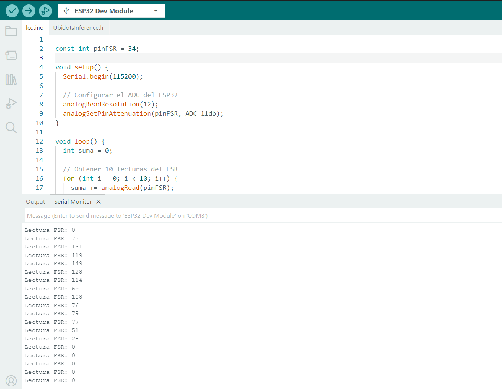

# Actividad 03 — Prueba experimental individual del sensor FSR

**Proyecto:** Ligura — Sistema de evaluación no destructiva de granadillas mediante excitación vibratoria y análisis vibroacústico  
**Etapa:** TRL 3 — Prueba de concepto experimental  
**Componente evaluado:** Sensor resistivo de fuerza (FSR)  
**Tipo de prueba:** Experimental individual, sin integración al gripper  
**Estado:** Prueba funcional realizada; calibración de fuerza pendiente.

## 1. Objetivo

Comprobar experimentalmente que un sensor FSR conectado a un ESP32 DevKit V1 responde a la aplicación y retirada de presión manual mediante cambios en la lectura analógica (ADC), antes de su integración al sistema de sujeción de Ligura.

## 2. Fundamento técnico

El FSR es un sensor cuya resistencia eléctrica generalmente disminuye al aumentar la fuerza normal aplicada sobre su zona sensible. Se empleó un divisor de voltaje para convertir ese cambio resistivo en una señal eléctrica medible por el ESP32.

En el circuito de prueba, el FSR se conecta entre **3.3 V** y el nodo de lectura; una resistencia fija de **10 kΩ** conecta ese nodo a **GND**. Así, la tensión esperada en el nodo se modela mediante:

$$
V_{out}=V_{cc}\frac{R_{fija}}{R_{FSR}+R_{fija}}
$$

Con $V_{cc}=3.3\,V$ y $R_{fija}=10\,k\Omega$:

$$
V_{out}=3.3\frac{10000}{R_{FSR}+10000}
$$

En esta conexión, una reducción de $R_{FSR}$ tiende a aumentar $V_{out}$ y la lectura ADC. **El ADC no es una medición directa de fuerza en newtons** y requiere calibración para estimarla. Tampoco debe asumirse que la conversión ADC→voltaje del ESP32 es ideal.

## 3. Materiales y equipo

| Elemento | Función |
|---|---|
| Sensor FSR | Detectar cambios de carga sobre su superficie |
| ESP32 DevKit V1 | Adquirir la señal analógica |
| Resistencia de 10 kΩ | Formar el divisor de voltaje |
| Protoboard y cables Dupont | Montaje eléctrico provisional |
| Cable USB y computadora | Alimentar/programar el ESP32 y visualizar resultados |
| Arduino IDE 2.3.10 | Programación y Monitor Serie |

## 4. Montaje y conexiones

Se utilizó el siguiente esquema eléctrico:

```text
  ESP32: 3V3
      |
     FSR
      |
      +---------------- GPIO 34 (ADC)
      |
    10 kΩ
      |
  ESP32: GND
```

| Conexión | Destino |
|---|---|
| Terminal 1 del FSR | 3V3 del ESP32 |
| Terminal 2 del FSR | Nodo de medición / GPIO 34 |
| Extremo 1 de la resistencia de 10 kΩ | Nodo de medición / GPIO 34 |
| Extremo 2 de la resistencia de 10 kΩ | GND del ESP32 |

**Seguridad del montaje:** las conexiones se realizan con el ESP32 desconectado del USB. La entrada ADC no debe recibir más de 3.3 V.

## 5. Procedimiento experimental

1. Se armó el divisor de voltaje en protoboard y se conectó su nodo intermedio al GPIO 34.
2. Se seleccionó la placa **ESP32 Dev Module** y el puerto serial **COM8** en Arduino IDE.
3. Se cargó un programa que toma 10 lecturas analógicas consecutivas y muestra su promedio entero en el Monitor Serie.
4. Se observó la lectura con el sensor sin presión.
5. Se presionó manualmente la superficie sensible del FSR, variando la presión aplicada.
6. Se retiró la presión y se observó el retorno de la lectura a valores cercanos a cero.
7. Se guardó una captura del Monitor Serie como evidencia.

**Condición de ensayo:** presión aplicada con el dedo, sin instrumentación de fuerza. Por ello, esta actividad verifica la respuesta funcional, pero **no constituye calibración en newtons ni evaluación de repetibilidad bajo carga controlada**.

## 6. Código utilizado — Arduino IDE

```cpp
const int pinFSR = 34;

void setup() {
  Serial.begin(115200);

  // Configurar el ADC del ESP32
  analogReadResolution(12);
  analogSetPinAttenuation(pinFSR, ADC_11db);
}

void loop() {
  int suma = 0;

  // Obtener 10 lecturas del FSR
  for (int i = 0; i < 10; i++) {
    suma += analogRead(pinFSR);
    delay(10);
  }

  // Calcular el promedio
  int adc = suma / 10;

  // Mostrar el resultado
  Serial.print("Lectura FSR: ");
  Serial.println(adc);

  delay(400);
}
```

**Parámetros:** entrada GPIO 34; resolución configurada de 12 bits (0–4095); atenuación `ADC_11db`; velocidad serial 115200 baudios; 10 muestras por resultado.

## 7. Resultados experimentales

Se transcribieron las **19 lecturas visibles** de la captura final del Monitor Serie.

| N.º | Lectura ADC | N.º | Lectura ADC |
|---:|---:|---:|---:|
| 1 | 0 | 11 | 79 |
| 2 | 73 | 12 | 77 |
| 3 | 131 | 13 | 51 |
| 4 | 119 | 14 | 25 |
| 5 | 149 | 15 | 0 |
| 6 | 128 | 16 | 0 |
| 7 | 114 | 17 | 0 |
| 8 | 69 | 18 | 0 |
| 9 | 108 | 19 | 0 |
| 10 | 76 | — | — |

### 7.1. Resumen descriptivo

| Indicador | Resultado |
|---|---:|
| Número de lecturas | 19 |
| Mínimo | 0 ADC |
| Máximo | 149 ADC |
| Promedio de toda la secuencia | 63.11 ADC |
| Lecturas mayores que cero | 13 |
| Lecturas iguales a cero | 6 |

> **Nota:** el promedio de toda la secuencia mezcla estados de presión y liberación, por lo que no debe interpretarse como un promedio calibrado para una fuerza determinada.

### 7.2. Gráfica de los valores registrados



La serie muestra un incremento inicial, variaciones mientras se manipula el sensor y un descenso hasta cero al retirar la presión. La presión manual no fue cuantificada ni mantenida necesariamente constante, por lo que las fluctuaciones **no permiten evaluar por sí solas la precisión ni la repetibilidad del FSR**.

## 8. Evidencias fotográficas del montaje y adquisición

### 8.1. Montaje experimental con ESP32



**Figura 1.** Vista superior del montaje físico utilizado para la prueba individual. Se observa el ESP32 conectado por USB, la protoboard, los conductores y el circuito resistivo de lectura.

### 8.2. Detalle del sensor FSR y sus conexiones



**Figura 2.** Detalle del sensor FSR, la resistencia y el cableado hacia la placa ESP32. La fotografía documenta la disposición física; la continuidad eléctrica de cada conexión se describe mediante el esquema de la sección 4.

### 8.3. Registro de datos en Arduino IDE



**Figura 3.** Captura real de Arduino IDE con el programa de adquisición y las lecturas del sensor durante una secuencia de presión y liberación.

Estas evidencias corresponden a la prueba funcional individual. La carga se aplicó manualmente y no se midió en newtons durante este ensayo.

## 9. Análisis de resultados

- Se obtuvieron valores ADC superiores a cero durante la presión manual, con un máximo observado de **149** en la captura final.
- Tras retirar la presión, las últimas cinco lecturas fueron **0**, compatible con el retorno a un estado sin carga detectable.
- La respuesta observada es consistente con la hipótesis de funcionamiento del divisor de voltaje y permite **detectar eventos de contacto y liberación**.
- Los valores no equivalen directamente a fuerza: no se conoce la carga exacta aplicada y no se calibró la cadena de medición.
- Las variaciones de lectura pueden depender de presión no uniforme, superficie de contacto, histéresis del FSR, conexiones o características del ADC. Esta prueba no determina cuál de esas causas domina.

## 10. Limitaciones y siguientes pruebas

1. **Calibración:** aplicar cargas conocidas, calcular $F=m\,g$ y registrar lecturas para construir la curva fuerza–ADC.
2. **Repetibilidad:** repetir cada carga varias veces en condiciones comparables y estudiar la dispersión.
3. **Montaje final:** validar la respuesta del FSR una vez instalado en el brazo del gripper, con una superficie de contacto adecuada.
4. **Seguridad de sujeción:** determinar el umbral de parada mediante ensayos que comprueben que la granadilla no sufre daño; no fijarlo solo a partir de esta prueba manual.

## 11. Conclusión

La prueba individual con componentes físicos mostró que el sensor FSR conectado al **ESP32 DevKit V1** proporciona una señal analógica que cambia cuando se aplica presión manual y vuelve a cero al liberarlo. Por tanto, se obtuvo **evidencia experimental inicial del principio de detección de contacto** previsto para Ligura.

Este resultado **no demuestra todavía una medición calibrada de fuerza**, ni asegura por sí mismo una sujeción segura de la granadilla. Es necesario continuar con ensayos de calibración y repetibilidad utilizando cargas conocidas, antes de integrar el sensor al gripper.

---

**Evidencias incluidas:** dos fotografías reales del montaje, captura real del Monitor Serie y gráfica elaborada a partir de las lecturas registradas.  
**Siguiente actividad del plan:** Actividad 4 — Simulación electrónica del FSR en Tinkercad.
