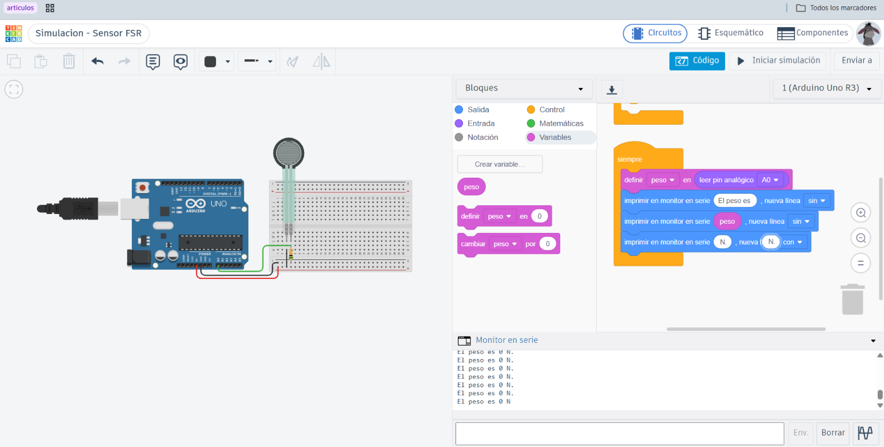
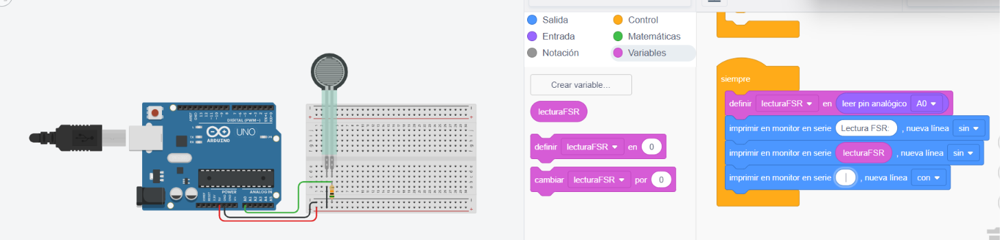
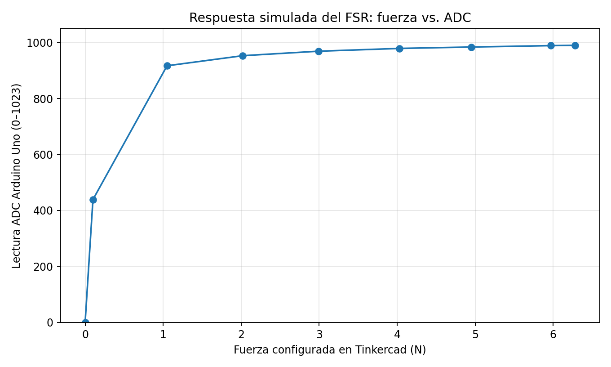
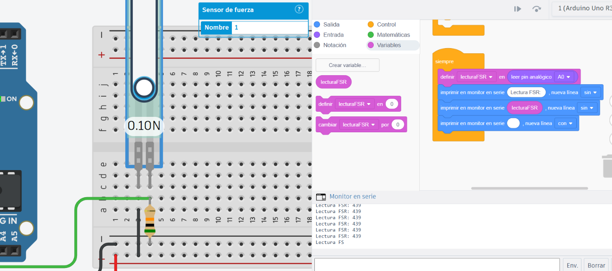
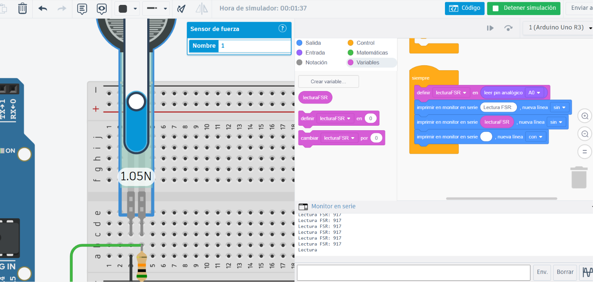
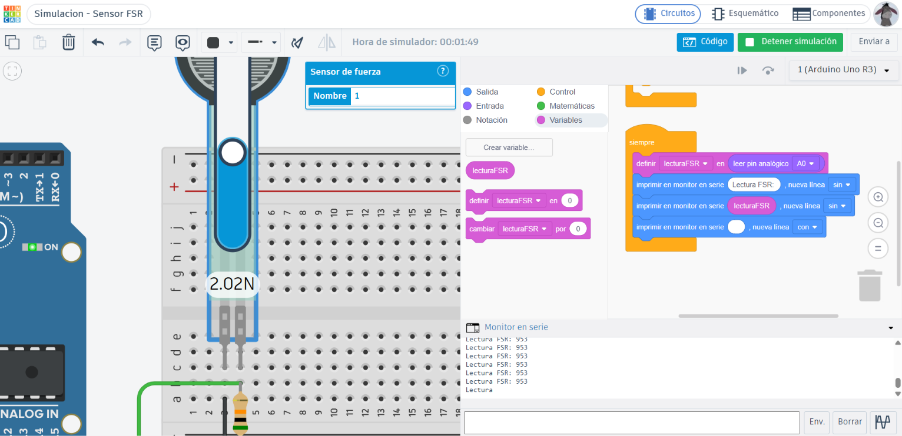
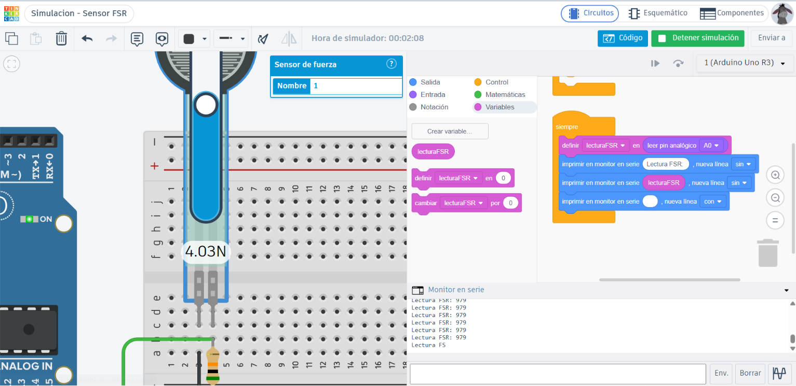
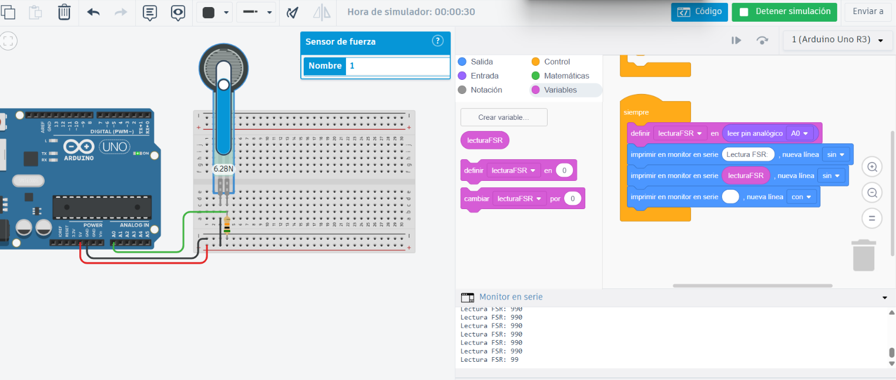
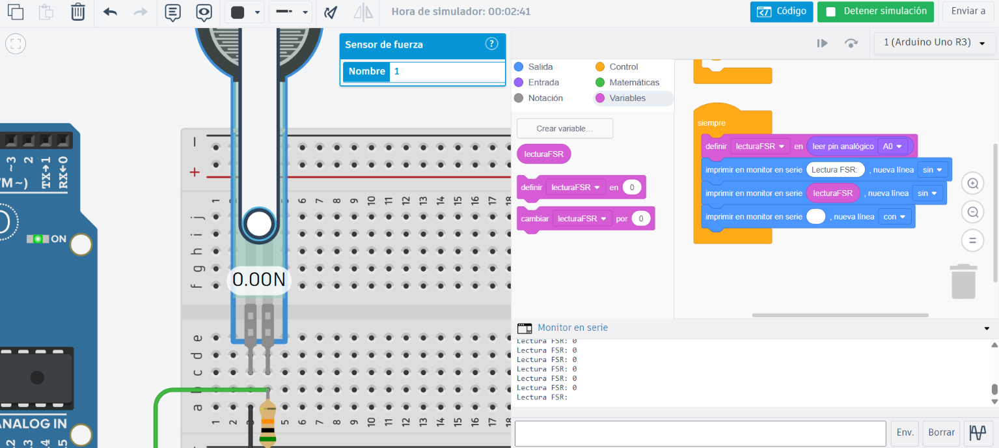

# Actividad 04 — Simulación electrónica del sensor FSR en Tinkercad

**Proyecto:** Ligura — Evaluación no destructiva de granadillas mediante excitación vibratoria y análisis vibroacústico  
**Etapa:** TRL 3 — Prueba de concepto  
**Componente evaluado:** Sensor resistivo de fuerza (FSR), representado por el modelo virtual de Tinkercad  
**Herramienta:** Tinkercad Circuits  
**Tipo de prueba:** Simulación electrónica y caracterización preliminar mediante fuerza configurada en el simulador  
**Estado:** Simulación de respuesta y liberación completada. **No es una calibración experimental del FSR físico.**

## 1. Objetivo

Evaluar en Tinkercad el comportamiento de un sensor de fuerza resistivo ante diferentes fuerzas configuradas, mediante un divisor de voltaje y la adquisición analógica con un Arduino Uno, para verificar la capacidad del circuito de detectar variaciones de carga y liberación antes de su eventual aplicación al gripper de Ligura.

## 2. Fundamento técnico

Un FSR modifica su resistencia eléctrica ante la fuerza aplicada. Mediante un divisor de voltaje, este cambio puede convertirse en una tensión observable por una entrada analógica. La relación depende de la orientación del divisor:

$$
V_{out}=V_{cc}\frac{R_{fija}}{R_{FSR}+R_{fija}}
$$

Esta expresión corresponde al caso en que el FSR queda entre la alimentación y el nodo de lectura, mientras la resistencia fija conecta el nodo a tierra. Se debe verificar que la conexión efectiva del simulador coincida con esta configuración antes de utilizar la expresión para estimar voltajes.

En esta actividad, la variable `lecturaFSR` contiene la **lectura ADC** de `A0`, no la fuerza en newtons. La fuerza en N es el valor que se configuró directamente en el sensor virtual mediante el control de Tinkercad.

El ADC del Arduino Uno entrega valores nominales de **0 a 1023** (10 bits). Este entorno virtual **no representa directamente** el ADC del ESP32 de la Actividad 3, que se configuró a 12 bits, ni garantiza reproducir el comportamiento cuantitativo del FSR RFP-602 físico.

## 3. Recursos y componentes virtuales

| Elemento | Uso en la simulación |
|---|---|
| Arduino Uno R3 | Lectura analógica de la señal mediante `A0` |
| Sensor de fuerza de Tinkercad | Modelo virtual de FSR con fuerza configurable en N |
| Resistencia fija | Divisor resistivo para convertir resistencia a voltaje |
| Protoboard y cables | Interconexión de componentes |
| Programación por bloques | Lectura de `A0` y envío al Monitor Serie |
| Monitor Serie | Registro de las lecturas ADC simuladas |

> **Nota de alcance:** el Arduino Uno es el equipo **simulado**; la prueba física previa de Ligura se realizó con **ESP32 DevKit V1**. No se deben mezclar sus escalas ADC ni atribuir estos datos al hardware real.

## 4. Montaje virtual

Se realizó en Tinkercad un montaje con el sensor FSR, una resistencia, una protoboard y un Arduino Uno R3. El nodo analógico se leyó por el pin `A0`. Se configuró la fuerza del sensor mediante el deslizador propio del simulador.

*Figura 1. Montaje electrónico virtual realizado en Tinkercad.*

## 5. Programa de adquisición

En el bloque **«siempre»**, se implementaron estas acciones:

1. `definir lecturaFSR en leer pin analógico A0`.
2. Imprimir el texto `Lectura FSR:` sin salto de línea.
3. Imprimir el valor de `lecturaFSR` sin salto de línea.
4. Imprimir un salto de línea para separar las lecturas.

*Figura 2. Lectura del pin analógico `A0` y registro de los datos en el Monitor Serie.*

Este programa **no transforma ADC a newtons**. No se realizó una conversión de fuerza en el código.

## 6. Procedimiento de simulación

1. Se inició la simulación y se observó la lectura del sensor virtual sin fuerza aplicada.
2. Se seleccionó el sensor y se modificó progresivamente la fuerza mediante el control deslizante de Tinkercad.
3. Se registró, para cada valor, la fuerza mostrada por el sensor y el valor estable observado en el Monitor Serie.
4. Se aumentó la fuerza hasta 6.28 N y se compararon las lecturas.
5. Se redujo nuevamente la fuerza a 0 N y se verificó el retorno del ADC a cero.
6. Se conservaron capturas del simulador con los parámetros y resultados observados.

## 7. Resultados de simulación

| Prueba | Fuerza configurada (N) | Lectura ADC simulada |
|---:|---:|---:|
| 1 | 0.00 | 0 |
| 2 | 0.10 | 439 |
| 3 | 1.05 | 917 |
| 4 | 2.02 | 953 |
| 5 | 2.99 | 969 |
| 6 | 4.03 | 979 |
| 7 | 4.95 | 984 |
| 8 | 5.97 | 989 |
| 9 | 6.28 | 990 |
| 10 | 0.00 (después de liberar) | 0 |

**Origen de los valores:** lecturas mostradas en las capturas de Tinkercad aportadas durante la actividad. Son resultados **simulados**, no mediciones sobre el FSR físico ni fuerzas aplicadas a una granadilla.

### 7.1. Curva fuerza–ADC

*Figura 3. Curva de respuesta del modelo virtual de FSR en Tinkercad con Arduino Uno.*

### 7.2. Evidencias de diferentes niveles de fuerza

| Fuerza configurada | Captura de evidencia |
|---|---|
| 0.10 N |  |
| 1.05 N |  |
| 2.02 N |  |
| 2.99 N |  |
| 4.03 N |  |
| 4.95 N |  |
| 5.97 N |  |
| 6.28 N |  |

### 7.3. Prueba de liberación

Al regresar a **0.00 N**, el Monitor Serie mostró **0 ADC**, por lo que el modelo virtual retornó al estado inicial tras retirar la fuerza.

*Figura 4. Prueba de liberación del sensor virtual y retorno a lectura cero.*

## 8. Análisis de resultados

La lectura aumentó de 0 a 439 ADC entre 0.00 y 0.10 N; a 1.05 N alcanzó 917 ADC. Sin embargo, entre 4.95 y 6.28 N solo cambió de 984 a 990 ADC. Por tanto, la respuesta **no es lineal** y muestra **compresión de la señal a fuerzas mayores**, acercándose a la parte alta del rango ADC.

La respuesta permite visualizar el principio de detección de fuerza, pero su menor variación a fuerzas elevadas puede dificultar distinguir pequeñas diferencias de carga. Esta observación corresponde a la configuración simulada y no permite fijar todavía un umbral seguro de sujeción para la granadilla.

El retorno a 0 ADC al retirar la carga demuestra un comportamiento de liberación **en el modelo virtual**. No permite concluir repetibilidad, histéresis ni precisión del sensor físico: para ello harían falta ciclos controlados y mediciones experimentales.

## 9. Limitaciones

- La simulación empleó un **Arduino Uno R3**, no el ESP32 del prototipo final.
- Se utilizó el **modelo genérico de fuerza de Tinkercad**, que no constituye una caracterización verificada del **FSR RFP-602** real.
- Los valores de fuerza fueron **configurados por software**, no aplicados con pesas físicas.
- No se comprobó la fuerza real ni la incertidumbre instrumental.
- Los datos registrados corresponden a una barrida ascendente y una liberación final; **no son suficientes** para medir repetibilidad ni histéresis.
- La curva simulada no debe usarse directamente como ecuación de calibración del sensor real ni como umbral definitivo para el gripper.

## 10. Conclusiones

1. Se implementó un circuito virtual de lectura FSR con Arduino Uno y Monitor Serie en Tinkercad.
2. La lectura ADC aumentó cuando se elevó la fuerza configurada, evidenciando una respuesta no lineal.
3. Se observó una menor variación del ADC a fuerzas mayores, lo que sugiere cercanía a la saturación en la configuración simulada.
4. Al retirar la fuerza, la lectura regresó a 0 ADC.
5. La actividad contribuye al **TRL 3 como evidencia de simulación de principio de funcionamiento**; no reemplaza la calibración física que debe realizarse para determinar la relación fuerza–ADC y el umbral de sujeción de Ligura.

## 11. Relación con el proyecto Ligura

En Ligura se prevé utilizar el FSR en uno de los brazos del gripper para reconocer contacto y monitorear la fuerza durante la sujeción. Esta simulación sirve para estudiar cómo una fuerza configurada puede reflejarse en una lectura analógica; la correspondencia exacta debe validarse con el sensor físico, el circuito definitivo y la geometría real de contacto con la granadilla.

## 12. Evidencias adicionales

- [Captura sin fuerza al iniciar](./imagenes/03_sin_fuerza.png)
- [Capturas del circuito y el programa](./imagenes/01_montaje_inicial.png)
- [Gráfica de respuesta fuerza–ADC](./imagenes/fsr_fuerza_adc_tinkercad.png)

**Siguiente etapa:** contrastar el modelo simulado con la prueba individual física ya realizada y, cuando sea posible, efectuar calibración con cargas de referencia.
