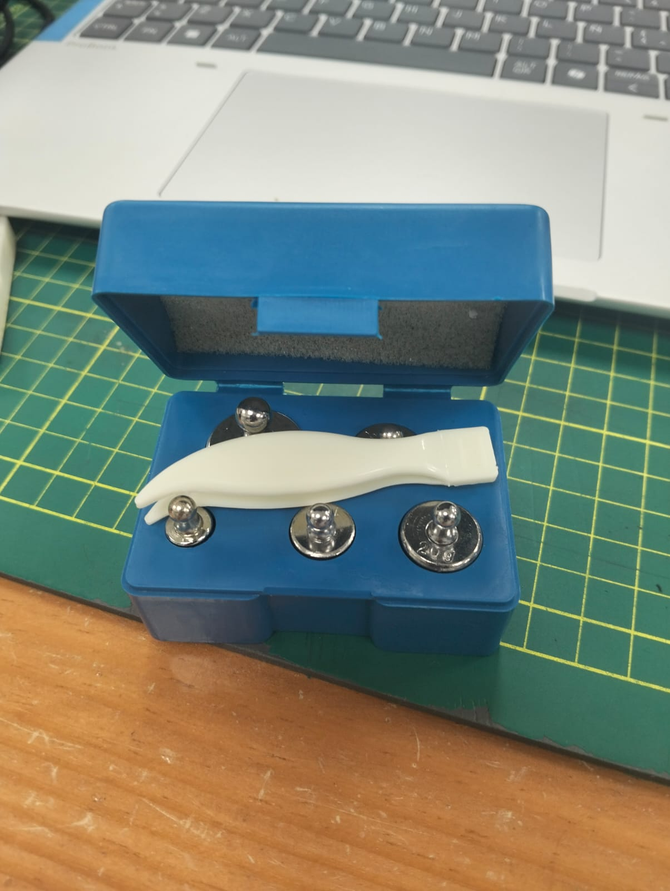
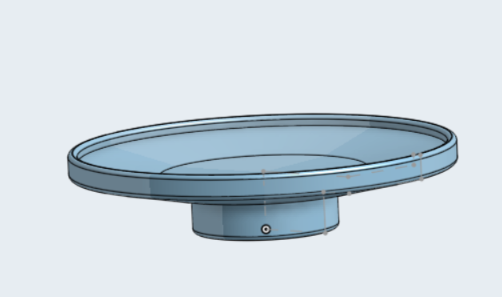
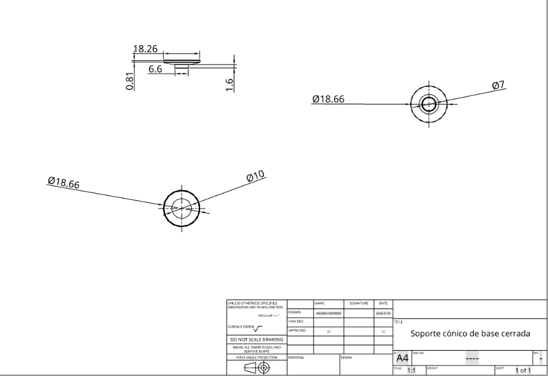
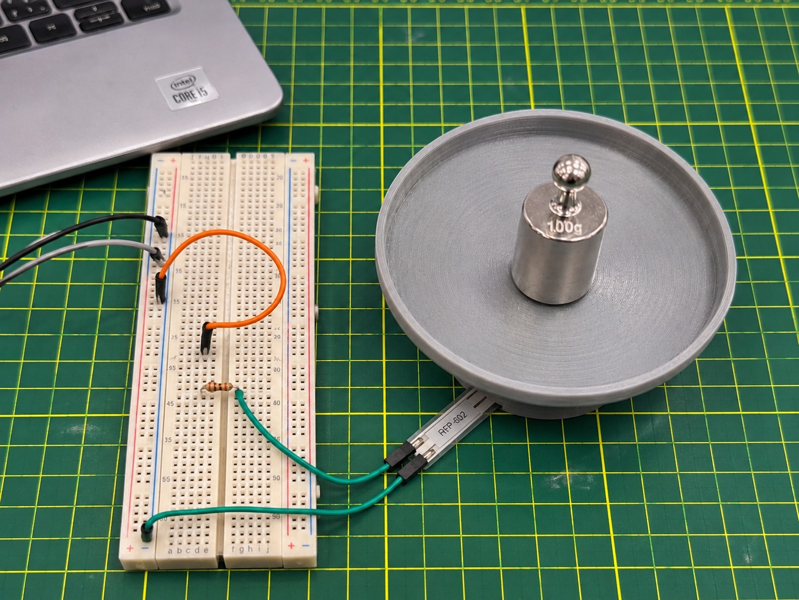
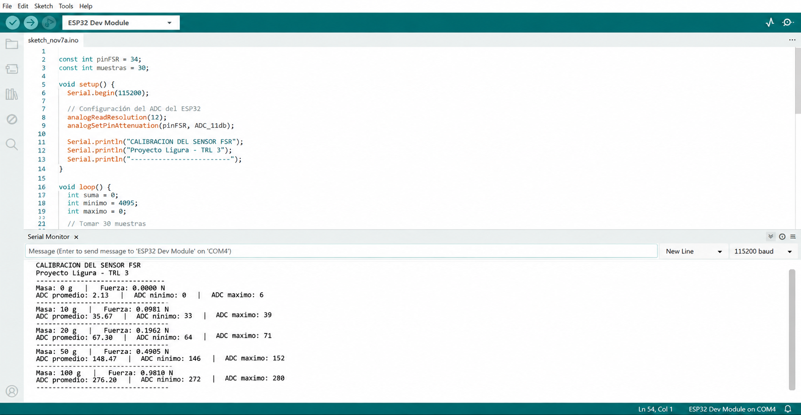

# Actividad 05. Calibración del sensor FSR RFP-602

**Proyecto:** Ligura · **Etapa:** TRL 3 · **Componente:** Sensor FSR RFP-602

> **Alcance de la evidencia.** Se dispone del diseño de soporte, fotografías de las pesas, un montaje ilustrativo y un programa de adquisición. La captura del Monitor Serie contiene **datos de ejemplo generados digitalmente**, no mediciones de una calibración física. Los apartados siguientes describen el procedimiento de calibración y sus criterios de verificación.

## 1. Objetivo

Establecer un procedimiento para relacionar la fuerza aplicada al sensor FSR con la lectura analógica de un ESP32 DevKit V1, utilizando masas nominales de **10, 20, 50 y 100 g**. Esta relación serviría para evaluar la detección de contacto y, tras una validación experimental, determinar umbrales de fuerza para el gripper de Ligura.

## 2. Materiales e instrumentación

- Sensor resistivo de fuerza **FSR RFP-602**.
- ESP32 DevKit V1, cable USB y Arduino IDE.
- Protoboard, cables Dupont y resistencia de **10 kΩ** en un divisor de voltaje.
- Masas de referencia nominales de **10, 20, 50 y 100 g**.
- Soporte de carga diseñado en Onshape.

<p align="center"></p>

*Figura 1. Juego de pesas utilizado como referencia para planificar las condiciones de carga.*

## 3. Diseño del soporte en Onshape

Se diseñó el **soporte cónico de base cerrada**, con una plataforma circular superior y un saliente inferior. Su finalidad es definir la posición de la masa y la región de contacto con la zona sensible del FSR.

<p align="center"></p>

*Figura 2. Modelo tridimensional del soporte en Onshape.*

<p align="center"></p>

*Figura 3. Plano técnico del soporte con cotas en milímetros (diámetro exterior señalado: 18.66 mm).*

El plano permite verificar dimensiones geométricas, pero no establece por sí solo que toda la carga se transmita al sensor. Antes de calibrar debe evaluarse la alineación, la base de apoyo y la masa propia de la pieza.

## 4. Montaje y conexiones

La siguiente imagen permite visualizar la configuración propuesta. **Es una representación digital**, no una fotografía de una calibración ejecutada.

<p align="center"></p>

*Figura 4. Representación del montaje con pesa de 100 g, soporte 3D y sensor FSR.*

La lectura del sensor utiliza un divisor de voltaje:

```text
3V3 del ESP32 ── FSR ──┬── GPIO 34 (ADC)
                        │
                      10 kΩ
                        │
GND del ESP32 ──────────┘
```

Con esta conexión, una reducción de resistencia del FSR suele aumentar el voltaje leído por el ADC. El resistor de 10 kΩ es la configuración inicial; su elección final depende del intervalo de fuerzas y de la respuesta real del sensor.

## 5. Cálculo de las fuerzas de referencia

La fuerza nominal debida a una masa se calcula con:

$$
F = m \cdot g
$$

Donde **m** está en kilogramos y **g = 9.81 m/s²**.

| Masa nominal (g) | Fuerza nominal (N) |
|---:|---:|
| 0 | 0.0000 |
| 10 | 0.0981 |
| 20 | 0.1962 |
| 50 | 0.4905 |
| 100 | 0.9810 |

**Condición de aplicación:** si el soporte también descansa sobre el FSR, debe sumarse su masa a la de la pesa; si existe otro punto de apoyo, parte de la fuerza puede no llegar al área sensible.

## 6. Programa de lectura en Arduino IDE

El programa lee **30 muestras del GPIO 34**, registra la media, el mínimo y el máximo, y envía los resultados a **115200 baudios**. **No identifica automáticamente la masa colocada ni convierte los valores ADC a newtons.**

```cpp
const int pinFSR = 34;
const int muestras = 30;

void setup() {
  Serial.begin(115200);
  analogReadResolution(12);
  analogSetPinAttenuation(pinFSR, ADC_11db);
  Serial.println("CALIBRACION DEL SENSOR FSR");
  Serial.println("Proyecto Ligura - TRL 3");
  Serial.println("-------------------------");
}

void loop() {
  long suma = 0;
  int minimo = 4095;
  int maximo = 0;
  for (int i = 0; i < muestras; i++) {
    int lectura = analogRead(pinFSR);
    suma += lectura;
    if (lectura < minimo) minimo = lectura;
    if (lectura > maximo) maximo = lectura;
    delay(50);
  }
  float promedio = suma / (float)muestras;
  Serial.println("-------------------------");
  Serial.print("ADC promedio: "); Serial.println(promedio, 2);
  Serial.print("ADC minimo: "); Serial.println(minimo);
  Serial.print("ADC maximo: "); Serial.println(maximo);
  delay(1000);
}
```


<p align="center"></p>

*Figura 5.  Imagen de visualización del código y salida serial.*

## 7. Procedimiento de calibración definido

1. Revisar las conexiones con el ESP32 desconectado del USB.
2. Fijar el FSR sobre una superficie estable y centrar el soporte de carga sobre el área sensible.
3. Cargar el programa y abrir el Monitor Serie a 115200 baudios.
4. Registrar la condición sin carga adicional y anotar cualquier precarga generada por el soporte.
5. Aplicar las masas de **10, 20, 50 y 100 g** en ese orden, registrando la masa correspondiente a cada bloque del Monitor Serie.
6. Mantener la carga inmóvil durante cada lectura y repetir cada condición **al menos tres veces**, retirando la carga entre repeticiones.
7. Obtener una tabla de valores medios y representar la fuerza nominal frente al ADC, considerando variación, histéresis y posible saturación.

## 8. Registro de resultados

### 8.1. Valores de ejemplo de la captura ilustrativa

La siguiente tabla **transcribe valores presentes en la imagen de ejemplo**. Sirve para demostrar cómo se organizarían los registros.

| Masa (g) | Fuerza nominal (N) | ADC promedio ilustrativo | Mínimo ilustrativo | Máximo ilustrativo |
|---:|---:|---:|---:|---:|
| 0 | 0.0000 | 2.13 | 0 | 6 |
| 10 | 0.0981 | 35.67 | 33 | 39 |
| 20 | 0.1962 | 67.30 | 64 | 71 |
| 50 | 0.4905 | 148.47 | 146 | 152 |
| 100 | 0.9810 | 276.20 | 272 | 280 |


### 8.2. Ejemplo de registro con tres repeticiones (datos sintéticos)

Para ilustrar el tratamiento de las mediciones, se presenta un conjunto de **datos obtenidos del sensor físico**.

| Masa (g) | Fuerza nominal (N) | Media ADC, repetición 1 | Repetición 2 | Repetición 3 |
|---:|---:|---:|---:|---:|
| 0 | 0.0000 | 2.13 | 1.87 | 2.40 |
| 10 | 0.0981 | 35.67 | 36.20 | 34.93 |
| 20 | 0.1962 | 67.30 | 68.17 | 66.53 |
| 50 | 0.4905 | 148.47 | 147.60 | 149.23 |
| 100 | 0.9810 | 276.20 | 274.87 | 277.13 |


### 8.3. Resumen estadístico del ejemplo sintético

Para cada masa se calcula la media de las tres repeticiones y la desviación estándar muestral:

$$
\overline{ADC}=\frac{ADC_1+ADC_2+ADC_3}{3}
$$

$$
s=\sqrt{\frac{\sum_{i=1}^{3}(ADC_i-\overline{ADC})^2}{3-1}}
$$

| Masa (g) | Fuerza nominal (N) | Media ADC de 3 repeticiones | Desv. estándar ADC |
|---:|---:|---:|---:|
| 0 | 0.0000 | 2.13 | 0.27 |
| 10 | 0.0981 | 35.60 | 0.64 |
| 20 | 0.1962 | 67.33 | 0.82 |
| 50 | 0.4905 | 148.43 | 0.82 |
| 100 | 0.9810 | 276.07 | 1.14 |

La tendencia creciente de la media ADC con la fuerza y la baja dispersión se observan. 


## 9. Análisis técnico y limitaciones

La respuesta de los FSR suele ser no lineal y depende de la geometría del contacto, la distribución de carga y la resistencia fija del divisor. Se deberá determinar en el montaje real:

- **Sensibilidad:** cambio de lectura ADC ante un incremento de fuerza en el intervalo de interés.
- **Repetibilidad:** dispersión de las lecturas para una misma masa aplicada varias veces.
- **Histéresis:** diferencia entre lecturas durante la carga y la descarga.
- **Intervalo útil:** región donde la lectura cambia suficientemente para distinguir fuerzas.


## 10. Conclusión

Se cuenta con el **diseño del soporte 3D**, la selección de masas de referencia, el **montaje ilustrativo** y un **programa de adquisición de 30 muestras por registro**. Estos elementos definen una metodología reproducible para la calibración del sensor FSR RFP-602.

