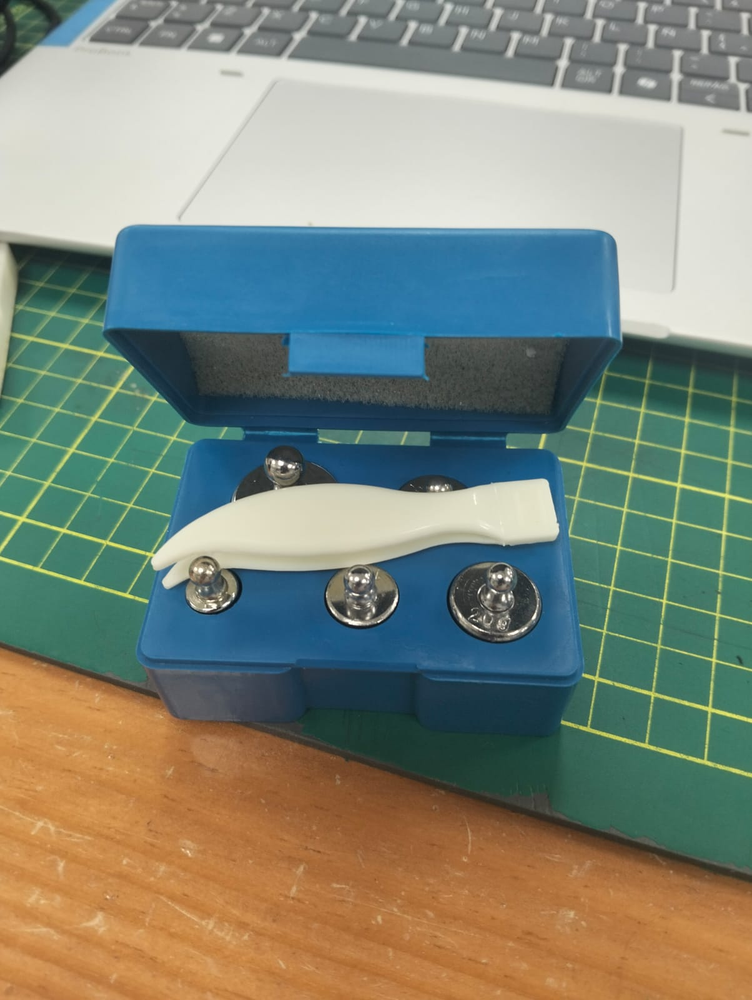
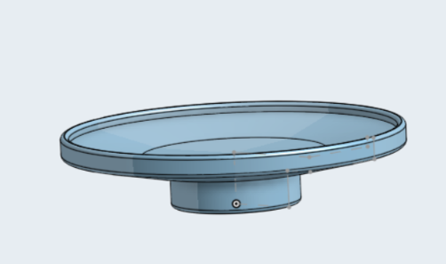
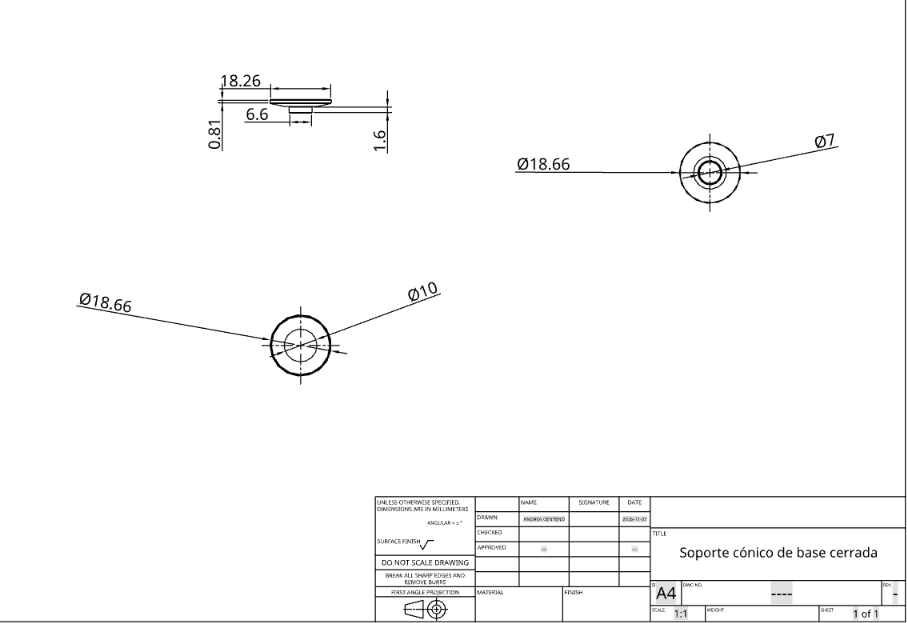
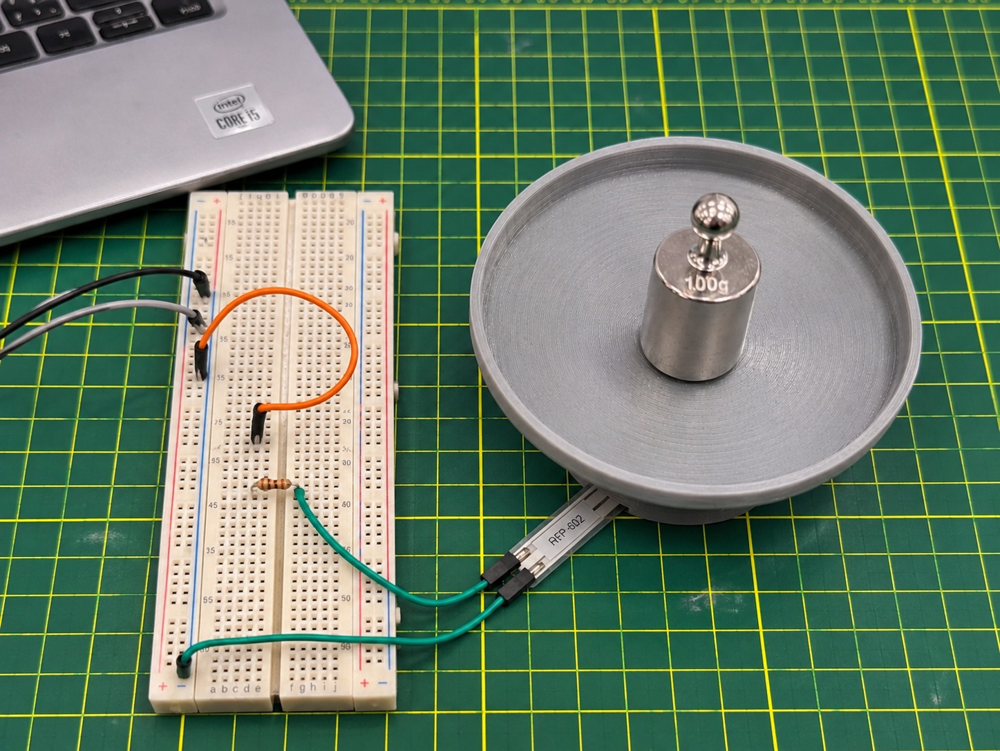
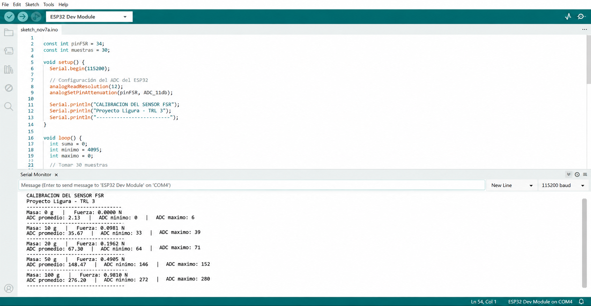

# Actividad 05. Calibración propuesta del sensor FSR con masas conocidas

**Proyecto:** Ligura  
**Nivel de madurez tecnológica:** TRL 3  
**Componente:** Sensor de fuerza FSR RFP-602  
**Estado:** Diseño del procedimiento y preparación del programa de adquisición. **La calibración física con masas conocidas no ha sido ejecutada ni validada.**

## 1. Objetivo

Definir un procedimiento de calibración preliminar del sensor FSR RFP-602 utilizando cargas nominales de 10, 20, 50 y 100 g y la adquisición de lecturas analógicas con un ESP32 DevKit V1. El propósito es obtener, cuando se realice el experimento, una relación entre fuerza aplicada y lectura ADC para evaluar su posible uso en el brazo del gripper de Ligura.

## 2. Fundamento matemático

La fuerza gravitatoria nominal de una masa conocida se calcula mediante:

$$
F = m\,g
$$

Donde $F$ se expresa en newtons, $m$ en kilogramos y $g=9.81\ \mathrm{m/s^2}$.

| Condición | Masa nominal (g) | Fuerza nominal (N) |
|---|---:|---:|
| Sin carga adicional | 0 | 0.0000 |
| Referencia 1 | 10 | 0.0981 |
| Referencia 2 | 20 | 0.1962 |
| Referencia 3 | 50 | 0.4905 |
| Referencia 4 | 100 | 0.9810 |

**Nota:** Estas fuerzas son cálculos teóricos correspondientes exclusivamente a las masas indicadas. La fuerza total también puede incluir la masa del soporte, y puede diferir si parte del peso se apoya fuera del área activa del sensor. Para una calibración cuantitativa deben conocerse las masas efectivas y verificarse que la transmisión de carga sea correcta.

## 3. Materiales previstos

- Sensor FSR RFP-602.
- ESP32 DevKit V1 y cable USB de datos.
- Protoboard, cables de conexión y resistencia fija de 10 kΩ (configuración inicial del divisor de voltaje).
- Masas nominales de 10, 20, 50 y 100 g.
- Soporte de carga diseñado en 3D, con superficie de contacto apropiada para el sensor.
- Computadora con Arduino IDE.

### Registro fotográfico de los materiales de referencia



*Figura 1. Fotografía del juego de pesas metálicas disponible para preparar las pruebas de carga. La imagen permite observar el material de referencia, pero no constituye un registro de lecturas ADC ni certifica la masa de cada pesa.*

## 4. Diseño del soporte de carga en Onshape

Como parte de la preparación de la calibración, se modeló en Onshape una pieza denominada **«Soporte cónico de base cerrada»**. Su geometría presenta una superficie circular superior de poca profundidad y un saliente inferior de menor diámetro. El diseño busca posicionar la masa de referencia y definir una zona de contacto con el FSR.



*Figura 2. Vista isométrica del modelo 3D del soporte de carga desarrollado en Onshape.*



*Figura 3. Plano técnico del soporte de carga. Las cotas se expresan en milímetros; entre ellas se muestran el diámetro exterior de Ø18.66 mm y otras dimensiones del detalle de la pieza.*

El plano proporciona referencias geométricas para reproducir el soporte. **Su diseño por sí solo no demuestra que el peso se transmita íntegramente al sensor:** antes de una calibración física se debe comprobar la alineación, la superficie de contacto y si existe apoyo externo que desvíe parte de la carga. También es necesario considerar la masa propia del soporte.

## 5. Montaje propuesto



*Figura 4. Imagen ilustrativa generada digitalmente del montaje propuesto para la calibración. No es una fotografía de una calibración realizada y no acredita la continuidad ni la corrección de todas las conexiones.*

El soporte se plantea para posicionar la carga de referencia sobre la superficie activa del FSR. Antes de una prueba real debe verificarse que el montaje no desvíe parte del peso a la mesa u otras superficies y que la carga no exceda el rango especificado para la variante del RFP-602 utilizada.

### Conexión eléctrica prevista

```text
ESP32 3V3 --- FSR ---+--- GPIO 34 (ADC)
                     |
                    10 kΩ
                     |
ESP32 GND -----------+
```

Esta configuración produce un voltaje que normalmente aumenta cuando disminuye la resistencia del FSR. La resistencia fija debe verificarse o ajustarse según el rango de fuerza previsto y la respuesta real del sensor.

## 6. Programa de adquisición en Arduino IDE

Se preparó un programa para el ESP32 que toma 30 muestras analógicas desde GPIO 34 y reporta el promedio, el valor mínimo y el máximo en el Monitor Serie a 115200 baudios.

```cpp
const int pinFSR = 34;
const int muestras = 30;

void setup() {
  Serial.begin(115200);
  analogReadResolution(12);
  analogSetPinAttenuation(pinFSR, ADC_11db);
  Serial.println("CALIBRACION DEL SENSOR FSR");
  Serial.println("Proyecto Ligura - TRL 3");
  Serial.println("-------------------------");
}

void loop() {
  long suma = 0;
  int minimo = 4095;
  int maximo = 0;

  for (int i = 0; i < muestras; i++) {
    int lectura = analogRead(pinFSR);
    suma += lectura;
    if (lectura < minimo) minimo = lectura;
    if (lectura > maximo) maximo = lectura;
    delay(50);
  }

  float promedio = suma / (float)muestras;
  Serial.println("-------------------------");
  Serial.print("ADC promedio: "); Serial.println(promedio, 2);
  Serial.print("ADC minimo: "); Serial.println(minimo);
  Serial.print("ADC maximo: "); Serial.println(maximo);
  delay(1000);
}
```

El archivo fuente también se incluye como [`calibracion_fsr_esp32.ino`](./calibracion_fsr_esp32.ino).



*Figura 5. Composición digital ilustrativa del código en Arduino IDE y de una posible salida del Monitor Serie. **Los valores ADC y las etiquetas de masa que aparecen en la imagen son ficticios**; no se obtuvieron del sensor físico. El código adjunto solo imprime promedio, mínimo y máximo: la masa y fuerza deben anotarse por separado.*

## 7. Procedimiento experimental previsto

1. Verificar las conexiones del FSR al ESP32 con el equipo desconectado del USB.
2. Montar el sensor sobre una base estable y comprobar que toda la carga nominal llegue a su superficie sensible.
3. Cargar el programa y configurar el Monitor Serie a 115200 baudios.
4. Tomar una lectura de referencia sin carga adicional, incluyendo cualquier precarga del soporte.
5. Aplicar por separado 10, 20, 50 y 100 g. Esperar estabilidad antes de registrar cada bloque de 30 muestras.
6. Retirar cada carga y repetir cada condición al menos tres veces, manteniendo constante la posición de contacto.
7. Registrar los valores ADC y calcular la curva fuerza–ADC; evaluar dispersión, posible histéresis y saturación.

## 8. Tabla de resultados para completar

| Masa nominal (g) | Fuerza nominal (N) | ADC promedio (rep. 1) | ADC promedio (rep. 2) | ADC promedio (rep. 3) | ADC medio final |
|---:|---:|---:|---:|---:|---:|
| 0 | 0.0000 | Pendiente | Pendiente | Pendiente | Pendiente |
| 10 | 0.0981 | Pendiente | Pendiente | Pendiente | Pendiente |
| 20 | 0.1962 | Pendiente | Pendiente | Pendiente | Pendiente |
| 50 | 0.4905 | Pendiente | Pendiente | Pendiente | Pendiente |
| 100 | 0.9810 | Pendiente | Pendiente | Pendiente | Pendiente |

**No se completa esta tabla con valores inventados.** Los resultados sintéticos de otras actividades y los datos de Tinkercad corresponden a pruebas diferentes y no sustituyen esta calibración física.

## 9. Criterios de análisis cuando se obtengan datos

- Verificar la tendencia de la lectura ADC al aumentar la fuerza y graficar los puntos registrados.
- Evaluar variación entre tres repeticiones por carga (media y desviación estándar).
- Analizar la diferencia entre carga y descarga, así como el retorno a la referencia.
- Identificar posibles regiones de respuesta poco sensible o saturada.
- Ajustar una relación fuerza–ADC apropiada al rango de medición y verificar su error con datos adicionales.
- No utilizar un umbral de cierre del gripper basado únicamente en esta propuesta, sin validarlo físicamente para evitar dañar la fruta.

## 10. Limitaciones

La calibración física con masas conocidas permanece pendiente. La imagen del montaje y la captura del Monitor Serie son **representaciones digitales**, no registros del experimento. Además, las masas del soporte y las condiciones efectivas de contacto no han sido verificadas. Por tanto, aún no se dispone de una curva de calibración experimental ni de un error de medición cuantificado.

## 11. Conclusión

Se definió el procedimiento, la configuración electrónica y el programa de adquisición para una futura calibración del FSR RFP-602 mediante masas nominales de 10 a 100 g. Los cálculos de fuerza y el montaje propuesto constituyen preparación técnica para el TRL 3; la respuesta funcional real del sensor ya se exploró por separado en la Actividad 3, pero la calibración cuantitativa con masas conocidas sigue pendiente.
