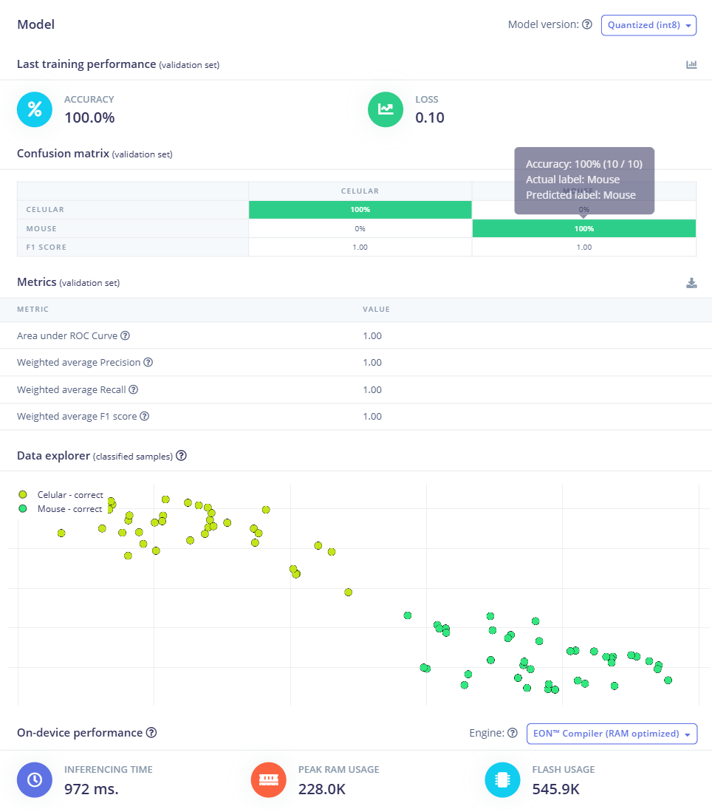
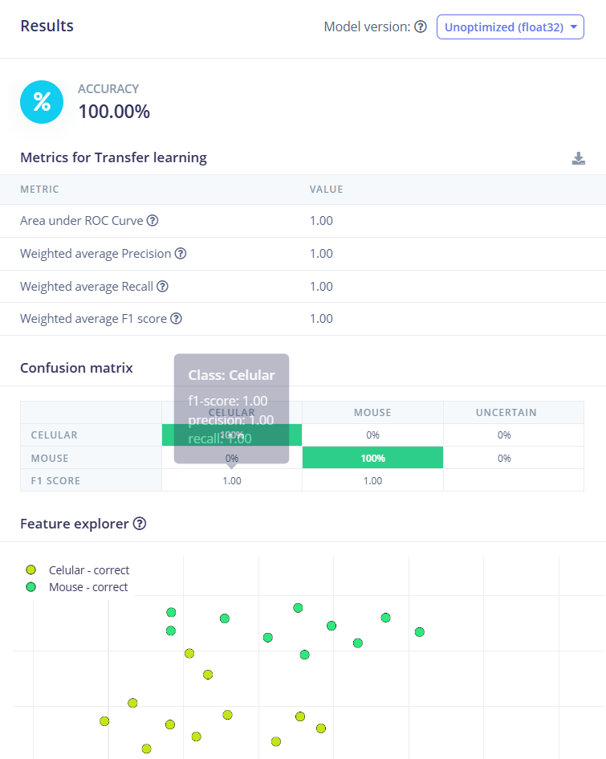
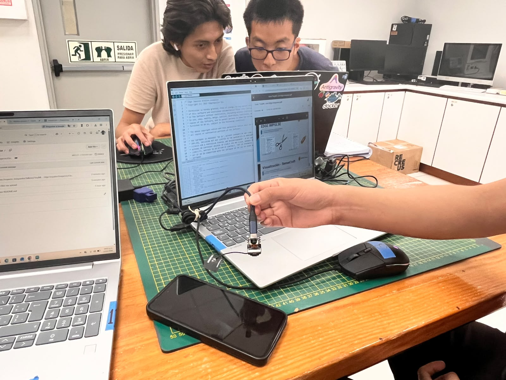
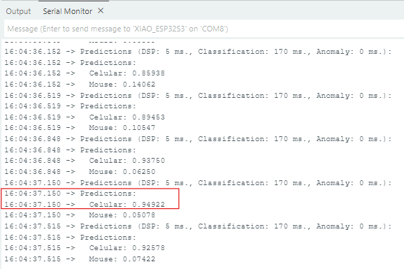
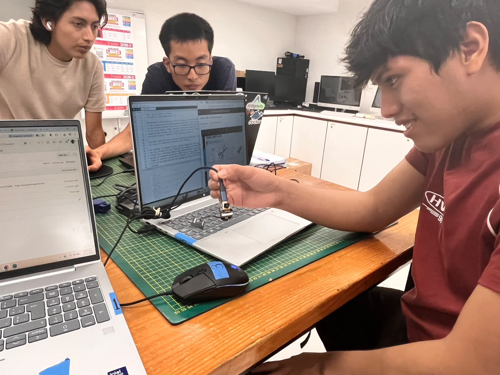
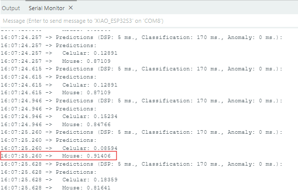
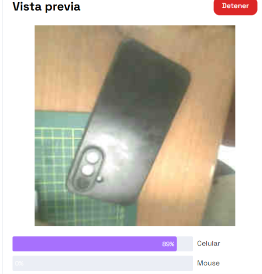
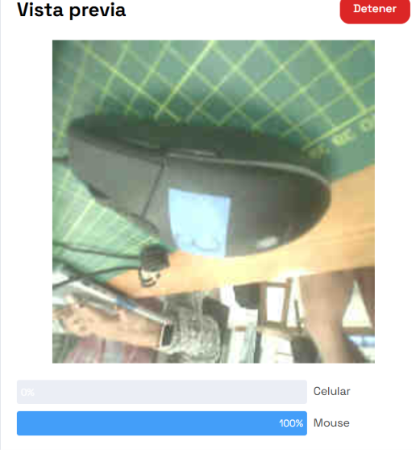

# 🟢 TinyML: Clasificación de objetos con Edge Impulse y SenseCraft AI

**Proyecto Integrador · Taller de TinyML · UPCH**

## 1. Descripción del proyecto

Este proyecto consiste en desarrollar un sistema de clasificación de imágenes mediante técnicas de **TinyML (Tiny Machine Learning)**, utilizando Edge Impulse y SenseCraft AI.

El modelo permite distinguir entre dos categorías de objetos: **celular** y **mouse**. Para ello, se utiliza un conjunto de imágenes etiquetadas, se entrena el modelo y se realizan pruebas para observar su comportamiento durante la clasificación.

El objetivo es evaluar el funcionamiento del modelo y documentar los resultados de entrenamiento, validación y pruebas realizadas con ambos objetos.

## 2. Herramientas utilizadas

| Herramienta o recurso | Función |
|---|---|
| **Edge Impulse** | Gestión del conjunto de datos, entrenamiento y evaluación del modelo. |
| **Transfer Learning** | Adaptación de un modelo previamente entrenado a las clases del proyecto. |
| **SenseCraft AI** | Realización de pruebas complementarias de clasificación. |
| **Dataset de imágenes** | Imágenes etiquetadas de celulares y mouse. |
| **XIAO ESP32S3 Sense** | Dispositivo utilizado en las pruebas de clasificación mostradas en el Monitor Serial. |

## 3. Conjunto de datos

El conjunto de datos contiene imágenes organizadas en dos categorías:

- **Celular:** imágenes de teléfonos celulares.
- **Mouse:** imágenes de ratones de computadora.

Las etiquetas permiten identificar la categoría correspondiente a cada imagen durante el entrenamiento y la evaluación del modelo.

*Figura 1. Conjunto de datos y etiquetado de las imágenes utilizadas en el proyecto.*

## 4. Entrenamiento y evaluación del modelo

### 4.1. Transfer Learning

Se utiliza Transfer Learning para adaptar un modelo previamente entrenado a la clasificación de las dos categorías definidas: `Celular` y `Mouse`.

*Figura 2. Resultados de la evaluación del modelo entrenado mediante Transfer Learning.*

La captura muestra un accuracy de **100.00 %**. Asimismo, las métricas de área bajo la curva ROC, precisión ponderada, recall ponderado y F1 score ponderado presentan un valor de **1.00**.

La matriz de confusión muestra un 100 % de clasificación correcta para las clases `Celular` y `Mouse` en la evaluación presentada.

### 4.2. Resultados del modelo cuantizado en Edge Impulse

*Figura 3. Métricas de validación, matriz de confusión y rendimiento del modelo cuantizado INT8.*

La evaluación del modelo presenta los siguientes resultados:

| Métrica | Resultado |
|---|---:|
| Versión del modelo | Quantized (INT8) |
| Accuracy | 100.0 % |
| Área bajo la curva ROC | 1.00 |
| Weighted average Precision | 1.00 |
| Weighted average Recall | 1.00 |
| Weighted average F1 score | 1.00 |
| F1 score de Celular | 1.00 |
| F1 score de Mouse | 1.00 |

La matriz de confusión muestra un 100 % de aciertos para cada clase y un 0 % de confusiones entre ambas en el conjunto de validación mostrado.

### 4.3. Rendimiento del modelo

Edge Impulse muestra los siguientes indicadores de rendimiento:

| Indicador | Resultado |
|---|---:|
| Motor de ejecución | EON Compiler |
| Optimización | RAM optimized |
| Tiempo de inferencia | 972 ms |
| Uso máximo de RAM | 228.0K |
| Uso de memoria Flash | 545.9K |

Estos indicadores permiten documentar el tiempo de inferencia y el uso de memoria reportados por la plataforma para el modelo evaluado.

## 5. Pruebas de clasificación en el dispositivo

### 5.1. Prueba de clasificación con celular

Se presenta un teléfono celular durante la demostración del proyecto. La prueba permite observar el objeto utilizado y relacionarlo con la salida generada por el modelo en el Monitor Serial.

**Evidencia de la prueba física**

*Figura 4. Demostración de la prueba con celular durante el funcionamiento del sistema.*

**Resultado del Monitor Serial**

*Figura 5. Resultado de la clasificación del celular en el Monitor Serial; se destaca la lectura seleccionada para el análisis.*

En la línea resaltada en rojo, registrada a las **16:04:37.150**, se muestran los siguientes valores:

| Clase | Valor registrado |
|---|---:|
| Celular | 0.94922 |
| Mouse | 0.05078 |

El valor de `Celular` equivale aproximadamente al **94.92 %**, mientras que el de `Mouse` equivale al **5.08 %**.

La clase `Celular` presenta el valor más alto, coincidiendo con el objeto utilizado en la prueba.

### 5.2. Prueba de clasificación con mouse

Se presenta un mouse de computadora durante la demostración del proyecto. A continuación, se muestra la evidencia física junto con la salida correspondiente del Monitor Serial.

**Evidencia de la prueba física**

*Figura 6. Demostración de la prueba con mouse durante el funcionamiento del sistema.*

**Resultado del Monitor Serial**

*Figura 7. Resultado de la clasificación del mouse en el Monitor Serial; se destaca la lectura seleccionada para el análisis.*

En la línea resaltada en rojo, registrada a las **16:07:25.260**, se muestran los siguientes valores:

| Clase | Valor registrado |
|---|---:|
| Celular | 0.08594 |
| Mouse | 0.91406 |

El valor de `Mouse` equivale aproximadamente al **91.41 %**, mientras que el de `Celular` equivale al **8.59 %**.

La clase `Mouse` presenta el valor más alto, coincidiendo con el objeto utilizado en la prueba.

### 5.3. Interpretación de las pruebas en el dispositivo

En las capturas analizadas, el valor más alto corresponde a la clase del objeto presentado:

- **Celular:** 0.94922 para la clase `Celular`.
- **Mouse:** 0.91406 para la clase `Mouse`.

Los valores descritos corresponden únicamente a las lecturas resaltadas en rojo en las capturas del Monitor Serial.

## 6. Pruebas complementarias con SenseCraft AI

### 6.1. Prueba con celular

Se presenta un teléfono celular en la interfaz de SenseCraft AI para observar el resultado de clasificación.

*Figura 8. Prueba de clasificación del celular en SenseCraft AI.*

La interfaz muestra los siguientes resultados:

| Clase | Resultado mostrado |
|---|---:|
| Celular | 89 % |
| Mouse | 0 % |

El valor mostrado para `Celular` es superior al de `Mouse`, coincidiendo con el objeto presentado en esta prueba.

### 6.2. Prueba con mouse

Se presenta un mouse de computadora en la interfaz de SenseCraft AI para observar el resultado de clasificación.

*Figura 9. Prueba de clasificación del mouse en SenseCraft AI.*

La interfaz muestra los siguientes resultados:

| Clase | Resultado mostrado |
|---|---:|
| Celular | 0 % |
| Mouse | 100 % |

El valor mostrado para `Mouse` es superior al de `Celular`, coincidiendo con el objeto presentado en esta prueba.

### 6.3. Comparación de las pruebas

| Objeto presentado | Monitor Serial | SenseCraft AI |
|---|---:|---:|
| Celular | 94.92 % para Celular | 89 % para Celular |
| Mouse | 91.41 % para Mouse | 100 % para Mouse |

Los valores corresponden a las pruebas individuales documentadas en cada plataforma. No deben confundirse con las métricas globales de validación de Edge Impulse.

## 7. Evidencia general del proyecto

*Figura 10. Evidencia del desarrollo y las pruebas del proyecto TinyML.*

## 8. Conclusiones técnicas

- El proyecto aborda la clasificación de imágenes en dos categorías: celular y mouse.
- La evaluación de Edge Impulse presenta un accuracy de 100.0 % en el conjunto de validación mostrado.
- En la prueba con celular, el valor resaltado en el Monitor Serial es 0.94922 para `Celular`, equivalente aproximadamente al 94.92 %.
- En la prueba con mouse, el valor resaltado en el Monitor Serial es 0.91406 para `Mouse`, equivalente aproximadamente al 91.41 %.
- En SenseCraft AI se muestran resultados de 89 % para el celular y 100 % para el mouse.
- Las evidencias relacionan cada objeto utilizado en las pruebas con su resultado correspondiente de clasificación.
- Las métricas de validación y los resultados individuales deben interpretarse por separado, pues corresponden a evaluaciones diferentes.

---

**Proyecto Integrador · Taller de TinyML**  
Universidad Peruana Cayetano Heredia (UPCH)
