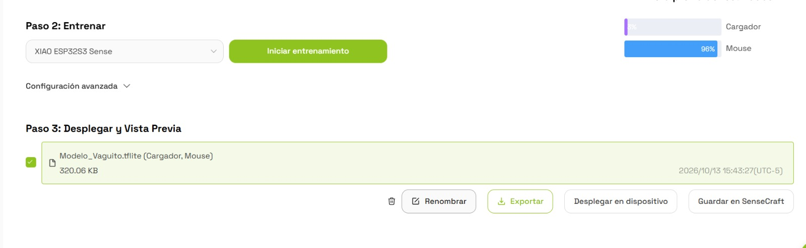
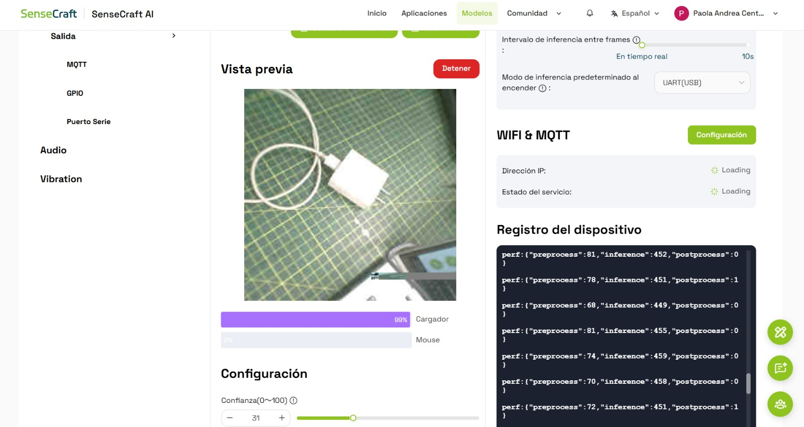
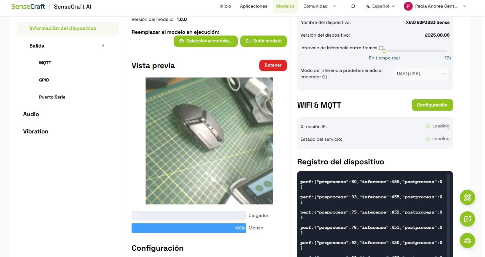
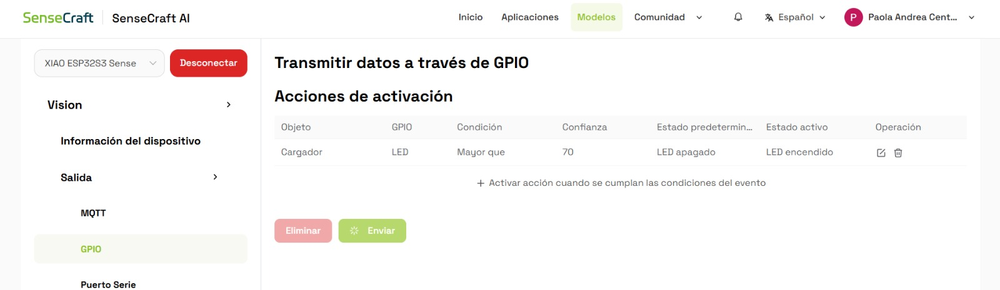
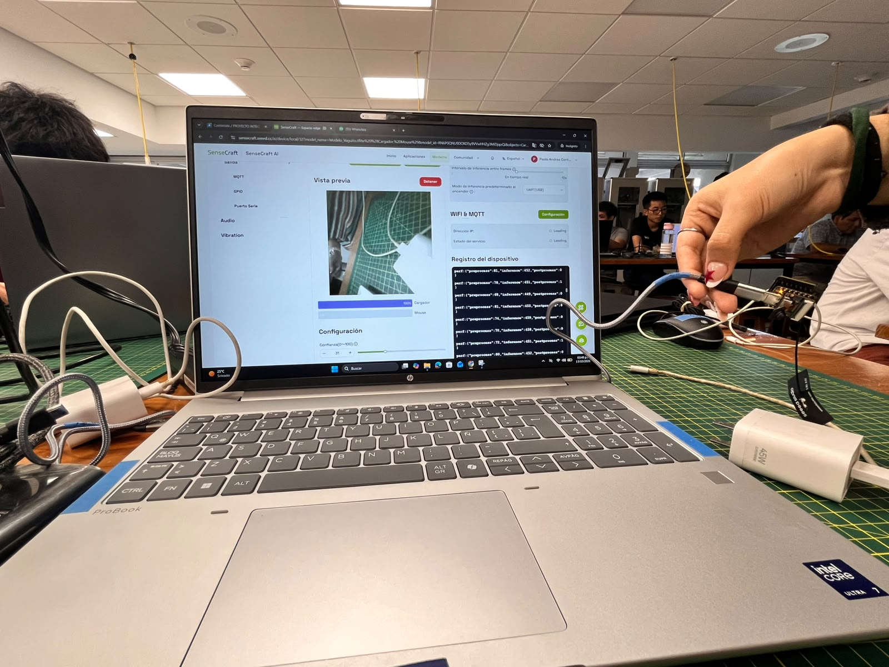
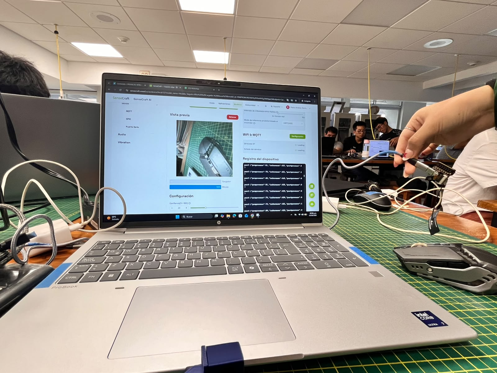

# 🟢 TinyML con SenseCraft AI
### Clasificación de objetos y activación de salidas GPIO

**Proyecto Integrador · Taller de TinyML · UPCH**

## 📌 Descripción del proyecto

Este proyecto consiste en entrenar e implementar un modelo de inteligencia artificial utilizando SenseCraft AI y el dispositivo **XIAO ESP32S3 Sense**.

El modelo clasifica imágenes en dos categorías: **Cargador** y **Mouse**. Después del entrenamiento, se despliega en el dispositivo y se configura una regla GPIO para activar un LED amarillo cuando la detección del cargador supera el umbral de confianza establecido.

## 🎯 1. Objetivos

- Crear un modelo de inteligencia artificial para clasificar imágenes.
- Recopilar datos de las categorías Cargador y Mouse.
- Entrenar y probar el modelo mediante la vista previa.
- Desplegar el modelo en el XIAO ESP32S3 Sense.
- Configurar y comprobar la salida GPIO.
- Realizar pruebas prácticas con los integrantes del equipo.
- Subir el modelo y el conjunto de datos al repositorio del grupo.

## 🧰 2. Herramientas y componentes

| Recurso | Descripción |
|---|---|
| SenseCraft AI | Plataforma para recopilar datos, entrenar y desplegar modelos. |
| XIAO ESP32S3 Sense | Dispositivo para ejecutar el modelo de IA. |
| Cámara | Captura imágenes para la clasificación. |
| Cargador y Mouse | Categorías del modelo. |
| GPIO | Control de la salida digital. |
| LED amarillo | Indicador de activación. |
| USB | Conexión con la computadora. |
| GitHub | Almacenamiento del código, modelo y evidencias. |

## 📸 3. Recolección y configuración de datos

Se recopilaron **230 imágenes en total**, distribuidas en dos categorías: **115 imágenes de Cargador y 115 imágenes de Mouse**. Los datos se organizaron en SenseCraft AI para entrenar un modelo capaz de distinguir ambos objetos.

### 3.1. Configuración de la clasificación

**Interpretación:** Se muestra la configuración de las categorías que conforman el modelo de clasificación: Cargador y Mouse. Esta etapa permite establecer las clases que se utilizarán para organizar las imágenes y realizar el entrenamiento.

### 3.2. Recolección de datos del cargador

**Cantidad de imágenes:** 115.

**Interpretación:** Se recopilaron 115 imágenes correspondientes al cargador. Estas muestras constituyen los datos de entrenamiento que permiten al modelo aprender las características visuales de esta categoría.

### 3.3. Recolección de datos del mouse

**Cantidad de imágenes:** 115.

**Interpretación:** Se recopilaron 115 imágenes del mouse para que el modelo aprenda a reconocer sus características visuales y diferenciarlo del cargador.

### 3.4. Organización de las categorías

**Resumen del conjunto de datos:**

| Categoría | Cantidad de imágenes |
|---|---:|
| Cargador | 115 |
| Mouse | 115 |
| **Total** | **230** |

**Interpretación:** Se organizó el conjunto de datos en dos categorías con la misma cantidad de imágenes. Esta distribución equilibrada permite que ambas clases tengan la misma representación durante la preparación del modelo.

## 🤖 4. Entrenamiento y despliegue del modelo

### 4.1. Entrenamiento

**Interpretación:** Se muestra el proceso de entrenamiento del modelo mediante SenseCraft AI. En esta etapa, el sistema aprende a reconocer las características visuales de las dos categorías a partir de las imágenes recopiladas.

### 4.2. Modelo en ejecución: cargador

**Resultado:** El modelo clasificó el objeto como **Cargador**, con una confianza del **99 %**.

**Interpretación:** La clasificación coincide con el objeto presentado ante la cámara, por lo que el resultado observado fue correcto. El porcentaje representa la confianza de esa inferencia específica, no la precisión global del modelo.

### 4.3. Modelo en ejecución: mouse

**Resultado:** El modelo clasificó el objeto como **Mouse**, con una confianza del **100 %**.

**Interpretación:** La clasificación coincide con el objeto presentado ante la cámara. Este resultado evidencia que el modelo pudo distinguir el mouse del cargador durante la prueba registrada.

## 🔌 5. Configuración y pruebas de la salida GPIO

Se configuró una regla GPIO para vincular la detección del cargador con el encendido de un LED amarillo. La salida permanece apagada mientras no se cumpla la condición y se activa cuando la confianza supera el umbral establecido.

### 5.1. Configuración de GPIO

| Parámetro | Valor configurado |
|---|---|
| Objeto | Cargador |
| Condición | Mayor que |
| Umbral de confianza | 70 |
| Estado predeterminado | LED apagado |
| Estado activo | LED encendido |

**Interpretación:** La regla establece que el LED amarillo debe encenderse cuando el modelo detecta un cargador con una confianza superior a 70. Si la condición no se cumple, el LED permanece apagado.

### 5.2. Prueba del LED con el cargador

**Resultado:** El modelo identificó el cargador con una confianza del **99 %**, superior al umbral GPIO de 70.

**Interpretación:** Al superar el umbral establecido, se cumple la condición configurada y se activa la salida GPIO, provocando el encendido del LED amarillo. Esta evidencia permite observar la relación entre la clasificación realizada por la inteligencia artificial y la respuesta física del dispositivo.

### 5.3. Prueba del LED con el mouse

**Resultado:** El modelo identificó el mouse con una confianza del **100 %**.

**Interpretación:** Aunque la confianza es elevada, la regla GPIO está configurada específicamente para la clase Cargador. Por ello, la detección del mouse no debería activar el LED mediante esta regla. El LED debe permanecer apagado mientras no se cumpla la condición asociada al cargador.

## 👥 6. Pruebas prácticas con integrantes del equipo

### 6.1. Prueba práctica del integrante 1: Juan Vidal Berrocal Ccapcha

**Integrante:** Juan Vidal Berrocal Ccapcha.

**Interpretación:** Se documenta la participación de Juan Vidal Berrocal Ccapcha durante las pruebas prácticas del sistema TinyML. La actividad permitió comprobar el funcionamiento del modelo de clasificación de imágenes y su interacción con el dispositivo XIAO ESP32S3 Sense mediante SenseCraft AI.

### 6.2. Prueba práctica del integrante 2: Cesar Alejandro Aaron Apcho Menenes

**Integrante:** Cesar Alejandro Aaron Apcho Menenes.

**Interpretación:** Se registra la participación de Cesar Alejandro Aaron Apcho Menenes en las pruebas prácticas del proyecto. Esta evidencia respalda la verificación del modelo desplegado y la comprobación de su funcionamiento con los objetos clasificados: Cargador y Mouse.

## 📊 7. Resultados y observaciones

| Prueba | Clase esperada | Resultado | Confianza |
|---|---|---|---:|
| Clasificación del cargador | Cargador | Correcto | 99 % |
| Clasificación del mouse | Mouse | Correcto | 100 % |
| Activación GPIO con cargador | Cargador | Supera el umbral | 99 % |
| Detección del mouse con regla para cargador | Mouse | No corresponde a la clase configurada | 100 % |

Los resultados registrados muestran que el modelo identificó correctamente los objetos durante las pruebas documentadas. Asimismo, la regla GPIO permite asociar la detección del cargador con el encendido del LED amarillo cuando se supera el umbral de confianza.

Los resultados pueden variar según la iluminación, la orientación, la distancia y el fondo de las imágenes. Los porcentajes mostrados corresponden a las inferencias observadas y no garantizan la misma confianza en todas las situaciones.

## 8. Conclusiones

- Se creó un modelo de clasificación de imágenes con las categorías Cargador y Mouse.
- Se recopilaron y organizaron muestras para entrenar el modelo en SenseCraft AI.
- Se desplegó el modelo en el dispositivo XIAO ESP32S3 Sense.
- Se comprobaron las clasificaciones del cargador y del mouse mediante pruebas prácticas.
- Se configuró una regla GPIO con un umbral de confianza de 70 para controlar un LED amarillo.
- Se documentó el funcionamiento de la clasificación y de la activación física mediante evidencias fotográficas.

En conclusión, el proyecto permitió integrar inteligencia artificial, clasificación visual y control de hardware mediante GPIO, demostrando cómo un sistema TinyML puede reconocer objetos y generar una respuesta física según una condición establecida.

## 📚 9. Referencias

- [SenseCraft AI](https://sensecraft.seeed.cc/)
- [Documentación oficial de Seeed Studio](https://wiki.seeedstudio.com/)
---

**Proyecto Integrador · Taller de TinyML · SenseCraft AI · XIAO ESP32S3 Sense**
