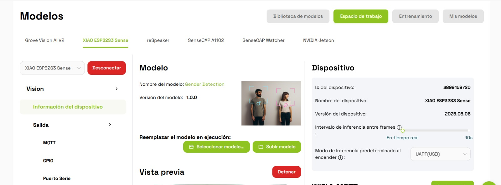
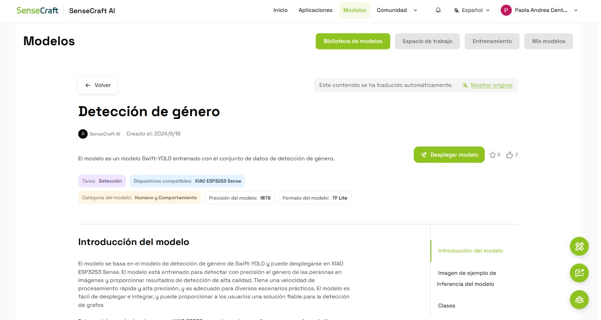
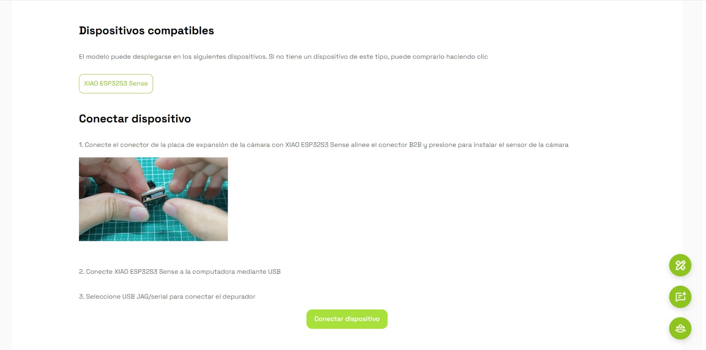
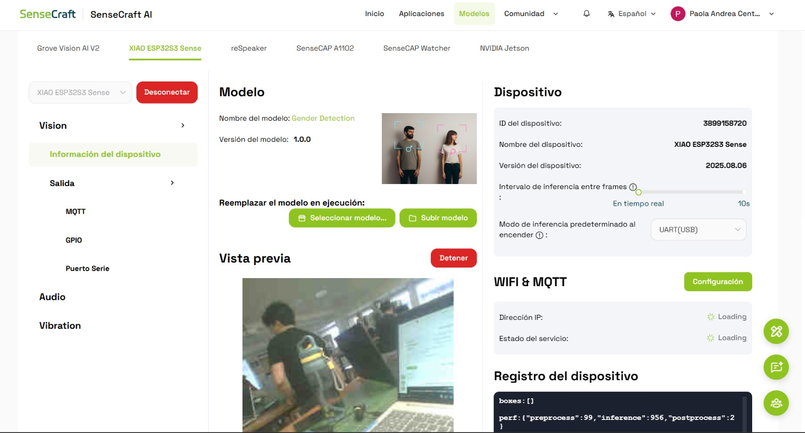
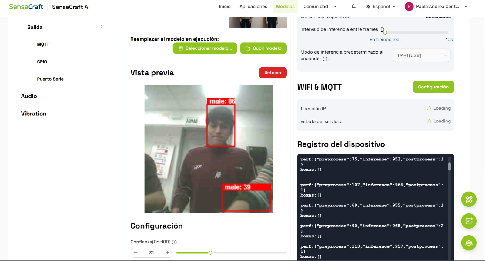
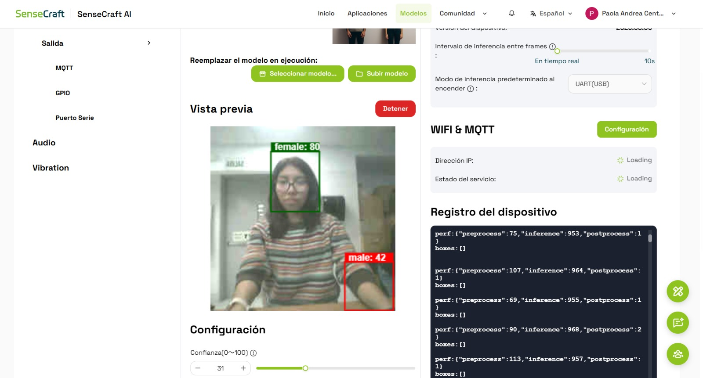
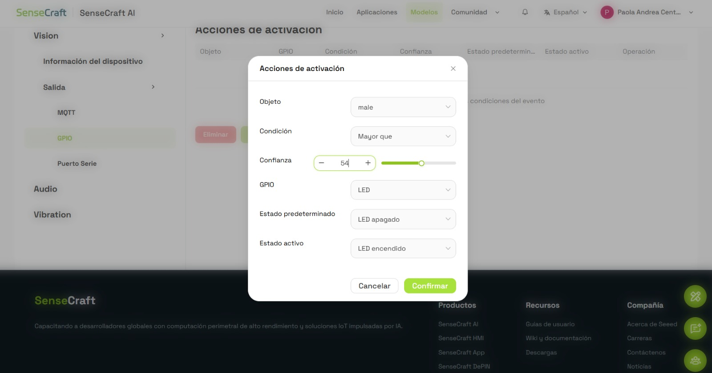
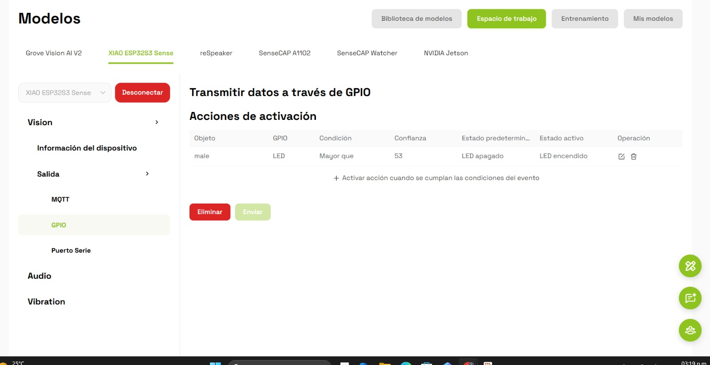
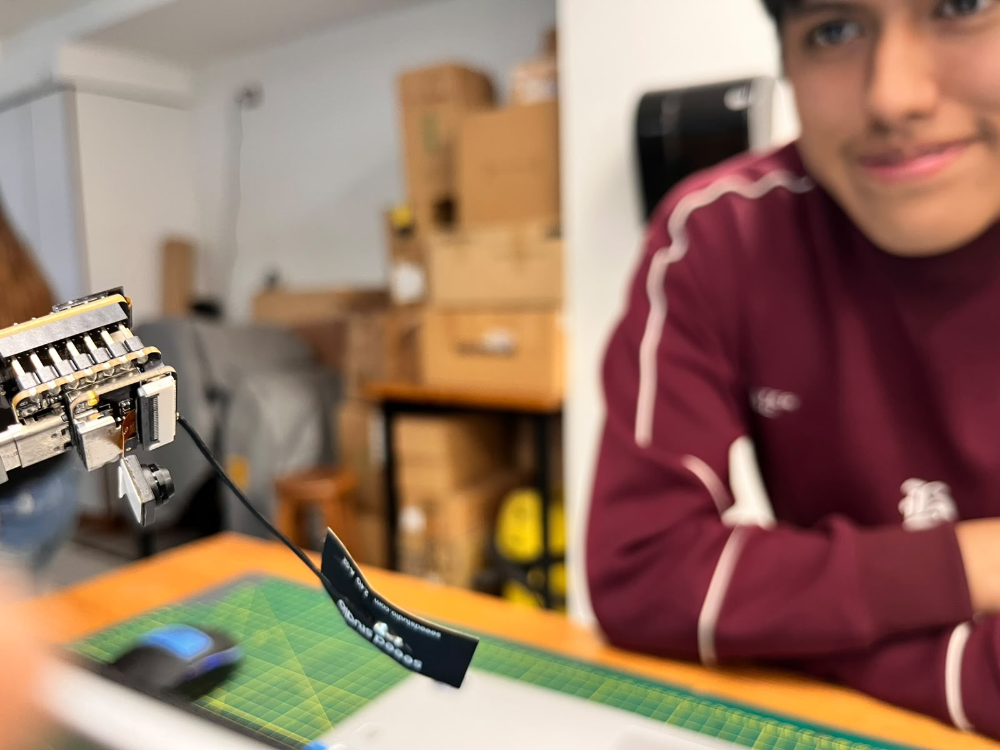
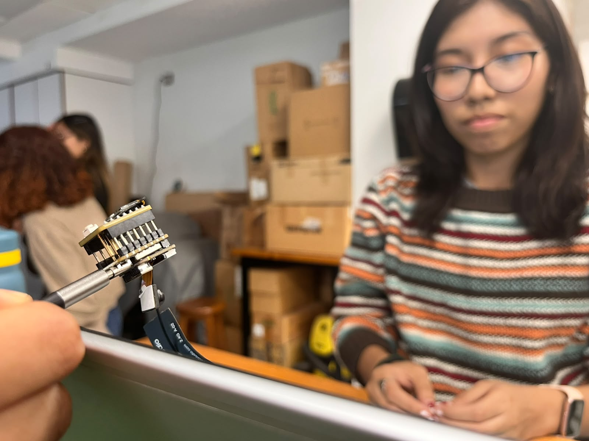

# 🟢 TinyML con SenseCraft AI
### Reconocimiento visual y activación de salidas GPIO

**Proyecto Integrador · Taller de TinyML**

Este proyecto consiste en implementar un modelo de inteligencia artificial en la plataforma SenseCraft AI y ejecutarlo en el dispositivo **XIAO ESP32S3 Sense**. Se realizan pruebas de reconocimiento visual con integrantes del equipo y se configura una salida GPIO para activar un LED cuando se cumple una condición de detección.

---

## 🎯 1. Objetivos

- Implementar un modelo diferente de inteligencia artificial en SenseCraft AI.
- Desplegar el modelo en el dispositivo XIAO ESP32S3 Sense.
- Evaluar el reconocimiento visual mediante pruebas con integrantes del equipo.
- Configurar una regla de activación a través de GPIO.
- Verificar el encendido del LED según la condición establecida.

## 🧰 2. Herramientas y componentes

| Recurso | Descripción |
|---|---|
| SenseCraft AI | Plataforma para gestionar y ejecutar modelos de IA. |
| XIAO ESP32S3 Sense | Dispositivo con cámara para inferencia en el borde. |
| Gender Detection | Modelo de detección visual seleccionado. |
| GPIO | Interfaz para controlar una salida digital. |
| LED | Indicador visual de la activación. |
| USB | Conexión del dispositivo con la computadora. |

## 🤖 3. Implementación del modelo

Se seleccionó el modelo **Gender Detection**, basado en Swift-YOLO y disponible en la biblioteca de SenseCraft AI. El modelo permite realizar inferencias sobre imágenes capturadas por la cámara y visualizar las detecciones mediante recuadros, etiquetas y valores de confianza.

### Modelo en ejecución

### Selección del modelo en la biblioteca

## 🔌 4. Conexión y configuración del dispositivo

Se utilizó el dispositivo XIAO ESP32S3 Sense para ejecutar el modelo de visión artificial. La conexión se realizó mediante USB, siguiendo el procedimiento de instalación del módulo de cámara y conexión de la placa.

Una vez conectado el dispositivo, se verificó la vista previa de la cámara y el funcionamiento del modelo.

## 🧪 5. Pruebas de reconocimiento visual

Se realizaron pruebas con integrantes del equipo para observar las detecciones generadas por el modelo y comprobar su funcionamiento ante diferentes personas.

### Prueba 1: Rodrigo Sebastián Asmat Mendoza

**Integrante:** RODRIGO SEBASTIAN ASMAT MENDOZA.

**Observación:** se visualiza una detección generada por el modelo sobre la imagen capturada, junto con su etiqueta de clase y el valor de confianza correspondiente.

### Prueba 2: Paola Andrea Centeno Bazán

**Integrante:** PAOLA ANDREA CENTENO BAZAN.

**Observación:** se observa la detección realizada por el modelo durante la prueba. Los resultados pueden variar según la iluminación, la posición y las condiciones de captura.

## ⚙️ 6. Configuración de la salida GPIO

Se accedió a la sección GPIO de SenseCraft AI para establecer una regla que vincule el resultado de la inferencia con una acción física.

### Parámetros de configuración

| Parámetro | Valor configurado |
|---|---|
| Objeto detectado | `male` |
| Condición | Mayor que |
| Umbral de confianza | 53 |
| Salida GPIO | LED |
| Estado predeterminado | LED apagado |
| Estado activo | LED encendido |

### Configuración de la acción

### Regla de activación registrada

La regla está diseñada para activar el LED cuando la detección del objeto seleccionado supera el umbral configurado. Su funcionamiento debe comprobarse mediante una prueba física del dispositivo.

## 📸 7. Evidencias fotográficas de los integrantes

### Rodrigo Sebastián Asmat Mendoza

**Nombre completo:** RODRIGO SEBASTIAN ASMAT MENDOZA.

### Paola Andrea Centeno Bazán

**Nombre completo:** PAOLA ANDREA CENTENO BAZAN.

## 💡 8. Verificación del LED

Para completar la validación, se debe comprobar que el LED permanezca apagado cuando no se cumpla la condición configurada y que se encienda cuando se active la regla GPIO.

La prueba debe documentarse mediante una fotografía o captura que permita observar el estado real del LED y la configuración utilizada.

**Estado de validación:** pendiente de adjuntar la evidencia física del LED encendido, si todavía no se ha registrado.

## 📊 9. Resultados y observaciones

Durante la implementación se configuró el modelo de detección visual en SenseCraft AI y se realizaron pruebas con integrantes del equipo. Asimismo, se estableció una regla de activación que relaciona una detección con una salida GPIO.

La validación completa requiere comprobar experimentalmente la respuesta del LED y registrar los resultados obtenidos. El valor de confianza mostrado por el modelo no representa por sí solo su precisión global.

## ✅ 10. Conclusiones

- Se implementó un modelo de visión artificial mediante SenseCraft AI.
- Se utilizó el dispositivo XIAO ESP32S3 Sense para realizar inferencias visuales.
- Se documentaron pruebas de reconocimiento con integrantes del equipo.
- Se configuró una regla de activación mediante GPIO para controlar un LED.
- La comprobación física de la salida permitirá confirmar el funcionamiento integral del sistema.

## 📚 11. Referencias

- [SenseCraft AI](https://sensecraft.seeed.cc/)
- [Documentación oficial de Seeed Studio](https://wiki.seeedstudio.com/)
- [XIAO ESP32S3 Sense](https://wiki.seeedstudio.com/xiao_esp32s3_sense/)

---

**Proyecto Integrador · TinyML · SenseCraft AI · XIAO ESP32S3 Sense**
